# A Size for Every Stream: The Expert's Guide to Sizing Kafka Streams

*Rohan Desai · October 25, 2023 · 15 min read*

Capacity planning and operating your Kafka Streams application can be quite challenging. Hopefully this guide can help you get started and point you in the right direction.


---

Kafka Streams is all about making it easy to write applications that react to the event streams in your Apache Kafka topics. Users love its rich, functional API that makes it a breeze to go from an idea to a first version of a working application. But what about what comes next? How do you take your working prototype and configure it to handle real-world workloads? And how do you monitor it and know when and how to scale it in response to changes in those workloads? This is where many users stumble or get stuck. In this post, I'll walk you through how to approach sizing your workloads, step by step. Then, I’ll go through an example that applies these guidelines to tune and size a real application.

# Why Is Sizing Difficult?

It’s important to tune and size your application to your workload. An untuned or under-provisioned application may lag behind its sources or even become unstable and crash. An over-provisioned application wastes valuable compute resources, and risks becoming under-provisioned over time as your workload ramps up during periods of low traffic.

Getting tuning and sizing right is tough. The challenge really comes down to the fact that the specific configuration and resources your application requires depends on so many factors. Kafka Streams hides a lot of the complexity of event streaming from you at development time. But, you still need to understand what it’s doing under the hood when the time comes to operate your application.

Some of the main factors at play include:

- **The specific processors that compose your application**. Perhaps the biggest factor is the specific combination of operators that you use. Completely stateless applications will have different dynamics from stateful applications. Within the umbrella of stateful applications, joins will be different from aggregations. Stream-stream joins require range scans and store entire streams and so they will behave differently from table joins. Different aggregations also place different demands on stores. And so on.
- **The format of your keys and values.** In many if not most cases, the main bottleneck is compute used to deserialize and serialize topic data to/from its application representation. So the specifics of your schema and serialization format will make a big difference. You're likely going to be able to process much more protobuf serialized data per unit of time than an equivalent application consuming JSON serialized records.
- **What happens in your processors**. Your processors themselves will also have a big impact, especially if they are computationally heavy (for example, you are evaluating some ML model) or you are making external calls, which block whole Kafka Streams threads.
- **Time**. Even with a steady workload, for stateful applications (especially those with lots of updates, like aggregations) the dynamics of your application are going to change over time as state accumulates and your stores need to expend resources to compact.

The upshot here is that, for now, there's no magic formula you can plug all these different parameters into to come up with a perfect `StreamsConfig` and number of cores/memory/disk/etc. You are going to need to actually run the application and figure it out experimentally.

But, how do you know that you've tuned your application correctly so that what looks like an application that can't keep up isn't just one that's misconfigured? And what should you monitor so that you find out when your application can't keep up?

In the following sections, we’ll take you through these questions in two parts. The first part provides a detailed guide on how to approach tuning and sizing. It starts by explaining how you can first configure your application for real workloads, then moves on to how you figure out a good node configuration and cluster size: both at first and over time as your load changes. The second part applies this guide to tune and size an example application.

# Part 1: Tuning and Sizing Guide

# Background Reading

Before we dive in, you should make sure you understand some fundamentals about Kafka Streams internals and operational practices. The rest of the document assumes an understanding of:

- Basic Kafka concepts like topics, partitions, producers, consumers, offsets, consumer groups, and consumer lag.
- Basics about Kafka Streams [internals](https://kafka.apache.org/36/documentation/streams/architecture) - in particular the threading model, the relationship between threads, consumers, and producers, and the [usage of tasks to distribute computation over the available threads](https://www.confluent.io/blog/kafka-streams-tables-part-3-event-processing-fundamentals/#stream-tasks).
- [How to collect](https://kafka.apache.org/documentation/#monitoring) Kafka client side metrics exposed over JMX.

# Make Sure Your Application is Stable and Tuned Correctly

With that out of the way, let’s start with digging into tuning your application. Before you start to experiment with scale, you need to make sure that your application is stable and tuned to utilize resources well.

Assuming you're looking at an application that's actively processing some load, here's a checklist you can go through to convince yourself it’s ready to scale test:

## Watch Committed Offsets and Rebalances

To make sure the application is stable and making progress, you're going to want to keep an eye on two indicators and make sure they look healthy:

### The Committed Offsets of the Consumer Group are advancing

From a bird's eye view, Kafka Streams works by reading records from Kafka using a Consumer, performing your application's computation, and then recording its progress by committing offsets back to Kafka. So to know that it’s really making progress (and not just say, rebalancing, processing some records, and failing, in a loop) you want to make sure the streams app is actively committing offsets back to Kafka.

You can do this by using the [Consumer Group CLI](https://docs.confluent.io/platform/current/clients/consumer.html#kafka-consumer-describe-group) to poll the committed offsets for the Kafka Streams consumer group (the group's name is the value from your `application.id` config). For example, the following run for an application with ID “responsive” reading from a topic called “input tells me that my current committed offset is 100, the end offset is 120, and lag is 20:

```bash
$ kafka-consumer-groups --bootstrap-server my.bootstrap.server:9092 --describe --group responsive --offsets
GROUP      TOPIC  PARTITION  CURRENT-OFFSET  LOG-END-OFFSET  LAG             CONSUMER-ID                                                                                                  HOST        CLIENT-ID
...
responsive input  21         100             120             20              responsive-36e36732-6b13-4423-a039-3c1d650c1d1f-StreamThread-2-consumer-09647258-64a1-4517-96fd-6232ba9e3078 /1.2.3.4    responsive-36e36732-6b13-4423-a039-3c1d650c1d1f-StreamThread-1-consumer
...
```

You want to make sure that all the source and repartition topic partitions' offsets are either advancing or fully caught up to the partitions’ end offsets.

### R**ebalances are not happening**

Kafka Streams will occasionally go through rebalances as it detects application replicas come and go and needs to change task assignments accordingly. In steady state, when trying to get a baseline for performance on a fixed set of nodes you also should make sure that there aren't rebalances happening in your application, by keeping an eye on a couple of metrics:

- **[Consumer Last Rebalance Seconds Ago](https://kafka.apache.org/documentation/#consumer_group_monitoring)**: This metric tells you how long it’s been since a given consumer last participated in a rebalance. When an application is stable, you shouldn’t see rebalances. So this value should be continuously increasing for all your consumers. If you notice it repeatedly resetting back to zero, then the consumers are rebalancing.
- [**Kafka Streams State**](https://docs.confluent.io/platform/current/streams/monitoring.html): This value should stay in RUNNING for all replicas.

### What if one of these is unhealthy?

If these indicators are unhealthy, then you have some debugging to do. Here's a quick rundown of some of the most common issues we've seen for users getting their applications up and running for the first time:

- **Check your poll interval and max records**: If your per-record processing time is long or spiky, for example because a processor makes blocking external calls, then you may need to tune your consumer's max poll interval (`max.poll.interval.ms`) and max poll records (`max.poll.records`). The consumer's poll interval configures the maximum allowed time between subsequent polls, before the consumer decides the application has stalled and triggers a rebalance. If you do blocking operations for each record, it’s easy for consecutive polls to take longer than this threshold. Tune the poll interval up to allow for longer blocking calls from your processor, though it may take longer to detect a hung task. Tune the poll records down to increase the likelihood your processor handles all records in time, though you may see more poll overhead.
- **Check your session timeout:** If a broker doesn’t receive a heartbeat from a consumer before the session timeout, then it removes the consumer from the group and triggers a rebalance. If your session timeout (`session.timeout.ms`) is too low, then you may see unnecessary rebalances. 45 seconds is a good value and is the default on the latest Kafka client versions.
- **Set the state directory:** Make sure you’re setting `state.dir` for stateful applications, and that the directory resides on the volume you want to use for your state stores. The default (`/tmp`) is usually either not durable across restarts or is on the root volume, which may be small.

## Memory Usage

You want to make sure that your application is configured to use memory safely by setting the right bounds on the various components. If you don’t do this, you could see your application crash on OOM or experience GC pressure.

Kafka Streams uses the JVM heap for holding the records it reads/writes from/to Kafka, and for its internal state and record cache (which provides both caching and write buffer semantics). It also creates RocksDB instances which allocate native memory for their write buffer and store caches. Finally, stateful workloads also benefit from the OS’s page cache for caching compressed store data. You’ll need to make sure you set bounds on the JVM and (for stateful applications) on RocksDB memory usage to ensure you don’t run out of memory.

**Stateless Applications**

For stateless applications, you just need to configure your JVM’s heap. Kafka Streams creates and destroys lots of objects as it processes batches of records, so you’ll probably need at least a few GB of heap for your JVM to avoid slowing your application down with GC pauses.

**Stateful Applications**

The Apache Kafka docs include a thorough [](https://docs.confluent.io/platform/current/streams/developer-guide/memory-mgmt)[guide](https://kafka.apache.org/36/documentation/streams/developer-guide/memory-mgmt.html) on how you can configure your application to manage memory safely. The highlights from there that we think are extra important are to:

- Make sure to use the `RocksDBConfigSetter` interface to set bounds on RocksDB’s write buffer and block cache.
- Makes sure to run with `jemalloc` to avoid [memory bloat from native allocations](https://www.confluent.io/blog/bounding-ksqldb-memory-usage/).
- If you’re using in-memory state stores or suppression, you need to account for the JVM heap memory used to store that state when sizing your JVM heap.

## RocksDB Tuning

Our founder Almog has written a fantastic blog that includes a section on how to tune your [RocksDB stores](https://www.responsive.dev/blog/guide-to-kafka-streams-state).

## Number of Threads

Make sure you’re running with an appropriate number of Stream Threads. If you’re not making blocking external calls, running with a number of threads that is 1-2x the number of cores is ideal, so that you can make sure CPU is used while a thread is blocked on reads/writes to Kafka or RocksDB. If you are making blocking external calls, during which the stream threads are idle and not actively scheduled on cpu, then you will likely want more threads depending on how long those calls block. Just make sure that you have enough tasks to distribute over the threads.

## Collect Your Metrics

This is also generally a good point to start aggregating metrics (especially those we’re referring to in this document) from your application and plotting them on a dashboard to help you easily eyeball patterns and trends. This [OSS dashboard specification](https://github.com/kineticedge/kafka-streams-dashboards) from the awesome Kafka Streams community is a great starting point.

# Capacity Planning

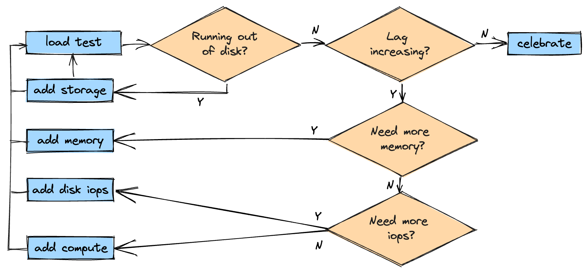

Once you’ve got your application tuned, you’ll want to determine a good node size (in CPUs, Memory, and Disk) and number of nodes to run it. To do this you’ll need to actually try replicating your production workload (or some fraction of it - but don’t forget to factor that in when deciding on your final replica count) and seeing the resources it takes.

To start with, pick some initial node size that seems reasonable to you. Generally, something like 1-8 CPUs, 2-8GB of memory *per cpu*, and 100-200GB of storage *per cpu* is a common range. Then, start sending your load to the smallest cluster possible, see where things break, adjust, and repeat until you have a configuration that looks reasonable.

## Your Starting Cluster

Start with the smallest possible cluster. If you’re not using standby replicas, then this is a single node. If you are using standby replicas, choose a number of nodes that is one more than the number of standbys. So, for example if you have configured 1 standby replica (the typical case) then start with 2 nodes. If you use fewer nodes, then Kafka Streams will not create standbys, which consume significant resources that you want to account for.

## Iterating

Once you’ve got a stable cluster (see the section above for how to tell), you want to look for signs that you need to adjust your allocated resources up or down. Here’s what to watch for:

### **Growing Lag**

Your main indicator that you need more resources is going to be growing consumer lag on one or more of your source or intermediate topics. You can monitor consumer lag using the consumer’s [records-lag](https://kafka.apache.org/documentation/#consumer_fetch_monitoring) metric to observe the lag with respect to the current position, or use the consumer group CLI as described in the previous section to observe lag with respect to the committed offset.

If you’re seeing growing lag and the application looks otherwise healthy (committed offsets are advancing, no rebalances), then you’ll need to figure out why. You might need more memory, more disk I/O capacity, or compute. You can get more resources by either provisioning bigger nodes (scaling vertically), or scaling horizontally by adding nodes.

In general, the default assumption tends to be that you need more compute. That’s often the case, however its first best to check whether the bottleneck might really be memory or I/O.

**Do I need more memory for reads?**

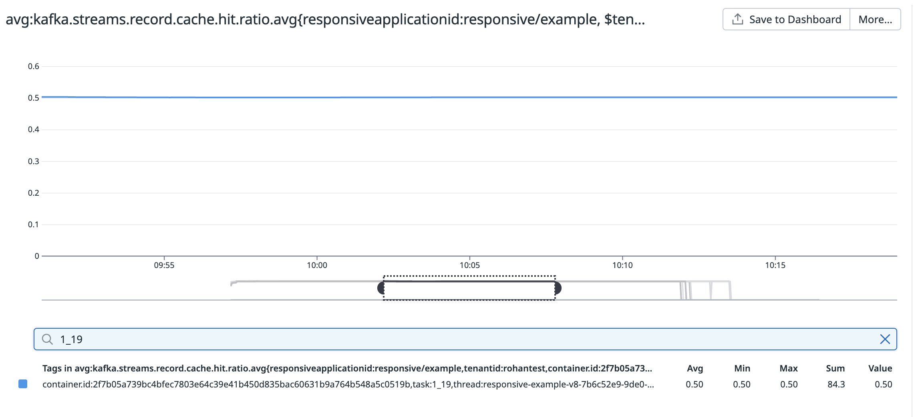

If you’re running a stateful application, one possibility is that you don’t have enough memory to cache your working set, and Kafka Streams needs to read from disk. When reading state, Kafka Streams reads from a series of caches. It first checks its record cache, then reads from RocksDB. RocksDB has its own cache for both search metadata (indexes and bloom filters) and data. If it doesn’t find what it needs in its cache, RocksDB reads from disk. Disk reads first look in the OS page cache before doing actual IO. You want to try to get a sense for how good of a hit rate you’re getting. Unfortunately, it’s actually quite difficult to measure the hit rate specifically — so you’ll need to rely on a few indirect indicators:

- To look at the hit rate from the Kafka Streams cache, you could look at the `hit-ratio` metric. Note that this is recorded at `DEBUG` level only, so you’ll need to turn that on if you want to look at the hit rate.
- RocksDB exposes its cache hit rates. You can look at `block-cache-data-hit-ratio`, `block-cache-index-hit-ratio`, and `block-cache-filter-hit-ratio`  Kafka Streams metrics to get hit rates for data blocks, index, and bloom filters, respectively. These were added in [KIP-471](https://cwiki.apache.org/confluence/display/KAFKA/KIP-471). Especially if you’ve configured RocksDB to pin index and filter blocks in cache, you should expect the latter two ratios to be high. Again, these are also only exposed at `DEBUG` level.
- To get a feel for your page cache usage, you can look at the memory used by the operating system to cache disk blocks. On Linux, you can use the command `free -mh` and look at the value under the `cache` column. In cases where you’re getting poor cache hit rates, you’d expect to see a lot of memory used by the cache. Note the inverse of that statement is not true — you could have lots of cache with a high hit rate — so you’ll need to take this indicator combined with the next one.
- Finally, look at disk IOPS activity (e.g. using `iostat` on linux) - in particular the number of disk reads per second.

If you see poor cache hit rates, lots of cached memory, lots of disk reads relative to your processing rate and high disk utilization, then you’re probably not getting good use from your caches and you may want to try making them bigger. I’d recommend starting by just giving the OS more memory, as its cache is more efficient because its caching compressed blocks (assuming you have RocksDB compression enabled, which is the default).

**Do I need more memory for writes?**

Another possibility is that your application may not have enough memory allocated to the write buffer (assuming you’ve configured a write [buffer manager limit](https://github.com/facebook/rocksdb/wiki/Write-Buffer-Manager) as described in the [memory management guide](https://kafka.apache.org/36/documentation/streams/developer-guide/memory-mgmt.html)). When this happens you’ll end up with lots of small SSTs in RocksDB that it needs to compact, and so you’ll see high disk write bandwidth or IOPS, and high disk utilization in `iostat`.

In this case you should make sure that you’ve sized your write buffer correctly. RocksDB buffers up writes in the write buffer until it’s either explicitly flushed, it reaches the maximum configured size for a single buffer ([16MB by default](https://github.com/confluentinc/kafka/blob/3deb479b09823602cf740254e2936b50a87001d7/streams/src/main/java/org/apache/kafka/streams/state/internals/RocksDBStore.java#L89)), or it’s reached the total limit of write buffer memory configured using the write buffer manager. It then creates a new buffer for new writes, transitions the existing write buffer to “immutable” and eventually flushes it to disk. Immutable buffers still count against the limit while they are being flushed.

Ideally, RocksDB never has to flush prematurely because it ran out of memory, and only because the write buffer filled up, or it was asked to by Kafka Streams. To try and make sure this is the case, I’d recommend trying to set a larger limit on the write buffer manager, up to half of the block cache size (assuming you’re accounting Write Buffer Manager memory from block cache as recommended by the Kafka guide).

**Do I need more memory for JVM?**

Finally, you might see the application spending a large percentage of time in GC pauses (you can check using [jostat](https://docs.oracle.com/javase/8/docs/technotes/tools/windows/jstat.html) or enabling gc logging). In this case, you may need a bigger heap or to tune your GC.

**Do I need more disk capacity?**

It’s possible that your workload either just has a really big working set that you can’t cache, or just needs a lot of write capacity. 

You can tell if you went through the steps above, tried the recommended tuning, and didn’t see an improvement and/or still observed lots of disk I/O and high disk utilization.

In that case you’ll need more throughput from your disks. Depending on the environment you’re running in you may be able to achieve this by adding capacity to your disk. For example, in AWS you can either provision more IOPS directly (piops volumes) or provision a larger volume (gp volumes), depending on your volume type. Just make sure you’re still within the [disk network limit](https://docs.aws.amazon.com/AWSEC2/latest/UserGuide/ebs-optimized.html).

Or you might be able to add volumes and RAID.

If none of these are an option you can choose to just scale up.

### **Running Out Of Disk Space**

Other than lag, the other top-level health indicator to watch out for is running out of disk space. In this case, you’ll either need to scale horizontally to add storage capacity or you can try to provision larger disks. Remember, in most cloud providers it’s possible to [grow your disks live.](https://docs.aws.amazon.com/AWSEC2/latest/UserGuide/recognize-expanded-volume-linux.html)

### Pre-Scaling Checklist

Finally, before actually scaling there’s a couple things you’ll want to sanity check:

Especially if you’re running in a rate-limited cloud provider like Confluent Cloud, you’ll want to make sure that you’re actually bottlenecked on Kafka Streams. To do this, you can use the `blocked-time-ns-total` metric added in [KIP-761](https://cwiki.apache.org/confluence/display/KAFKA/KIP-761%3A+Add+Total+Blocked+Time+Metric+to+Streams). This metric tells you the total time a given thread spent blocked on Kafka clients (either producing or consuming). If your threads are spending a lot of their time in each window blocked (say, more than 75%) then its less likely that adding resources will help and you should first make sure that you are not being rate-limited by your Kafka provider. Check out the KIP for details on how to read and interpret this metric.

Similarly, if you’re making calls to an external service from your application, you should first make sure that your application is not bottlenecked on that service before trying to scale up.

### **Scaling Up**

So you’ve decided to scale up. The things to think about here are

1. Should I scale vertically or horizontally?
2. How much?
3. What do I monitor to keep track of the scaling process?

**Vertical vs Horizontal**

Choosing to scale horizontally by adding nodes vs vertically by provisioning nodes with more resources is a bit of an art. You want nodes that are not “too big” or “too small”. Nodes that are too small will have more overhead, unrelated to record processing, from the VM and/or container runtime and the JVM. Nodes that are too large may not play nice with your compute infra - for example if you’re using Kubernetes, you need to make sure your container resource requests actually fit on your cluster’s nodes. The node size also determines how granular you can be when scaling horizontally.

**How Much To Scale Up**

In most cases, choosing how much to scale up is also a bit of an art - you’ll have to try and see what the results are, and iterate from there.

One exception is when deciding how many replicas to add when reacting to growing lag. In this case it’s probably a good bet that your application’s throughput will scale linearly with the number of replicas. Therefore, you can try to look at the ratio between the current append rates at your source topics and your application’s current processing rate and try to scale up to meet the append rate. So, if your application is processing 100 records per second at its source topics and the source topics are being appended to at 400 records per second, then try 4 times as many replicas as you currently have. The benefit here is that you hopefully need to scale up fewer times. Each scale up requires adding new resources, rebalancing, and restoring all your state - so the fewer you need to do the better.

Note that this will probably not give you the “correct” number of replicas the first time. This is because of the way Kafka Streams passes data down the sub-topology graph. Imagine an application with two sub-topologies. The first sub-topology reads from a source topic, rekeys the records, and writes to a repartition topic. The second sub-topology reads from the repartition topic and performs an aggregation. If your application is not able to keep up with the source topic, and you scale it, then it’s going to start writing much more data into the repartition topics and its likely that the second sub-topology will start to lag. So you’ll have to iterate to get to the real number of replicas that you need.

**Monitoring Scale-Up**

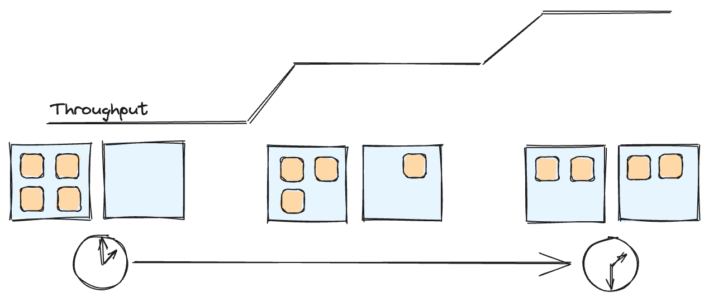

Once you’ve added or replaced nodes, you’ll need to monitor the rebalancing process so that you know when the new resources are fully initialized and being used by Kafka Streams to process more records.  This is especially important for stateful applications, which replicate state to the new node(s) by creating warm up replicas of tasks, which transition to active only when sufficiently caught up — a process that can take minutes or even hours if there is lots of built up state.

The key indicators you should be watching are:

- `last-rebalance-seconds-ago`: You’ll want to keep an eye on rebalances. Kafka Streams will rebalance to decide the new task assignment after the new replica is added, and will continuously do [probing rebalances](https://cwiki.apache.org/confluence/display/KAFKA/KIP-441%3A+Smooth+Scaling+Out+for+Kafka+Streams) to track warmup progress and transition replicas to active. If you see that this value continues to increase on all clients, then that’s a good indication that things have stabilized.
- `records-lag`: Keep an eye on the current lag of the restore consumers on the newly added nodes. The restore consumers will have the token `restore-consumer` in their client IDs, for example `example-36e36732-6b13-4423-a039-3c1d650c1d1f-streamthread-1-restore-consumer`. Warmup tasks will transition to active tasks as the lag approaches 0.

Once these indicators are healthy, your new nodes should be actively processing data and you can re-evaluate your sizing.

**Gotchas**

There’s a couple gotchas that can bite you and cause you to not observe the expected gains from scaling up:

- Make sure that the application has enough tasks to distribute across the nodes you’re scaling to. You want to make sure there is *at least* one task per thread over all your nodes. If not, you will have added resources but they won’t be assigned any tasks and won’t be used.
- If your load has significant skew, then you might not see the expected improvements from scaling up. For example, if all your data is being written to one of your source partitions, then Kafka Streams won’t be able to distribute that work over the added nodes.

### **Scaling Down**

On the flip side, how can you tell when your application has too many resources provisioned and can be scaled down?

**Thread Utilization**

On the compute side, your main indicator should be whether or not your application is actively using its processing threads. You can measure this by looking at the Consumer’s `io-wait-time-ns-total` metric. This metric tells you the total amount of time the consumer spent blocked waiting on new records to arrive from Kafka. You can use this metric the same way you use `blocked-time-ns-total` from [KIP-761](https://cwiki.apache.org/confluence/display/KAFKA/KIP-761%3A+Add+Total+Blocked+Time+Metric+to+Streams), except this time you’re computing the % of time blocked waiting for new records. If all your threads are spending a significant portion of their time waiting (lets say > 75%), then it’s probably safe to get rid of a node.

Note that this is different from `blocked-time-ns-total`, which includes time blocked on I/O and producer control calls (like committing transactions). For the purpose of scaling down, we want to look at how much time a thread truly spent doing nothing that contributes to record processing. If it’s spending time reading and writing to Kafka or an external system, the thread is still *driving* meaningful work and it might not be safe to get rid of it.

**Disk Utilization**

You might also notice that you’re not using as much storage as you expected. In that case, you can allocate less storage per node. Note that you won’t be able to do this without replacing the entire volume.

**How Much To Scale Down**

If you’re scaling down by removing replicas, make sure to scale down by less or equal to the number of standby replicas for stateful workloads. So, for example if you run with 2 standbys, don’t scale down by more than two replicas at a time. Otherwise you may lose all the replicas of some stores and need to restore them before resuming processing.

# Scaling Up During Production Operations

Once you’ve figured out a good node size and number of nodes for your application, it’s time to actually run it in production. But like all things, your workload dynamics will change over time, and you’ll probably need to tune your node counts or sizes over time. To know when to do this tuning, you’ll want to set up automated alerts. For the most part, the indicators above still apply and you can set alerts for idle threads, high disk utilization, etc.

The main exception is the indicator that you need to scale up — growing lag. Real workloads are going to be very different from your test workloads. They’ll constantly be changing, and you probably don’t want to be alerted just on temporary lag growth. Instead, a better indicator of likely under-provisioning is the average latency that records experience between arriving at source topics and being processed by your application.

You have a couple options for monitoring this:

1. `record-e2e-latency-avg`: Kafka Streams added an end-to-end latency metric in [KIP-613](https://cwiki.apache.org/confluence/display/KAFKA/KIP-613%3A+Add+end-to-end+latency+metrics+to+Streams). This metric records the difference between a record’s timestamp (as determined by the timestamp extractor) and the wallclock time when the record is processed by a given topology node. The value of this metric at output nodes will tell you the average end-to-end latency for the application. One option is to monitor this metric and alert when it is consistently over some threshold. Because the metric uses the record’s timestamp as the start time, this may not be a good option if your application gets lots of late-arriving data. It may also not be a good option if your topology has aggregations and a relatively long commit interval (relative to your desired threshold) - as records may be buffered before factoring into latency.
2. Alternatively, you can monitor consumer lag on your applications, and set a threshold for consumer lag based on what you expect your processing rate to be. So, for example if you know your nodes can do 100 records per second, and you want your records to be processed within 30 seconds, then you should make sure lag stays below 3000 records.
3. Finally, you can try to monitor various utilization metrics. I’d recommend monitoring some combination of CPU utilization and thread utilization as described in the previous section, and alert when these values are over 80%.

# Part 2: Sizing an Example Application

With our playbook in hand, let’s run through an example where we’ll take an actual application and apply our playbook to right-size it for different loads.

## Our Example Application

Our example application will model an “event-driven state machine” that tracks orders for an online store from the point the order is submitted through its progress during shipping and delivery. The application reads from two streams - “orders” and “progress” that track new orders and shipping progress events, respectively. It merges these streams and computes each order’s current status in an aggregation. The code for the example application is published [here as a github gist](https://gist.github.com/rodesai/7f849c8886de53896a2b8d03ed297b64).

I want to plan for 10K records/second to my source topics, and 2 million in-flight orders. Each source topic has 32 partitions.

**Test Infra**

We’ll be running the application on:

- an EKS cluster in AWS us-west-2
- m5.xlarge instances (4 vCPUs, 16GiB Memory)
- attached gp3 EBS volumes (3000 IOPS at 125MBps - which is below the m5.xlarge baseline of 143.75MBps)
- Confluent Cloud Basic SKU Kafka Cluster, also in AWS us-west-2.

## Stability Checklist

To start, I tried to run the application using 2 minimally sized nodes (each node is a Kubernetes pod) and verify that it is stable. Each pod is capped to 4Gib of memory. For this experiment I’ve configured my JVM heap to be 1Gib, and configured 2Gib of RocksDB block cache.

I tried generating 1000 records/second and running through my stability checklist.

I can see that all my source partition offsets are committing. Here’s an example of one partition:

```bash
bin/kafka-consumer-groups --bootstrap-server pkc-n98pk.us-west-2.aws.confluent.cloud:9092 --describe --group responsive-example-v8 --offsets --
command-config /tmp/creds; sleep 300; bin/kafka-consumer-groups --bootstrap-server pkc-n98pk.us-west-2.aws.confluent.cloud:9092 --describe --group responsive-example-v8 --offsets --
command-config /tmp/creds

GROUP                 TOPIC                                                                      PARTITION  CURRENT-OFFSET  LOG-END-OFFSET  LAG             CONSUMER-ID                                                                                                             HOST            CLIENT-ID
...
responsive-example-v8 progress                                                                   5          11966151        11966188        37              responsive-example-v8-1ba0ec43-9d96-4c89-8845-f0090e74e687-StreamThread-2-consumer-59ef63e2-2b8a-44a8-a208-562b64943d16 /35.86.127.142  responsive-example-v8-1ba0ec43-9d96-4c89-8845-f0090e74e687-StreamThread-2-consumer
...
GROUP                 TOPIC                                                                      PARTITION  CURRENT-OFFSET  LOG-END-OFFSET  LAG             CONSUMER-ID                                                                                                             HOST            CLIENT-ID
responsive-example-v8 progress                                                                   5          11984272        11984371        99              responsive-example-v8-1ba0ec43-9d96-4c89-8845-f0090e74e687-StreamThread-2-consumer-59ef63e2-2b8a-44a8-a208-562b64943d16 /35.86.127.142  responsive-example-v8-1ba0ec43-9d96-4c89-8845-f0090e74e687-StreamThread-2-consumer
```

My last-rebalance time is continuously increasing for all clients, meaning that the application is not rebalancing:

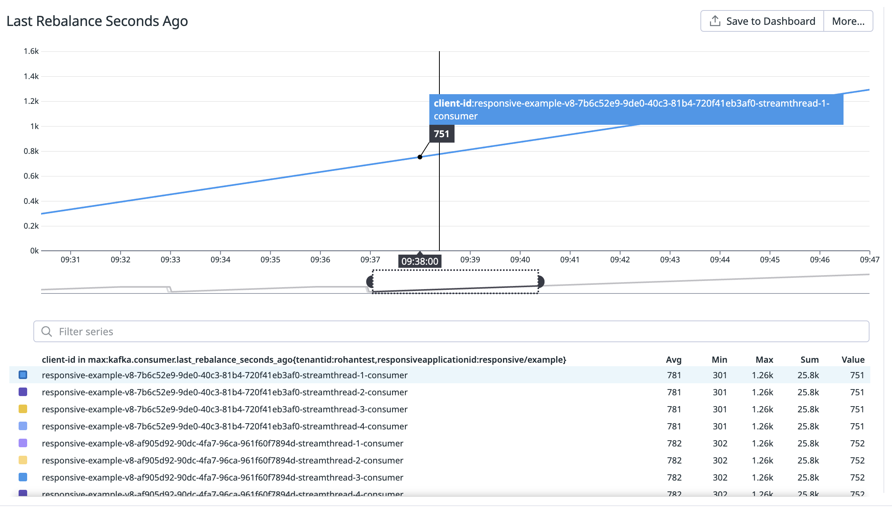

Finally, my applications’ state is consistently RUNNING for both nodes

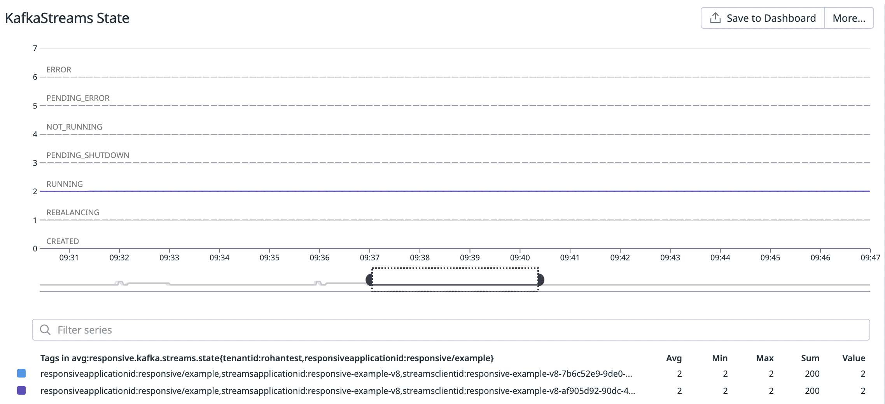

The application looks stable, so I’ll now try sending my 10K records/second.

## Sizing for 10K Records / Second

After ramping my load up to 10K records/second, I observed that my 2 nodes are starting to lag behind for their stateful tasks. This includes both the main aggregation tasks and the standby tasks. You can see consumer lag continuously rise on our charts:

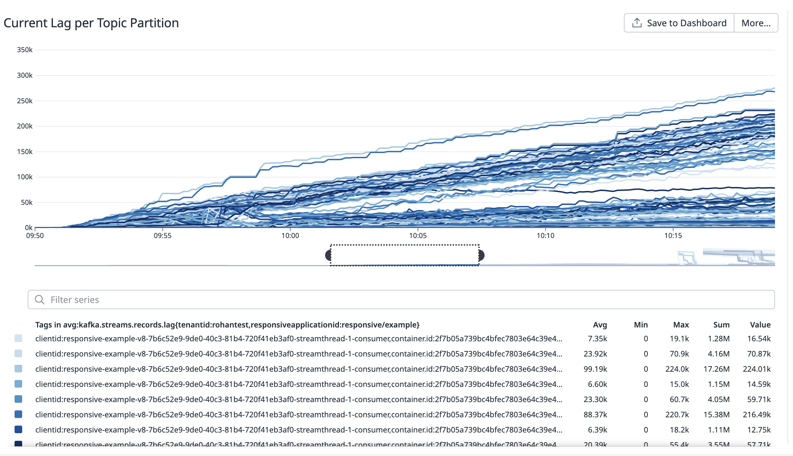

My main suspicion for this workload is that there’s not enough memory to fit all the state about my 2 million orders. To try and validate this, I took a look at memory usage and disk IO statistics.

Here’s the output from running `free` on one of my nodes:

```bash
# free -mh
               total        used        free      shared  buff/cache   available
Mem:            15Gi       3.3Gi       8.9Gi       2.0Mi       3.0Gi        11Gi
```

This tells me that I have at most 3.3 Gib allocated by my JVM and RocksDB heap, and 3.0 Gib used by the OS cache. Note that these will be the values for the whole VM - not just my container. But I’m pretty sure my container is what’s allocating most of the memory on this machine. I could confirm this for the anonymous memory by looking at the RSS for my JVM. For the cache I could use [pcstat](https://github.com/tobert/pcstat) which would tell me how much cache space is taken up by my rocksdb sst files. Also, note that there is a lot of “free” and “available” memory. This is because my container’s usage is being limited to 4GB by k8s/the container runtime.

Here’s the output from `iostat`, collected at 10 second intervals on one of my nodes:

```bash
# iostat -kdx 10
Device            r/s     rkB/s   rrqm/s  %rrqm r_await rareq-sz     w/s     wkB/s   wrqm/s  %wrqm w_await wareq-sz     d/s     dkB/s   drqm/s  %drqm d_await dareq-sz     f/s f_await  aqu-sz  %util
nvme1n1       3550.80  70363.20     0.00   0.00    0.88    19.82  311.20  65175.20    67.00  17.72    5.88   209.43    0.00      0.00     0.00   0.00    0.00     0.00    0.00    0.00    4.94  92.96

Device            r/s     rkB/s   rrqm/s  %rrqm r_await rareq-sz     w/s     wkB/s   wrqm/s  %wrqm w_await wareq-sz     d/s     dkB/s   drqm/s  %drqm d_await dareq-sz     f/s f_await  aqu-sz  %util
nvme1n1       2177.80  27339.20     0.00   0.00    0.70    12.55  254.40  55478.40    52.20  17.03    7.24   218.08    0.00      0.00     0.00   0.00    0.00     0.00    0.00    0.00    3.37  86.96

Device            r/s     rkB/s   rrqm/s  %rrqm r_await rareq-sz     w/s     wkB/s   wrqm/s  %wrqm w_await wareq-sz     d/s     dkB/s   drqm/s  %drqm d_await dareq-sz     f/s f_await  aqu-sz  %util
nvme1n1       2820.20  63307.20     0.00   0.00    0.63    22.45  363.20  70940.00   117.00  24.36    6.14   195.32    0.00      0.00     0.00   0.00    0.00     0.00    0.00    0.00    4.00  92.88

Device            r/s     rkB/s   rrqm/s  %rrqm r_await rareq-sz     w/s     wkB/s   wrqm/s  %wrqm w_await wareq-sz     d/s     dkB/s   drqm/s  %drqm d_await dareq-sz     f/s f_await  aqu-sz  %util
nvme1n1       2415.80  52355.20     0.00   0.00    0.73    21.67  236.60  52659.20    36.00  13.21   10.00   222.57    0.00      0.00     0.00   0.00    0.00     0.00    0.00    0.00    4.14  93.84

Device            r/s     rkB/s   rrqm/s  %rrqm r_await rareq-sz     w/s     wkB/s   wrqm/s  %wrqm w_await wareq-sz     d/s     dkB/s   drqm/s  %drqm d_await dareq-sz     f/s f_await  aqu-sz  %util
nvme1n1       3502.60  52911.20     0.40   0.01    0.56    15.11  188.00  37404.80    55.00  22.63    5.57   198.96    0.00      0.00     0.00   0.00    0.00     0.00    0.00    0.00    2.99  92.56

Device            r/s     rkB/s   rrqm/s  %rrqm r_await rareq-sz     w/s     wkB/s   wrqm/s  %wrqm w_await wareq-sz     d/s     dkB/s   drqm/s  %drqm d_await dareq-sz     f/s f_await  aqu-sz  %util
nvme1n1       3278.60  33156.00     1.40   0.04    0.55    10.11  227.20  48872.00    39.60  14.84    5.69   215.11    0.00      0.00     0.00   0.00    0.00     0.00    0.00    0.00    3.10  93.04
```

As I suspected I’m hammering my disk with reads that are missing the various caching layers.

If you really want, you could also check the hit ratios of the caches in Kafka Streams. Note that you will have to run with `DEBUG` level metrics. Your performance will likely decrease, but it should still give you a good idea of the hit rate. I tried this, and saw poor hit rates. Here’s an example for one task’s (1_19) reads:


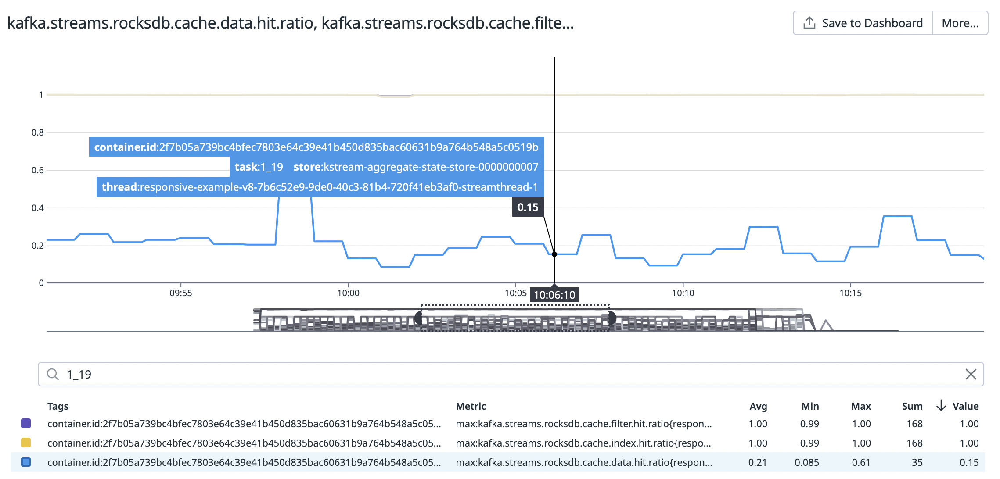

My Kafka Streams cache hit rate is ~50%. I think this is misleadingly high as the cache seems to register a “hit” when flushing dirty buffers from the cache. So if I do a bunch of read-modify-writes and get a 50% hit rate, then my reads probably never were fetched from cache. My RocksDB index and filter reads are always hitting cache, but the block cache hit rate is quite low (~21%).

To try and get better caching, I scaled my application’s memory up to 10Gib per pod. After doing that, I saw much better throughput and much more reasonable read rates to my EBS volume. In fact, with 10Gib the application is able to keep up with its sources.

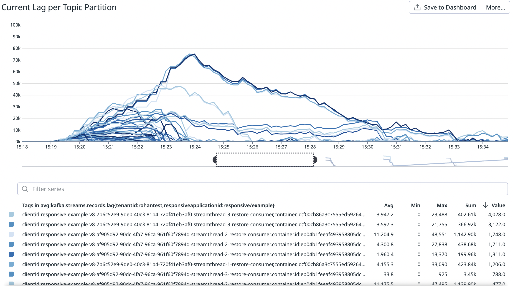

Though the application is able to keep up, it’s doing so just barely and is hitting the EBS volume pretty hard with writes (note that my reads have come way down):

```bash
# iostat -kdx 10
Device            r/s     rkB/s   rrqm/s  %rrqm r_await rareq-sz     w/s     wkB/s   wrqm/s  %wrqm w_await wareq-sz     d/s     dkB/s   drqm/s  %drqm d_await dareq-sz     f/s f_await  aqu-sz  %util
nvme1n1         28.80    118.40     0.00   0.00    9.26     4.11  550.20 128072.80    93.00  14.46   17.04   232.77    0.00      0.00     0.00   0.00    0.00     0.00    0.00    0.00    9.64  92.80

Device            r/s     rkB/s   rrqm/s  %rrqm r_await rareq-sz     w/s     wkB/s   wrqm/s  %wrqm w_await wareq-sz     d/s     dkB/s   drqm/s  %drqm d_await dareq-sz     f/s f_await  aqu-sz  %util
nvme1n1         27.60    119.20     0.00   0.00    6.91     4.32  553.20 128060.80   104.40  15.88   13.42   231.49    0.00      0.00     0.00   0.00    0.00     0.00    0.00    0.00    7.61  99.20

Device            r/s     rkB/s   rrqm/s  %rrqm r_await rareq-sz     w/s     wkB/s   wrqm/s  %wrqm w_await wareq-sz     d/s     dkB/s   drqm/s  %drqm d_await dareq-sz     f/s f_await  aqu-sz  %util
nvme1n1         26.80    113.60     0.00   0.00    9.72     4.24  564.20 128121.60   135.00  19.31   14.74   227.09    0.00      0.00     0.00   0.00    0.00     0.00    0.00    0.00    8.58  95.84

Device            r/s     rkB/s   rrqm/s  %rrqm r_await rareq-sz     w/s     wkB/s   wrqm/s  %wrqm w_await wareq-sz     d/s     dkB/s   drqm/s  %drqm d_await dareq-sz     f/s f_await  aqu-sz  %util
nvme1n1         28.00    121.60     0.00   0.00    6.11     4.34  555.80 128102.40   127.00  18.60   16.89   230.48    0.00      0.00     0.00   0.00    0.00     0.00    0.00    0.00    9.56  90.24

Device            r/s     rkB/s   rrqm/s  %rrqm r_await rareq-sz     w/s     wkB/s   wrqm/s  %wrqm w_await wareq-sz     d/s     dkB/s   drqm/s  %drqm d_await dareq-sz     f/s f_await  aqu-sz  %util
nvme1n1         34.40    148.00     0.00   0.00    9.72     4.30  556.20 128056.80   132.40  19.23   13.16   230.24    0.00      0.00     0.00   0.00    0.00     0.00    0.00    0.00    7.66  97.84

Device            r/s     rkB/s   rrqm/s  %rrqm r_await rareq-sz     w/s     wkB/s   wrqm/s  %wrqm w_await wareq-sz     d/s     dkB/s   drqm/s  %drqm d_await dareq-sz     f/s f_await  aqu-sz  %util
nvme1n1         21.00     90.40     0.00   0.00    8.03     4.30  557.80 128133.60   115.20  17.12   19.37   229.71    0.00      0.00     0.00   0.00    0.00     0.00    0.00    0.00   10.97  97.84
```

To try and get to a utilization that felt more safe I decided to add a replica. In reality, I’d probably first try to tune my write buffer size up (we’ll do this later), but this also lets me demo what you should monitor when scaling up 😉.

You can see my application scaling up in the following charts of consumer lag and last rebalance. You can see spikes in consumer lag (about 2 spikes every 10 minutes or so) that drain over the following minutes. What’s happening here is that Kafka Streams’ task assignor is gradually migrating stateful tasks over to the new node by assigning them as warmup tasks (the lag is always for a restore consumer), and then switching them to active tasks once they are sufficiently caught up. You can also see the application periodically rebalance until everything is migrated. These are called “probing rebalances”, which Kafka Streams does to monitor progress of the warming tasks. We know that the scale up is done when we stop seeing new restoring tasks and rebalances.

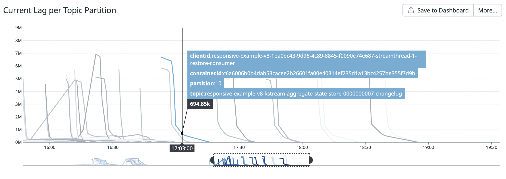

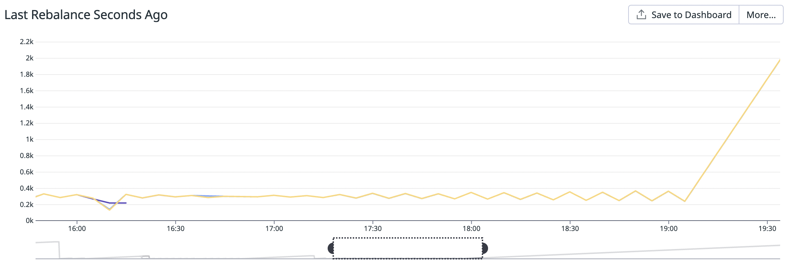

After the scale-up, I see more reasonable load on my disk:

```bash
# iostat -kdx 60 # just take one longer 60 second sample
Device            r/s     rkB/s   rrqm/s  %rrqm r_await rareq-sz     w/s     wkB/s   wrqm/s  %wrqm w_await wareq-sz     d/s     dkB/s   drqm/s  %drqm d_await dareq-sz     f/s f_await  aqu-sz  %util
nvme1n1        334.30   2708.20     0.00   0.00    1.21     8.10  444.43  97392.13    89.23  16.72    7.49   219.14    0.00      0.00     0.00   0.00    0.00     0.00    0.00    0.00    3.73  65.13
```

Now let’s try tuning up the write buffer limit like we talked about before. So far during my experiments, my write buffer manager limit has been set to 128MB. This is probably too low for 32 stores. After increasing my write buffer manager’s limit to 512MB, my write rate (269 w/s) and disk utilization (50%) look much better:

```bash
Device            r/s     rkB/s   rrqm/s  %rrqm r_await rareq-sz     w/s     wkB/s   wrqm/s  %wrqm w_await wareq-sz     d/s     dkB/s   drqm/s  %drqm d_await dareq-sz     f/s f_await  aqu-sz  %util
nvme1n1        248.52   4231.73     0.00   0.00    1.68    17.03  269.57  62395.27    39.63  12.82    9.49   231.47    0.00      0.00     0.00   0.00    0.00     0.00    0.00    0.00    2.98  50.52
```

At the end, just to be sure I checked disk size and my disks are fairly underutilized, so I can likely shrink them a bit if I were to actually deploy. If I needed to, I could just expand them later.

```bash
# df -h
Filesystem      Size  Used Avail Use% Mounted on
...
/dev/nvme1n1    252G   24G  229G  10% /mnt/data
...
```

## Monitoring for Under-Utilization

Finally, let’s suppose we were running this application in production and wanted to monitor for underutilization so we could scale down. To do this we’ll look at the fraction of time the application spends in `io-waittime-total` . Here’s what my application’s `io-waittime-total` looks like when I reduce load to 3000 records/second. The chart below reports the percentage of time in each minute that each consumer spends just waiting for records to arrive:

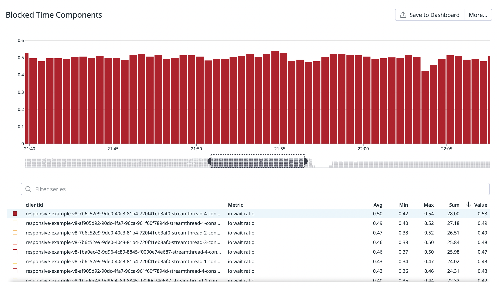

You can see that the application’s threads are sitting waiting for records about half the time. So it’s probably going to be safe to get rid of a replica to get better utilization.

# Summary

Capacity planning and operating your Kafka Streams application can be quite challenging. You’ll need to understand a fair bit of the guts of Kafka Streams, and know what telemetry to watch and how to react. Even then, it’s really more an iterative process of trial and error than an exact science. Hopefully this guide can help you get started and point you in the right direction.

At Responsive, we believe that as an application developer you shouldn’t have to worry about any of this. Instead, our view is that delegating to a metrics-based and policy-driven control plane is the best way to size and tune Kafka Streams.

With Responsive’s platform, you can use Kafka Streams’ awesome API to write your applications and then have Responsive’s Control Plane figure out the best way to run them and keep them healthy. All you have to do is [specify a policy](https://docs.responsive.dev/control-plane/policies) that defines the Control Plane’s goals and constraints in black-box terms that make sense to you.

In our next post, we will deep dive into the inner workings of the Responsive Control plane. We’ll go in depth on how Responsive’s decoupling of storage from compute for Kafka Streams makes autoscaling much simpler, talk through its BYOC architecture, walk through the different autoscaling policies, show you how those policies use the metrics we talked about in this post to automate scaling decisions, and give you a sneak peek at our future plans.

Until then, you can check out our [blog](https://www.responsive.dev/blog) and [docs](https://docs.responsive.dev/) to learn more about Responsive, [come join our Discord](https://discord.gg/HQSmfZzw) if you’d like to discuss this post or other Kafka Streams topics, and [download the SDK](https://www.responsive.dev/sdk) if you’d like to get started with Responsive!

# Appendix: Diagnostic Tools

Here’s a list of the diagnostic tools I referenced throughout this guide.

1. [iostat](https://linux.die.net/man/1/iostat): `iostat` gives you details about the IO that your applications are doing to attached disks.
2. [df](https://linux.die.net/man/1/df): `df` tells you how much disk space you’re using on all your mounted filesystems.
3. [free](https://man7.org/linux/man-pages/man1/free.1.html): `free` breaks down Linux memory usage into different categories like memory allocated by applications, cached memory, free memory, etc.
4. [pcstat](https://github.com/tobert/pcstat): `pcstat` tells you how much of a given file or set of files is cached by the OS in page cache. You can use this to see if RocksDB is filling up your page cache.
5. [jstat](https://docs.oracle.com/javase/8/docs/technotes/tools/windows/jstat.html): You can use `jstat` to get statistics about GC activity.
6. [kafka-streams-dashboards](https://github.com/kineticedge/kafka-streams-dashboards): A good starting point for building your own metrics dashboards.
7. [cachestat](https://brendangregg.com/blog/2014-12-31/linux-page-cache-hit-ratio.html): `cachestat` can tell you what your page cache hit rate is. YMMV with this one. You’ll need to make sure your kernel is configured with `CONFIG_FUNCTION_PROFILER` , and if you’re using k8s that you’re either using the tool from the node or from a privileged pod.
