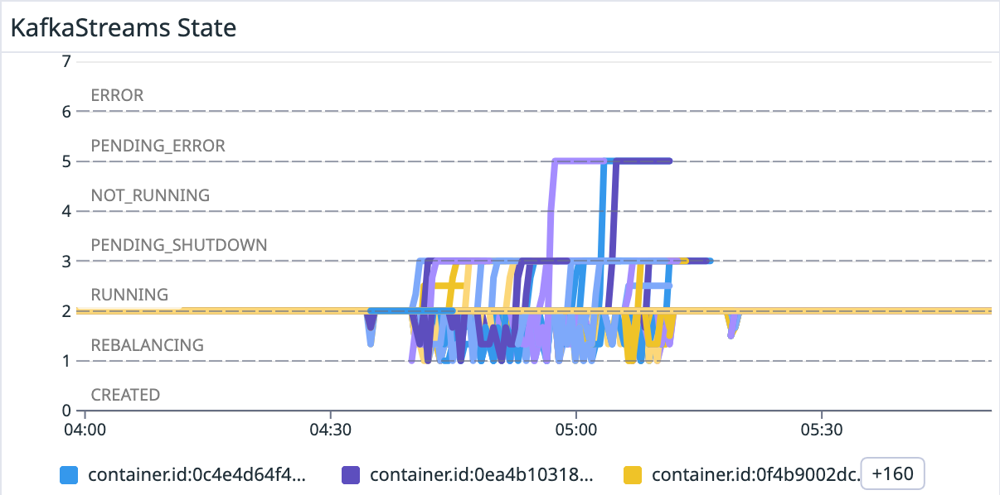
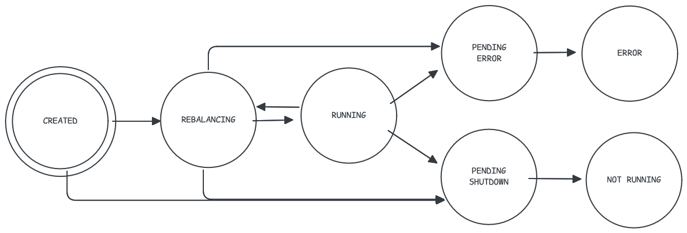

# Kafka Streams 101: Application Lifecycle

*Almog Gavra · February 24, 2025 · 12 min read*

Learn how to properly start, stop, and manage the lifecycle of Kafka Streams


---

**Last Updated:** Apache Kafka version 4.0 and Responsive SDK version 0.39.0

> **Learning Objective:** By the end of this Kafka Streams 101 lesson you will learn how to properly start, stop, and manage the lifecycle of Kafka Streams.

# Quick Summary

- Learn the proper order of operations for starting up a Kafka Streams instance
- Understand how to cleanly shutdown Kafka Streams to avoid instability
- Get an overview of how to coordinate many nodes with the same application ID
- (If Applicable) Learn best practices when using Spring Boot

# Concept Overview

### Lifecycle Overview

The lifecycle of a `KafkaStreams` instance is linear but nuanced:

1. Determine topology-specific configurations (if any)
2. Construct the topology, which is your application logic
3. Configure and instantiate `KafkaStreams` (we covered [configuration](https://www.responsive.dev/blog/important-configs-kafka-streams-101) in a previous KS101 Lesson)
4. Wire in listeners, error handlers, and clients
5. Configure shutdown behavior
6. Start the application with `KafkaStreams#start`
7. Stop the application

## Building and Configuring a Topology

We describe in depth the process of designing your topology and the different types of DSL operators in other Kafka Streams 101 Lessons. This section instead outlines topology-specific configurations and other wiring that needs to be done at the topology level.

The first step is creating and configuring a `Topology` instance:

```java
StreamsConfig streamsConfig = new StreamsConfig(props);
TopologyConfig topologyConfig = new TopologyConfig(streamsConfig);
StreamsBuilder builder = new StreamsBuilder(topologyConfig);
... // your application logic
Topology topology = builder.build(props);
```

There are ongoing efforts to clean this up, but there’s currently two ways that extra configurations make their way to the topology:

1. Via the `StreamsBuilder#new(TopologyConfig)` instantiation
2. Via the `StreamsBuilder#build(Properties)` method when building the `Topology`

The latter is *only* used for respecting the `topology.optimization` configuration.

## Instantiating Kafka Streams

*Before* you start your Kafka Streams instance, you want to create the `KafkaStreams` object and wire all relevant listeners and configurations.

Here are the important things to wire in:

### Uncaught Exception Handlers

Perhaps the most important thing to wire in with your `KafkaStreams` instance before starting it are the exception handlers with the `KafkaStreams#setUncaughtExceptionHandler` method. Configuring a `StreamsUncaughtExceptionHandler` will inform Kafka Streams on how to handle (the aptly named) uncaught exceptions in the processing threads. The API gives you three options:

| Option               | Description                                                                                                                                                      | When To Use                                                                                                                                                                                          |
|----------------------|------------------------------------------------------------------------------------------------------------------------------------------------------------------|------------------------------------------------------------------------------------------------------------------------------------------------------------------------------------------------------|
| REPLACE_THREAD       | The failed thread is replaced, causing it to retry processing the same batch of records on the same thread that threw the exception.                             | This is the configuration to use for errors that your application are resilient to, such as retriable exceptions. An example here is a network failure when making a remote call from Kafka Streams. |
| SHUTDOWN_CLIENT      | All threads on this Kafka Streams client (a single instance of `KafkaStreams`) will be shutdown and transition to `NOT_RUNNING` (see below).                     | The default behavior, which will trigger a rebalance and assign the tasks to other nodes.                                                                                                            |
| SHUTDOWN_APPLICATION | This indicates that the error is unrecoverable and all Kafka Streams clients with the same `application.id` (including those on other nodes) should be shutdown. | Something that isn’t recoverable in any situation (e.g. a topic was deleted or serde errors configured with “fail on error”)                                                                         |

There are many different types of errors that can come up in Kafka Streams, and we recommend that you don’t dwell too hard on getting this right on your very first deployment since it’s easy to change after the fact. The default behaviors are pretty good, and if you observe some behavior that you don’t like you should add the preferred behavior to the exception handler.

We’ll have a more detailed lesson on handling errors in a future KS101 lesson, subscribe to be notified when we publish that one! That one will discuss the other types of exception handlers that are available to configure (like the serialization and producing error handlers).

### State Listener

State listeners can be registered with Kafka Streams to notify you when the state has changed from one of `CREATED` `REBALANCING` `RUNNING` `PENDING_SHUTDOWN` `NOT_RUNNING` `PENDING_ERROR` and `ERROR`. Kafka Streams operates as an FSM with the following topology:



| State            | Description                                                                                                                                                                                                                                                                                    |
|------------------|------------------------------------------------------------------------------------------------------------------------------------------------------------------------------------------------------------------------------------------------------------------------------------------------|
| Created          | Kafka Streams is initialized in this state and will wait for you to call `start` before transitioning away (or it can be closed before calling `start` in which case it will transition directly to `PENDING_SHUTDOWN`)                                                                        |
| Rebalancing      | Kafka Streams has multiple threads that are assigned tasks. If any one of the threads are currently rebalancing (are in the `PARTITIONS_REVOKED` or `PARTITIONS_ASSIGNED` states), the entire Kafka Streams instance will be in the `REBALANCING` state.                                       |
| Running          | This is the steady state for Kafka Streams. When data is being processed and all threads are stable, Kafka Streams will be in the `RUNNING` state.                                                                                                                                             |
| Pending Shutdown | This is a transition state that indicates a clean shutdown was requested and Kafka Streams will stay in this state while the cleanup processes are executing.                                                                                                                                  |
| Not Running      | This is a terminal state which indicates Kafka Streams has closed as a result of normal operation.                                                                                                                                                                                             |
| Pending Error    | This is a transition state during which Kafka Streams attempts to cleanly shutdown despite the presence of an error. It will eventually transition to `ERROR`. Note that transitions to this state will be called if any of the stream threads, or the global thread, encounter a fatal error. |
| Error            | This is a terminal state which indicates Kafka Streams has closed as a result of an error.                                                                                                                                                                                                     |

Listening to the transitions between these states can give you important insight into what’s going on in your Kafka application. [KIP-1091](https://cwiki.apache.org/confluence/display/KAFKA/KIP-1091%3A+Improved+Kafka+Streams+operator+metrics) will make this easier to monitor out of the box, but until that is merged it is highly recommended to export the state transitions on your own using a state listener:

```java
kafkaStreams.setStateListener(new StateListener() {
  @Override
  public void onChange(final State newState, final State oldState) {
    // report metric for the newState
  }
});
```

With the [Responsive SDK](http://www.responsive.dev/sdk), we’ve implemented a `SateListener` that reports a metric that is simply a number to indicate which state it’s in. If you’re not using the SDK, we recommend you implement something similar (or use the SDK!) and then graph it in your favorite metric visualizer:



### Restore Listeners

Long restores are something [we’ve written about](https://www.responsive.dev/blog/guide-to-kafka-streams-state) time and time again, and sometimes it’s unclear how much progress is being made with restores. Since the restore consumer doesn’t use a consumer group, it’s often a whole different set of metrics that can be tough to reason about.

Luckily, Kafka Streams provides another listener that you can wire into your `KafkaStreams` application using `setGlobalStateRestoreListener` (which is used for *all* state restores, not just for global tables — the API is a bit confusing!). This gives you detailed information on when a restore starts, when each individual batch of records is restored, whether a restore has been suspended (due to the task migrating to another node as a result of a rebalance) and when the restore is complete.

This can be helpful for custom monitoring and routine logging but is also helpful in advanced scenarios: for example, if you want to coordinate with a resource provider (such as kubernetes) to dynamically change the resources allocated to a given pod (e.g. leverage increased IOPs during restoration).

### Standby Listener

If you have configured standbys with your application, you can add callbacks for three different situations using the `StandbyUpdateListener`:

1. You can be notified that a standby replica has been started using `onUpdateStart`
2. You can be notified that a standby replica has processed a batch of records with `onBatchLoaded`
3. You can be notified that the standby has been suspended (as well as at which offsets it was suspended) either because it was `MIGRATED` to another node or `PROMOTED` to the active replica.

### (Advanced) Kafka Client Supplier

Kafka streams is extremely well factored and [pluggable in nature](https://www.responsive.dev/blog/kafka-streams-is-an-application-framework), so much so that you can even pass in your own Kafka clients for it to use. One use case for this is to inject custom behavior beyond what is available with the configured consume and produce interceptors.

In order to do that, you need to implement `KafkaClientSupplier` and pass that into the Kafka Streams constructor (such as `KafkaStreams#new(Topology, Properties, KafkaClientSupplier)`).

## Shutting Down Your Application

I could have titled this section “why not just `kill -9` my Kafka Streams app?” — it’s very important to make sure that your Kafka Streams applications are properly shut down! There are many reasons why you want to make sure your app is cleanly shutdown, to name a few of them:

1. You don’t want to reprocess records. A clean shutdown will properly commit anything that has been processed and you won’t have duplicate outputs (for at-least-once processing)
2. You want the state stores to write their checkpoint files. This is will avoid unnecessary restoration when you start back up.
3. You want to control the behavior of whether or not (and how) a rebalance is triggered as a result of a shutdown.

### Close vs. Cleanup

It is important to note is that there are two parts of shutting down a Kafka Streams application that differ dramatically:

1. `close`: this will simply close the application by signaling all of your threads to stop, any data that is on disk will remain on disk!
2. `cleanUp`: this will cleanup all of the data on disk (in your `state.dir`) associated with your `application.id`. Note that this must be called either *before* you start your application or after `close` is complete.

In normal operation (such as restarting a pod or upgrading to a new version), you should not use `cleanup` or you will risk unnecessary restores. `cleanup` is particularly useful when resetting or deleting an application (also see: [our guide on upgrading topologies](https://www.responsive.dev/blog/topology-upgrades-kafka-streams-101)) with no intention of running it again, in testing scenarios, or if there has been some corrupted data on disk and you want to force a restore.

### Leaving the Group

A normal `close` will not cause the Kafka Streams application to send a `LEAVE GROUP` request to the broker, and therefore will not trigger a rebalance (didn’t understand that sentence? We have a [full deep dive on rebalancing](https://www.responsive.dev/blog/guide-to-kafka-streams-rebalancing), but you may want to carve out 30 minutes to read it).

There is the option, however, to call `KafkaStreams#close(CloseOptions)` and specifically request that the node leaves the group (this only works when using [static membership](https://www.responsive.dev/blog/kafka-streams-history-of-rebalancing#improvement-4-static-membership)). In normal operation, you should not use this as it will cause unnecessary instability and rebalancing. It *should* be used in situations where you are scaling down, otherwise you will need to wait for the `session.timeout.ms` to elapse before a rebalance is triggered and the tasks that were assigned to this node are moved to another node.

### Clean Shutdown via Shutdown Hook (Keep Your App Running)

Since starting Kafka Streams is non-blocking, you’ll want to hang on to your Kafka Streams instance and block your main thread until you are ready to shutdown. The threads spawned by Kafka Streams are daemons, meaning they won’t prevent your app from shutting down even if they haven’t joined the main process.

The way that we suggest you do that is by registering a shutdown hook on the JVM runtime, and awaiting a countdown latch triggered by that shutdown hook:

```java
final KafkaStreams streams = new KafkaStreams(topology, props);
final CountDownLatch latch = new CountDownLatch(1);

// attach shutdown handler to catch SIGINT
Runtime.getRuntime().addShutdownHook(new Thread("streams-shutdown-hook") {
    @Override
    public void run() {
        streams.close();
        latch.countDown();
    }
});

try {
    streams.start();
    latch.await();
} catch (Throwable e) {
    System.exit(1);
}
System.exit(0);
```

## Spring Boot

We don’t usually recommend using Spring Boot for Kafka Streams applications since subtle interactions between different configurations are tricky, having control over your application lifecycle is important, and freedom to use a different version of Apache Kafka from the version spring uses might be necessary for bug fixes etc...

> If you do use Spring Boot, make sure to use the most recent version! There are important fixes that have been released recently.

That being said, all of the recommendations above are possible to implement using Spring Boot as well and many of the good practices are implemented out of the box:

- Specifying `properties` when you create the `StreamsBuilderFactoryBean` will pass the same set of properties to the `StreamBuilder#new`, `StreamBuilder#build`and the `KafkaStreams` instance, meaning configurations will be respected per-topology.
- To add any of the listeners or exception handlers to Kafka Streams you can use the `KafkaStreamsCustomizer` interface (set using `StreamsBuilderFactory#setKafkaStreamsCustomizer`). Alternatively, you can directly call `setStateRestoreListener` and `setStreamsUncaughtExceptionhandler` on the `StreamsBuilderFactoryBean` itself
- If you want to make sure `cleanup` is called when you start or stop the application, you can configure that using `setCleanupConfig` on the `StreamsBuilderFactoryBean`
- If you want to issue a leave group when the application closes, you can call `setLeaveGroupOnClose` on `StreamsBuilderFactoryBean`
- If you want to supply your own Kafka clients, you can use `setClientSupplier` on `StreamsBuilderFactoryBean`

# Related Error Messages

You may see the following `TaskCorruptedException` if an unclean shutdown with EOS leads to some error. In these situations, make sure you are following the steps above to cleanly shutdown your application.

There are various related error messages, here are some of the common ones:

```java
Tried to initialize store offsets for corrupted store <STORE>
```

```java
State store <STORE> did not find checkpoint offsets while stores are not empty,
since under EOS it has the risk of getting uncommitted data in stores we have to
treat it as a task corruption error and wipe out the local state of task <TASK>
before re-bootstrapping
```

# Related Metrics

| MBean                                                                              | Metric                     | Description                                                       |
|------------------------------------------------------------------------------------|----------------------------|-------------------------------------------------------------------|
| kafka.streams:type=stream-metrics,client-id=([-.\w]+), process-id=([-.\w]+)        | client-state               | The current state of the Kafka Streams instance. NOTE: available after 4.0                   |
| kafka.streams:type=stream-thread-metrics,thread-id=([-.\w]+), process-id=([-.\w]+) | thread-state               | The current state of the `StreamThread` NOTE: available after 4.0 |
| kafka.consumer:type=consumer-coordinator-metrics                                   | last-rebalance-seconds-ago | Whether or not a rebalance is ongoing                             |
