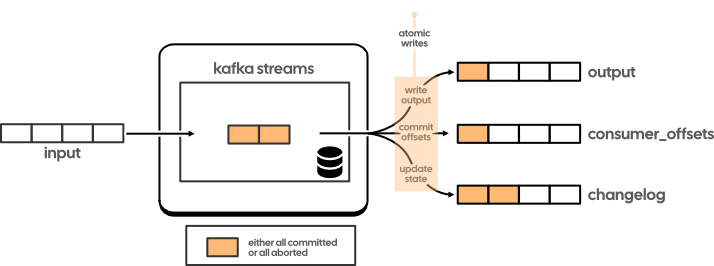
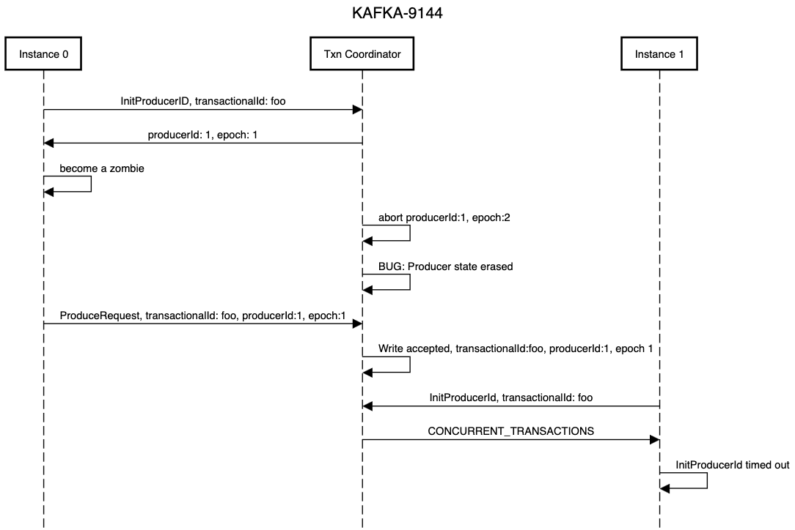
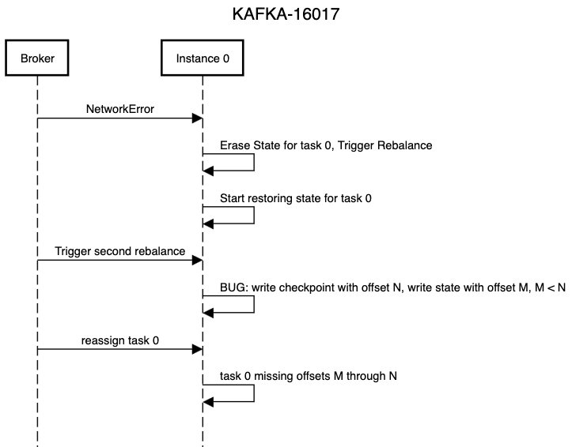
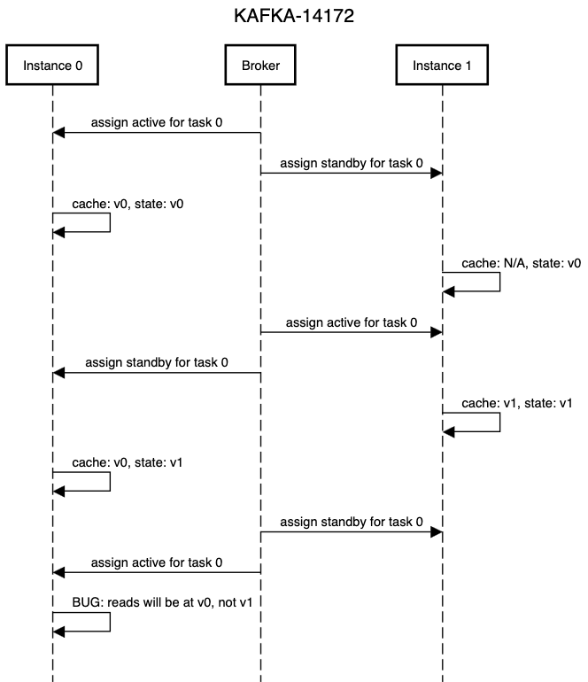

# Enter the Matrix: A practical guide to exactly-once semantics in Kafka Streams

*Apurva Mehta and Sophie Blee-Goldman · April 11, 2024 · 20 min read*

A practical guide for developers building stateful Kafka Streams applications with exactly-once semantics enabled. It covers how exactly-once semantics work, how to tune your transactions, and how to solve common issues with the exactly-once system.


---

Exactly-once semantics in Kafka and Kafka Streams are a remarkable capability that greatly expand the types of applications developers can build. Not surprisingly, the underlying transactional system that enables exactly-once semantics is quite sophisticated. So when things go wrong, it can be very hard for developers to debug and resolve their issues. 

This post is meant to provide developers with a practical guide to using exactly-once semantics in Kafka Streams. 

The outline for this post is as follows:

1. [Background](#1--a-brief-review-of-exactly-once-semantics-in-kafka-and-kafka-streams): an overview of the exact semantics (no pun intended!) along with a high level architecture overview.
2. [Limitations](#2-limitations): what Kafka Streams' exactly-once semantics _don't_ do for you.
3. [Tuning](#3-tuning-transactions-in-kafka-streams): how to configure your applications for stablility and performance when using exactly-once semantics.
4. [Errors and Exceptions](#4-errors-and-exception-types): a summary of the exceptions you may expect to see when using transactions and what they mean. 
4. [Common problems](#5-survey-of-known-issues-and-what-to-do-about-them): what you can do about the common issues developers face.
6. [Parting thoughts](#6-parting-thoughts): what's on the horizon.
7. [References](#7-annotated-references): A collection of all the most valuable documents and presentations related to exactly-once semantics in Kafka and Kafka Streams.

This post is intended to be the missing piece that links all the great resources on exactly-once semantics in Kafka that have come before. We deliberately avoid including content that is well presented elsewhere, so we encourage you to follow all the JIRAs, design docs, and talks that we link to if you want to maximize the value of this post. If you want to dig into anything else in more detail, check out the list of references at the end where we collected the most useful resources we’ve found on exactly-once semantics in Kafka and Kafka Streams. 

## 1.  A brief review of exactly-once semantics in Kafka and Kafka Streams

### Kafka Transactions

| Capability |  |
| --- | --- |
| write atomically to multiple topics and partitions (including the consumer offsets topic) | ✅ |
| deliver only committed messages | ✅ |
| write atomically to non-kafka systems | ❌ |
| write atomically to topics spanning kafka clusters | ❌ |
| applications can identify transaction boundaries | ❌ |

Kafka’s transactions system is conceptually simple. Fundamentally, the main guarantee is that you can issue multiple writes to multiple topics and partitions atomically. The framework ensures that either all of the writes in a transaction are successful, or all of them are aborted. And building on top of the producer's transactions, the consumer client can be configured to read only messages from committed transactions.

Note the use of the term “successful” — Kafka transactions are actually slightly different from traditional database transactions in which writes are either applied atomically or not at all, as messages from aborted transactions are still “applied” in the traditional sense. They will simply be invisible to a consumer configured to `read.committed`. A consumer configured with `read.uncommitted` on the other hand will consume not only uncommitted messages (ie those part of an ongoing/open transaction) but also those from aborted transactions.

To deliver this transactional capability, Kafka maintains transactional state per producer in a transaction log represented by a topic named `__transaction_state` . The current state of all transactions is the materialized view of the transaction log topic. This is similar to how the consumer group coordinator maintains the state of each consumer group in a `__consumer_offsets` topic: the state of a given group is a materialized view of the offsets topic. This design choice implies that each producer can have at most one open transaction at a given point in time.

Additionally, the Kafka protocol’s transactions require logging the state of each partition participating in a transaction via “transaction markers”, which are written to the actual data partitions (rather than the transaction log). These markers indicate when a given producer has committed or aborted a transaction, and are used with `read.committed` consumers to determine whether a batch of records should be served (in case of a commit marker) or filtered out (in case of an abort marker). If you ever see non-continuous offsets in your Kafka topic, it could be because these markers are occupying those offsets. 

Most of the complexity in the implementation comes from fencing zombie producers and ensuring that the state of the transaction log converges with the state in the topics participating in a transaction. A zombie producer refers to a producer that thinks it’s part of an active transaction but in reality has been superseded by another, more recent, producer with the same transaction id. This is a classic problem in distributed systems, and the Kafka transaction protocol ensures that these zombies can’t corrupt live transactions.

If you are interested in the details of how the system works, the original design doc [KIP-98](https://cwiki.apache.org/confluence/display/KAFKA/KIP-98+-+Exactly+Once+Delivery+and+Transactional+Messaging) is still one of the best ways to understand the data and control flows. 

### Exactly-once in Kafka Streams



*Kafka Streams can achieve read-modify-write atomicity since it uses kafka topics to commit offsets, write state changes, and write to output topics. Atomic writes to multiple topics is provided for by the Kafka transaction protocol.*

While the Kafka transaction protocol only guarantees atomic writes across multiple topics and partitions and is focused on the write-read pattern, the typical Kafka Streams application involves operations such as reading events from input topics, computing and updating application state, and writing events to output topics in a read-process-write pattern. Thus, in order to provide application developers useful semantics, Kafka Streams needs to go beyond the core Kafka transactional protocol.

Which it does! Kafka Streams allows an application to atomically:

1. read input events from one or more topics,
2. manipulate each event and/or update state,
3. write output events to other topics. 

As an application developer, you are guaranteed that the event your function receives, the state you update as part of processing that event, and the outputs you write to other topics as part of handling the event will all be one atomic unit. The results of a Streams application with exactly-once semantics will be as if each input event were applied *exactly* one time, no more and no less — a powerful guarantee that lets you build quite sophisticated apps with those semantics!

And the best part is that you only need to enable these semantics through a single config: just set the the `processing.guarantee` in StreamsConfig to `exactly_once_v2`. Kafka Streams will take care of configuring the clients and invoke all the underlying APIs correctly for you, so you don’t have to worry about things like the transaction id or `read.committed` mode. This is why a significant percentage of the total use of transactions in all of Kafka is through Kafka Streams — it’s so easy to use!

So how does Kafka Streams do so much with so little? Ultimately it’s because delivery semantics are based on recording progress by committing offsets for the input topics and changelog topics, and committing offsets is nothing more than a write to the `__consumer_offsets` topic — a write that can be done atomically through the Kafka transactional protocol! By making all the writes to these different topics part of a single transaction, Kafka Streams can provide users with an atomic ‘read-modify-write’ primitive.

The original design doc for exactly-once semantics (EOS) in Kafka Streams, [KIP-129](https://cwiki.apache.org/confluence/display/KAFKA/KIP-129%3A+Streams+Exactly-Once+Semantics), and the [accompanying blog](https://www.confluent.io/blog/enabling-exactly-once-kafka-streams/) both do a great job in describing how this all works.

## 2. Limitations

Having understood what exactly-once semantics in Kafka and Kafka Streams can do for you, let’s turn our attention to what they *can’t* do for you. Many of these limitations are rooted in the limitations of the transaction subsystems in Kafka. 

### Semantics

Since the fundamental guarantee which Kafka Streams relies on is that writes to multiple topics and partitions are atomic, there are several situations in which exactly-once semantics cannot be guaranteed. These include: 

1. Any reads and writes from external (non-Kafka) systems that are made as part of event processing will not be covered by the exactly-once guarantee. Since these reads and writes don’t involve reading from or writing to Kafka topics, they are outside of the scope of Kafka transactions and thus outside of the scope of exactly-once semantics in Kafka Streams. 
2. A somewhat common misconception is that Kafka’s transactions give you read-your-write semantics like what you would expect from a traditional ACID transaction in a relational database. However, those semantics make less sense for Kafka given that it represents a log abstraction. For a log, the position of the reader determines what is read.
3. Today, a transaction in Kafka is confined to topics and partitions that reside within a single Kafka cluster. So by extension, Kafka Streams can only guarantee exactly-once semantics if it is operating on topics within a single cluster. This is actually the biggest reason why Kafka Streams apps don’t support interfacing with multiple Kafka clusters today. Of course, this means that if/when the Kafka protocol supports cross-cluster Kafka transactions, there can be cross-cluster Kafka Streams apps too!
4. There is no notion of ‘read atomicity’, by which we mean the ability to read *all* the writes from a particular transaction in one fetch. Consumers also don't know when they have read all the messages that were committed as part of a single transaction. This poses a fundamental challenge if you are trying to reassemble an upstream transaction in your Kafka Streams application.

### Performance

One of the biggest tradeoffs with enabling exactly-once semantics in Kafka Streams is that it can potentially explode your end-to-end application latency, ie. the latency from when an event was written to an input topic to the time the corresponding outputs were written to the (final) output topics. We say “final” here because the end-to-end latency of an event from the input topic to the output topic of a single subtopology will be roughly the same, but the latency from an input topic to an output topic that’s across multiple subtopologies can be quite high.

This is because each [sub-topology](https://docs.confluent.io/platform/current/streams/architecture.html#sub-topologies-also-called-sub-graphs) in Kafka Streams runs its own transaction, and each transaction commits on the `commit.interval.ms` boundary. So if your commit interval is 10 seconds, and you have 3 sub topologies in your app, your *minimum* end-to-end latency with exactly-once semantics is 30 seconds. This can catch people by surprise and is important to keep in mind if you have latency sensitive applications or a large number of subtopologies and override the default `commit.interval.ms` (more on this later). You can learn about how to tune transactions to get your desired latency profile in the next section. 

### Operations

In the original (and still current) implementation of exactly-once semantics in Kafka Streams, an unclean shutdown means that all local state on that instance is erased (whether rocksDB or in-memory) and has to be restored again from the start of the changelog topic before the application can continue processing. This can have significant availability implications for your application that you need to keep in mind. 

Luckily, [KIP-892](https://cwiki.apache.org/confluence/display/KAFKA/KIP-892%3A+Transactional+Semantics+for+StateStores) should fix this situation and allow store contents to be retained even in the face of an unclean shutdown. Keep an eye out for when that KIP’s implementation is merged and be sure to enable the feature should you be suffering from availability issues in your Kafka Streams application with EOS.

## 3. Tuning Transactions in Kafka Streams

We already covered how to tune and size your Kafka Streams applications in [another blog](https://www.responsive.dev/blog/a-size-for-every-stream), but when it comes to exactly-once semantics there are some additional configs to consider, as well as some different concerns with familiar configs. These are the main configurations to keep in mind for an EOS app in particular, on top of all the usual configs.

### *commit.interval.ms* (StreamsConfig)

The single most important config for an exactly-once application to look at is the `commit.interval.ms`. If you’re used to running non-EOS Streams apps where you never had to touch the`commit.interval.ms`, you might be thinking: why should I suddenly care now?

Well, to combat the potential e2e-latency-explosion we mentioned above, Kafka Streams actually uses a different — and *much* lower — default value for the `commit.interval.ms` when exactly-once semantics are enabled. Specifically, it drops from 30s to only 100ms. And unsurprisingly, dropping this by two orders of magnitude has a significant impact on performance, stability, and mental health of the application operator. 

It’s a well-known fact to most that turning on EOS in Kafka Streams means trading off performance for semantics. And this makes sense: everything good in life comes at some expense, right?

> But did you also know that EOSv2 ([KIP-447](https://cwiki.apache.org/confluence/display/KAFKA/KIP-447%3A+Producer+scalability+for+exactly+once+semantics)) applications with the same 30s `commit.interval.ms` performed nearly as well as non-EOS applications in benchmarks in terms of throughput?

But did you also know that EOSv2 ([KIP-447](https://cwiki.apache.org/confluence/display/KAFKA/KIP-447%3A+Producer+scalability+for+exactly+once+semantics)) applications with the same 30s `commit.interval.ms` performed nearly as well as non-EOS applications in benchmarks in terms of throughput? As it turns out, the “expense” at the heart of the EOS performance tradeoff is not actually about raw performance at all, but specifically latency. In other words: enabling EOS doesn’t have to mean trading off *throughput* for semantics — you can choose to trade off end-to-end latency instead by increasing the `commit.interval.ms`. Many applications that aren’t latency sensitive will find that they can get almost the same throughput with EOS turned on as off, just by giving both the same `commit.interval.ms`!

In the end, we recommend to tune an EOS application by first determining how much latency the broader environment can handle, and working backwards to figure out the best value for your commit interval. 

For example, let’s say your application has four subtopologies and you want to make sure records can go from the input of the 1st subtopology to the output of the 4th subtopology within 1 minute. Divide the desired e2e latency by the number of subtopologies to get a target commit interval of 60s / 4 = 15s. (Of course, if 1 minute is a strict e2e latency bound, you probably want to leave some wiggleroom and use a slightly smaller value, like 10s).

For those of you whose applications aren’t sensitive to latency at all, we suggest to just pick a reasonable starting value (like the non-EOS default of 30s) and then see how it goes. Check out our other blog post on [monitoring your Kafka Streams applications](https://www.responsive.dev/blog/monitoring-kafka-streams) for some tips on how to understand and evaluate the app’s performance. 

Lastly, don’t forget that you can always monitor the `record-e2e-latency` metrics to make sure it stays within acceptable bounds. But most applications can almost certainly handle a large commit interval, especially those with few or only one subtopology, so make sure to evaluate the `commit.interval.ms` config for each app!

### *transaction.timeout.ms* (ProducerConfig)

Whereas all Kafka Streams applications will have, and should pay attention to, the `commit.interval.ms` config, there are some configs that are specific to applications that have enabled exactly-once. The most important one of these is the `transaction.timeout.ms` config. 

In short, this determines how long a producer can go between beginning a new transaction and committing it. If a StreamThread fails to perform a commit within this timeout, its producer will be fenced and it will get kicked out of the group, similar to the consumer being fenced if the StreamThread misses the max poll interval. In both cases, the StreamThread has to rejoin via rebalances, and will typically encounter a TaskMigratedException before realizing it has to rejoin the group. 

There are a number of different reasons an application may be hitting the transaction timeout, from simple ones like heavy/long processing to more complicated edge case scenarios, or even bugs.

In an application with very long individual record processing times, even if you have accounted for the heavy processing by increasing the `max.poll.interval.ms` to prevent the group coordinator from kicking the StreamThread out of the group, it can still be kicked out by a different broker — the transaction coordinator — if it exceeds the `transaction.timeout.ms`. 

Some of the more complicated and situational reasons for transactions hitting the timeout are covered in the later section on [Transaction timeouts](#3-transaction-timeouts).

Finally, note that the `transaction.timeout.ms` and `commit.interval.ms` are inherently coupled within Streams, as they both have to do with the frequency of committing. The commit interval controls how often Streams will attempt to commit and forms a *lower* bound on how often Streams will commit during regular processing, while the transaction timeout establishes an *upper* bound on how long it can go between commits. 

Therefore, you should make sure that the `transaction.timeout.ms` is *at least* as big as the `commit.interval.ms`, and ideally a bit larger to ensure that Streams has some breathing room to complete the commit. The default `transaction.timeout.ms` is only 10s, so this is especially important if you decide to increase the commit interval to something closer to the non-EOS default of 30s. Luckily, Streams will check to make sure this is the case and will help you out by throwing the following exception should you increase the `commit.interval.ms` and forget to bump up the `transaction.timeout.ms` correspondingly:

```java
java.lang.IllegalArgumentException: Transaction timeout 10000 was set 
lower than streams commit interval 30000. This will cause ongoing transaction
 always timeout due to inactivity caused by long commit interval. Consider
 reconfiguring commit interval to match transaction timeout by tuning
'commit.interval.ms' config, or increase the transaction timeout to match
commit interval by tuning `producer.transaction.timeout.ms` config.
```

## 4. Errors and Exception Types

One of the most confusing aspects of EOS that users may run up afoul of is the large web of exceptions and error types. We’ll cover the most common and important ones in this section with a focus on what they are and when they occur under normal operation, and attempt to answer the single most important question: 

When can you just ignore an exception, and when do you need to care?

*note:* *for actual bugs and edge cases that don’t fall under “normal operation”, see the following section after this one.*

### ProducerFencedException

The javadocs for this exception describe it as such:

> *This fatal exception indicates that another producer with the same `transactional.id` has been started. It is only possible to have one producer instance with a `transactional.id`  at any given time, and the latest one to be started "fences" the previous instances so that they can no longer make transactional requests. When you encounter this exception, you must close the producer instance.*
> 

Note that this exception is “fatal” only in the context of the transactional producer itself, indicating that it needs to be closed, and not at all fatal to Kafka Streams or the StreamThread that owns this producer. In the Kafka Streams world, a `ProducerFencedException` will typically be wrapped in a `TaskMigratedException` which tells the StreamThread that it no longer “owns” this task and most likely has dropped out of the consumer group and will need to rejoin. You may think of a StreamThread’s Producer and Consumer clients as separate entities, but they are inextricably linked and both play a role in group membership and fencing zombies for exactly-once semantics in Kafka Streams to work.

Generally speaking, a `ProducerFencedException` here and there is nothing to worry about. It’s expected that StreamThreads will sometimes miss a rebalance or otherwise drop out of the consumer group as part of normal operations, and Kafka Streams both expects and accounts for this scenario by closing the old Producer and initializing a new one when rejoining the group. 

The exception is only a problem if or when it becomes a persistent issue: when encountered repeatedly over a long period of time. Even then, the `ProducerFencedException` is just a symptom of the problem and not the true root cause. It’s important to look at the application holistically and try to figure out why one or more of the StreamThreads are struggling to remain an active member of the consumer group and losing ownership of their assigned tasks. If you’re not sure how to do, make sure to check out our blog on [diagnosing rebalancing issues](https://www.responsive.dev/blog/guide-to-kafka-streams-rebalancing).

### InvalidProducerEpochException

This exception is fairly similar to the `ProducerFencedException`, and is more or less interpreted the same way by Kafka Streams: as a `TaskMigratedException` indicating the StreamThread has dropped out of the consumer group and will need to rejoin.

The notable difference between these two exceptions is, in fact, fully abstracted away from the user by Kafka Streams, and exists only at the level of the producer client. Whereas the `ProducerFencedException` is a “fatal exception” and requires a producer to be closed, the `InvalidProducerEpochException` is non-fatal to the producer and simply requires the current transaction be aborted.

Of course, Kafka Streams will handle this in both cases as part of the `TaskMigratedException` handling process. Instead of closing the existing producer and re-initializing a new one as is done after a `ProducerFencedException`, following a `InvalidProducerEpochException` the StreamThread will simply call `Producer#abortTransaction` on that producer and then continue on to rejoin the group.

Due to their similarities, the same rules as for a `ProducerFencedException` apply to the `InvalidProducerEpochException`: don’t panic if you see this in the logs, but if it happens repeatedly and/or often, then it’s worth taking a closer look. As long as your application isn’t rebalancing frequently enough to be causing you problems, then a `ProducerFencedException` or `InvalidProducerEpochException` here and there aren’t going to be hurting anyone.

### InvalidPidMappingException

This exception is somewhat more rare than the others, though also a normal part of operating Kafka and/or Kafka Streams. It occurs when the broker config `transactional.id.expiration.ms`  is exceeded by an idle transactional producer, in which case the transaction coordinator will have expired and cleaned up its transactional id. If the idle producer returns to operation, the transaction coordinator will be unable to find or map the producerId, or “Pid” — hence the exception name. 

The timeout is specifically applied to status updates from a transactional producer, meaning a producer’s transactional id will only be expired if it goes without initiating or committing/aborting a transaction for a long time. Practically speaking, this means an application would have to go the length of `transactional.id.expiration.ms` (which defaults to 7 days) without processing any output records for that partition. It’s worth noting that this occurrence is typically more rare with the modern EOSv2 and its producer-per-StreamThread model, but older applications that haven’t upgrade from EOSv1 are more susceptible since they use one producer for each StreamTask, since it’s much easier for there to be no output records for a single task than across all tasks owned by the StreamThread.

Unfortunately Kafka Streams does not currently (as of this writing) automatically catch and handle this particular exception, so you most likely will want or need to handle this in some way should it occur. You can register an exception handler (via the `KafkaStreams#setStreamsUncaughtExceptionHandler` API) to make sure a StreamThread that hits this is replaced instead of killing the entire client, and we always recommend an application sets an exception handler to make sure it can respond and recover to all kinds of exceptions. Of course, if it’s hitting this particular exception, you should also consider whether it might be likely to occur again and raise the `transactional.id.expiration.ms` config accordingly.

### UnknownProducerIdException

Lastly, we have the `UnknownProducerIdException`: with similarities to all of the above exception types, we can cover this one in terms of the above. On its surface, this exception is more similar to the `InvalidPidMappingException` than anything else, as it has to do with expiration on the broker side of things. Whereas the `InvalidPidMappingException` happens when the producer itself is expired according to the `transactional.id.expiration.ms`, the `UnknownProducerIdException` can arise when all of the actual data ever produced by a transactional producer has been expired according to the topic config `retention.ms`. This occurs because all metadata for a given producerId will be cleaned up by the broker once the last records from that producerId are removed, and the broker won’t be able to recognize the producerId or locate the producer metadata needed to serve requests.

However, whereas the `InvalidPidMappingException` is fatal to the StreamThread, a `UnknownProducerIdException` is only fatal to the producer itself — it’s fatal in the same sense as a `ProducerFencedException`, in other words. And this is reflected in how the `UnknownProducerIdException` is handled: by wrapping it in a `TaskMigratedException` and then closing the producer and initializing a new one.

Like the `ProducerFencedException`, this one isn’t worth worrying about if you only see it once — and in general, this specific exception should be much more rare and unlikely to result in rebalancing loops due to its nature. Since `retentions.ms` defaults to 7 days, it’s probably not going to happen over and over again. Of course, if you know for a fact that your application will be dealing with some (very) low throughput topics, it’s worth considering a larger `retention.ms` to make sure you don’t lose all the data for your producers while they sit around idling.

On the other hand, all it takes is a single rebalance for Kafka Streams to recover from an `UnknownProducerIdException` — so it’s probably easiest to just let it slide, and (as always), monitor the app to make sure things recover.

## 5. Survey of known issues and what to do about them

Now that you are armed with the semantics of transactions in Kafka and Kafka Streams and have a high level understanding of how these semantics are delivered in the implementation, we turn our attention to some of the common errors you may see while running an app that uses transactions. We’ll talk about what these errors mean and what you can do about them (besides banging your head on the wall 🙂).

### **1. InitProducerId timeouts**

**Symptoms:**

Kafka Streams consistently fails due to timeout of InitProducerId:

```java
org.apache.kafka.common.errors.TimeoutException: Timeout expired
 after 60000milliseconds while awaiting InitProducerId
```

This timeout can happen when initializing a task, and can be detected by looking out for the following warning in the logs:

```
Timeout exception caught trying to initialize transactions. The 
broker is either slow or in bad state (like not having enough replicas) 
in responding to the request, or the connection to broker was 
interrupted sending the request or receiving the response. Will retry 
initializing the task in the next loop. Consider overwriting 
max.block.ms to a larger value to avoid timeout errors,
```

Streams will actually catch task-level TimeoutExceptions and retry them, up to the configured `task.timeout.ms` . This helps with transient timeouts, but what if the error persists? If there is an underlying problem that prevents this “InitProducerId” from succeeding, the request will continue to time out and eventually the exception will be thrown all the way up to kill the StreamThread

The following tickets have more details on the symptoms and causes of persistent timeouts while initializing a Kafka Streams application with exactly-once semantics enabled:

- [KAFKA-8803](https://issues.apache.org/jira/browse/KAFKA-8803): Streams will not start due to `TimeoutException: Timeout expired after 60000milliseconds while awaiting InitProducerId`
- [KAFKA-13375](https://issues.apache.org/jira/browse/KAFKA-13375): Kafka streams apps w/EOS unable to start at InitProducerId

**Potential Causes:** 

You may be wondering: what even *is* an “InitProducerId” request? The long answer is really long, but the short answer is: it’s part of the initial request a transactional producer makes when it’s first initialized with the given transactional id. In other words, it’s a part of the Producer’s `#initTransactions` API — the very first call it has to make before launching into a cycle of beginning and committing/aborting transactions. Of course, Kafka Streams will call all these APIs for you, so during normal operations you should never have to know, or care. 

In the normal case, when the broker-side transaction coordinator receives an `InitProducerId` request, it aborts any open transactions with that `transactional.id` before initializing the new one. However, there have been bugs in the implementation where the coordinator doesn’t abort an open transaction and keeps the new producer waiting forever, as shown in the sequence from [KAFKA-9144](https://issues.apache.org/jira/browse/KAFKA-9144) below. In particular, the diagram shows how a ‘zombie’ producer instance 0 can block a new producer instance 1 from completing its initialization. In the case of KAFKA-9144, producer state is erroneously deleted from the broker, which results in improper handling of the `InitProducerId` request.



*In KAFKA-9144, a zombie producer—Instance 0—can create a transaction which is open indefinitely and thus block a new producer—Instance 1—from successfully initializing..*

Hanging transactions are usually due to the Kafka Broker or Kafka Producer bugs:

1. There can be—and indeed there are—bugs in the implementation of the transaction protocol that can cause a transaction to remain open indefinitely. See [KAFKA-9144](https://issues.apache.org/jira/browse/KAFKA-9144) (and in particular this [comment](https://issues.apache.org/jira/browse/KAFKA-9144?focusedCommentId=17058443&page=com.atlassian.jira.plugin.system.issuetabpanels%3Acomment-tabpanel#comment-17058443)) for a scenario for how this can happen, which is depicted in the diagram above.
2. Design gaps in the protocol can combine with bugs in the client to cause hanging transactions much more frequently than you would otherwise expect. So if your environment uses anything but the first-party java clients, you may run into hung transactions more often. Updates like [KIP-890](https://cwiki.apache.org/confluence/display/KAFKA/KIP-890%3A+Transactions+Server-Side+Defense) will make the protocol robust to buggy clients and generally reduce frequency of hung transactions in multi language client environments. 
3. Note: The Kafka devs are always hard at work finding, fixing, and sometimes also inadvertently introducing bugs to the Kafka protocol. It’s always a good idea to search JIRA for any newly identified issues, and remember to always check which broker or client version(s) that a reported issue is designated as affecting!

Regardless of the cause, once a broker has a hung transaction, new producers can’t initialize, and you will see a timeout when trying to initialize a new producer. Kafka Streams will attempt to initialize a producer in a handful of different situations, most often when an instance restarts or a rebalance shuffles tasks to a new StreamThread. 

**Solutions:** 

1. Bouncing the the transaction coordinator for the partitions whose transactions can’t init might help, as described in [KAFKA-8803](https://issues.apache.org/jira/browse/KAFKA-8803).
2. If bouncing the leaders doesn’t help, then you need to check if there is a hung transaction that’s blocking the current task from initializing.  To verify if this is the case, check  `LastStableOffsetLag` (which should not be increasing for the stuck partitions) and `PartitionsWithLateTransactionsCount`  (which should include the stuck partitions). So if a given partition has increasing `LastStableOffsetLag` and that partition is in the set of partitions with late transactions, consider running the tool the tool described in [KIP-664](https://cwiki.apache.org/confluence/display/KAFKA/KIP-664%3A+Provide+tooling+to+detect+and+abort+hanging+transactions) to reset the stuck partitions. 
3. Watch for [KIP-890: Transactions Server-Side Defense](https://cwiki.apache.org/confluence/display/KAFKA/KIP-890%3A+Transactions+Server-Side+Defense) to land and upgrade accordingly. This KIP upgrades the protocol so that bad clients can no longer cause hung transactions.

### 2. EOS violations

**Symptoms:**

Sometimes, when there are frequent rebalances due to application crashes or due to network errors that result in `TaskCorruptedException` in your application, it’s possible for some writes on state stores to appear ‘lost’, ie. you don’t read your updates to a state store even if they have been committed. The exact way you notice missed reads will depend on your application logic. 

**Causes:**



*In KAFKA-16017, a divergence between checkpoint version and state version results in missing messages.*

All Kafka Streams versions up to and including 3.4.1 suffer from bugs that can result in the violation of EOS guarantees.

Here are two separate bugs that manifest in the same symptoms of your state store reads being stale:

- [KAFKA-14172](https://issues.apache.org/jira/browse/KAFKA-14172): bug: State stores lose state when tasks are reassigned under EOS with standby replicas and default acceptable lag.
- [KAFKA-16017](https://issues.apache.org/jira/browse/KAFKA-16017): Checkpointed offset is incorrect when task is revived and restoring

In both cases, multiple rebalances caused tasks to move around or flip between active and standby mode. In both cases some internal task state (eg the record cache or record collector) became stale relative to the state on disk, causing the state store to serve stale reads. 



*In KAFKA-14172, a divergence between the version of the Kafka Streams record cache and the underlying state store can result in missing messages.*

**Solutions:**

Each of the JIRAs above offer ways to remediate stale reads in a production system. Please take a look at them and implement those workarounds if you are hitting these issues. 

Generally speaking, a workaround for a large portion of these bugs is to disable state store caching. This can degrade performance for both reads and writes, so it’s worth testing it out in a safe environment before implementing in production. You can do so by setting the cache size config to `0`: use `statestore.cache.max.bytes` if you’re on version 3.4 or above, and `cache.max.bytes.buffering` for versions 3.3 and below.

It is, however, best to upgrade to 3.4.2 and later versions of Kafka Streams so you pick up fixes to all known issues that relate to breaking of the exactly-once guarantees. 

### 3. Transaction timeouts

**Symptoms**

A common source of errors when running with exactly-once semantics enabled is that if your application takes too long to process data, your transaction is timed out by the broker. This scenario will result in an error like this surfacing in your application log: 

```bash
"exception":org.apache.kafka.streams.errors.TaskMigratedException: Error 
encountered sending record to topic _topic_ for task 1_0 due to:
org.apache.kafka.common.errors.InvalidProducerEpochException: Producer 
attempted to produce with an old epoch.
Written offsets would not be recorded and no more records would be 
sent since the producer is fenced, indicating the task may be
 migrated out; it means all tasks belonging to this thread should be 
migrated.
```

**Causes**

There can be a multitude of causes for your Kafka Streams transaction to be timed out. Some of the common ones are: 

1. [KAFKA-13295](https://issues.apache.org/jira/browse/KAFKA-13295): Long restoration times can sometimes result in transaction timeouts when certain task assignments force a StreamThread into a long restore in the middle of an open transaction.  This class of bugs should be fixed by the “state updater thread” that’s part of the [new threading architecture](https://cwiki.apache.org/confluence/display/KAFKA/Streams+Runtime+Architecture+with+New+Threading) ([KAFKA-10199](https://issues.apache.org/jira/browse/KAFKA-10199)), and is scheduled to make its official debut in the 3.8 release.
2. Long writes to the state stores (eg. [KAFKA-9062](https://issues.apache.org/jira/browse/KAFKA-9062)): If your state store is very slow, for instance if RocksDB is undergoing major compactions and slowing down your reads and writes, you may take too long to process your records, causing the transaction to be timed out by the broker. 
3. Long punctuations: If you your punctuations are long, specifically longer than the transaction time out, your transactions will be timed out while your punctuation code is executing. 
4. Otherwise slow process functions: In general, if your `process` functions are slow, you are in danger of hitting your transaction timeout. See the [Configuration](https://www.responsive.dev/blog/guide-to-kafka-streams-exactly-once-transactions#3-tuning-transactions-in-kafka-streams) section above for more details on when and how to properly configure this.

As always, there are plenty of older issues that have since been fixed (such as [KAFKA-14294](https://issues.apache.org/jira/browse/KAFKA-14294)) and new ones being found all the time. We always recommend searching the Kafka JIRA for similar issues, especially if you are running an older version of the client or brokers.

**Solutions**

Apart from the upcoming structural fixes to Kafka Streams with the new threading architecture, the best thing you can do to resolve situations where the broker times out your Kafka Streams transaction is to either increase the transaction timeout, speed up your app and/or state store, or decrease the work Streams attempts to complete in a single transaction. In practice, you can try to help Streams finish everything it needs to commit a transaction within the timeout in any of the following ways: 

1. Decrease your `commit.interval.ms` so that you process fewer messages in a single transaction. The lower your commit interval, the more transactions you will have for the same number of messages processed. 
2. Split your monolithic `process` and `punctuate` functions into smaller pieces, especially if you can distribute them across multiple subtopologies.
3. Decrease your `poll.max.records` so that you don’t read too many messages in a single `poll` call. This can be particularly important if you do “heavy” processing, or have long processing times for each record.

## 6. Parting thoughts

We hope this post helped you better understand and operate your Kafka Streams applications that use exactly-once semantics. 

Since the system was first launched in 2017, it has seen adoption across a wide range of companies for a wide range of use cases. Many famous financial institutions run mission critical apps that rely on exactly-once semantics to be correct. The stakes don’t get higher than that!

The last seven years have also revealed design gaps and implementation bugs that have tripped up many a hapless development team. The good news is that the community is actively investing in this area. We’ve mentioned these previously in this post, but the following three improvements are under development and particularly exciting:

1. [KIP-890](https://cwiki.apache.org/confluence/display/KAFKA/KIP-890%3A+Transactions+Server-Side+Defense): This is the most significant upgrade to the original protocol and will fix all the known design gaps, and thus address all known correctness issues.
2. The [new threading architecture](https://cwiki.apache.org/confluence/display/KAFKA/Streams+Runtime+Architecture+with+New+Threading) in Kafka Streams will make for more stable transactions, and less disruptive timeouts, in the Kafka Streams context. This [JIRA label](https://issues.apache.org/jira/browse/KAFKA-13501?jql=labels+%3D+new-streams-runtime-should-fix) includes many common issues that should be fixed with the new threading model. The new threading system, in combination with the [V2 of Kafka Streams exactly-once semantics](https://www.slideshare.net/GuozhangWang/exactlyonce-made-easy-transactional-messaging-improvement-for-usability-and-scalability) that was shipped a few years ago, will make for more stable, scalable, and performant transactions in the Kafka Streams context.
3. [KIP-892](https://cwiki.apache.org/confluence/display/KAFKA/KIP-892%3A+Transactional+Semantics+for+StateStores): is a major upgrade to the performance and usability of exactly-once semantics in Kafka Streams, and fixes one of the biggest shortcomings of the original implementation: unclean shutdowns needing to wipe out local state and causing potentially massive restores.
4. Responsive also helps improve the stability and scalability of Kafka Streams applications which use exactly-once
semantics by offloading the transaction management for state stores to a separate database via the [Responsive SDK](https://www.responsive.dev/sdk).
Our  [talk](https://www.confluent.io/events/kafka-summit-london-2024/its-a-trap-solving-restoration-with-custom-kafka-streams-state-stores/) from Kafka Summit London covers the details. At a high level, with Responsive, Kafka is simply a
write ahead log for a remote store. By leveraging compare-and-set operations against a remote store and by using
changelog offsets as state versions, Responsive ties neatly into Kafka’s transaction mechanism without the added
complexity of managing local state. The SDK is a downloadable library that you can add to your application to move your
state stores from RocksDB to MongoDB or Cassandra in [5 minutes](https://docs.responsive.dev/sdk/quickstart).

Transactional data systems are hard to get right, and nothing breeds stability and correctness better than success in highly demanding production environments. If there’s one thing that users, devs, and support engineers can all agree on when it comes to exactly-once, it’s that no one wants to be woken up at 3am when it goes down. We hope you are as heartened as us by the community’s investments in making the transactional system in Kafka and Kafka Streams better based on several years of real world production feedback. 

We can’t wait to see all the amazing apps that are built—and peacefully operated—on this system in the years to come!

## 7. Annotated References

1. Blog: [Transactions in Kafka](https://www.confluent.io/blog/transactions-apache-kafka/) (2017). The original blog post covering how transactions work in Kafka.
2. Blog: [Exactly-once in Kafka Streams](https://www.confluent.io/blog/enabling-exactly-once-kafka-streams/) (2017). The original blog post covering how transactions work in Kafka Streams. 
3. Talk: [Transactions in Action: Story of Exactly-Once in Apache Kafka](https://www.confluent.io/events/current/2023/transactions-in-action-the-story-of-exactly-once-in-apache-kafka/) (2023) . A talk covering the evolution of the transaction protocol in Kafka over the years. 
4. Talk: [Exactly-once stream processing done right](https://www.confluent.io/events/kafka-summit-london-2023/exactly-once-stream-processing-done-right/) (2023). An updated overview of how exactly-once semantics work in Kafka and Kafka Streams.
5. Talk: [Exactly-Once Made Fast](https://www.slideshare.net/GuozhangWang/exactlyonce-made-easy-transactional-messaging-improvement-for-usability-and-scalability) (2020). This talk covers the major improvements made to the exactly-once implementation in Kafka Streams to improve performance, scalability, and stability. 
6. Design doc: [KIP-98](https://cwiki.apache.org/confluence/display/KAFKA/KIP-98+-+Exactly+Once+Delivery+and+Transactional+Messaging) (2016). The original design doc. Still one of the best resources on how exactly-once semantics actually work in Kafka. 
7. Design doc: [Exactly Once Delivery and Transactional Messaging in Kafka](https://docs.google.com/document/d/11Jqy_GjUGtdXJK94XGsEIK7CP1SnQGdp2eF0wSw9ra8/edit) (2016): Written alongside KIP-98, this is the definitive document on the design of the transactional system in Kafka. If you want to go deep, this is the document for you. 
8. Design doc: [KIP-129](https://cwiki.apache.org/confluence/display/KAFKA/KIP-129%3A+Streams+Exactly-Once+Semantics) (2016). The original design document for exactly-once semantics in Kafka Streams. 
9. Design doc: [KIP-890](https://cwiki.apache.org/confluence/display/KAFKA/KIP-890%3A+Transactions+Server-Side+Defense) (2022). This KIP covers the most significant upgrades to the exactly-once protocol in Kafka since the original work. These improvements solve most of the structural problems with the original design which have collectively resulted in significant operational issues with applications using Kafka’s transactions.

## Acknowledgements

Special thanks to [Guozhang Wang](https://www.linkedin.com/in/guozhangwang/) for providing valuable feedback on early drafts of this post.
