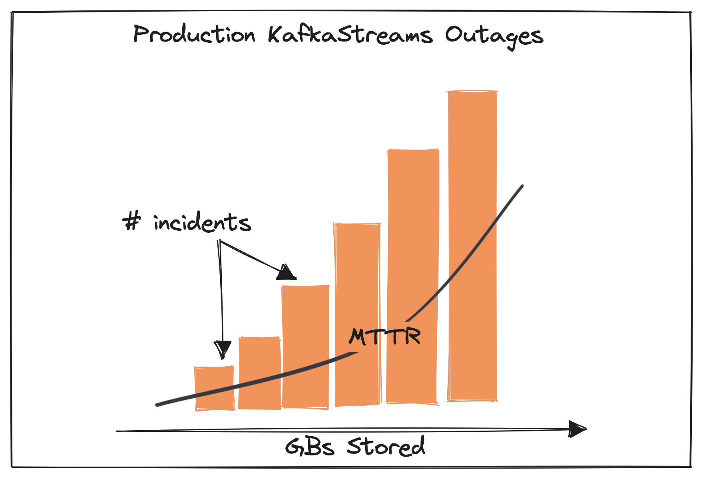
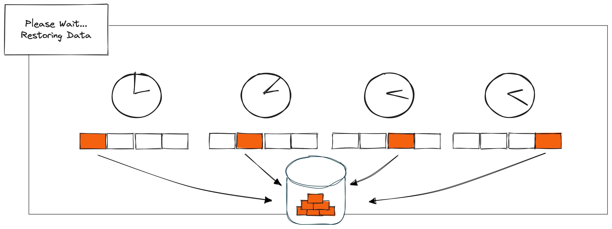
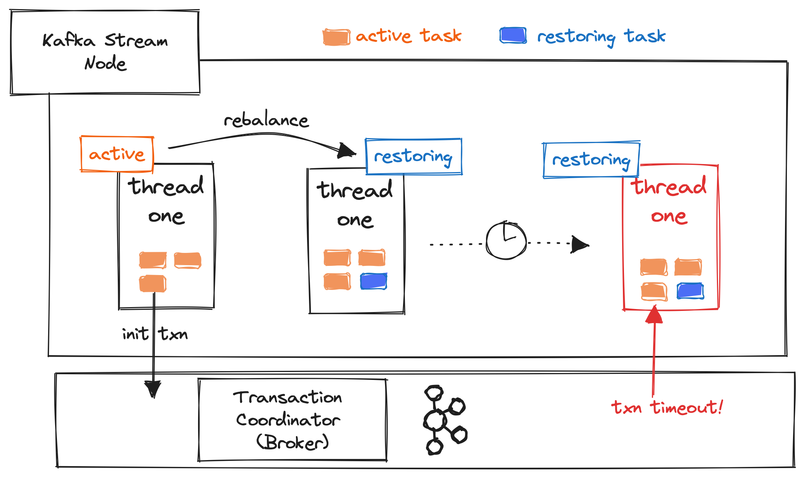
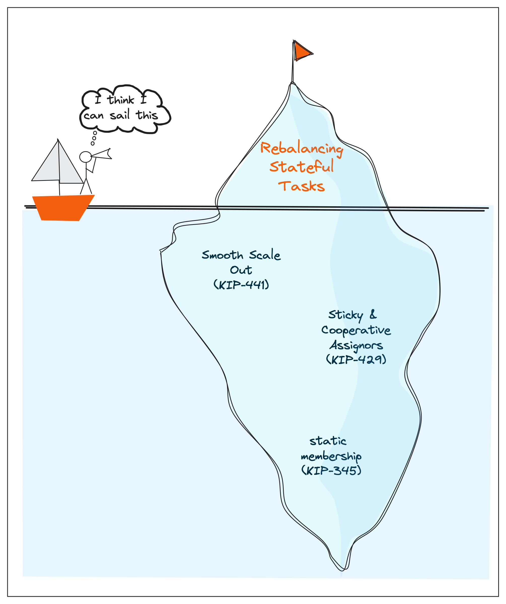
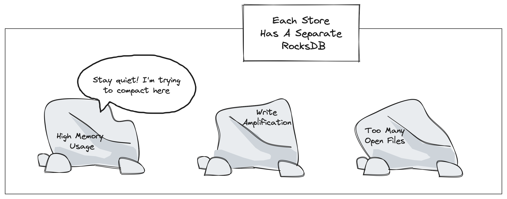

# Don't Panic: The Definitive Guide to Kafka Streams State

*Almog Gavra · October 4, 2023 · 10 min read*

A definitive guide to managing Kafka Streams state that covers some history, architecture concepts and many tips to prevent panic in the face of long restoration and rebalances.

---

*State is hard. Really hard. You just won't believe how vastly, hugely, mind-bogglingly hard it is. I mean, you may think it's a long way down the road to functional programming, but that's just peanuts to state. Listen...* \*

Having spent years at Confluent in charge of operating deployments of Kafka Streams, we’re no strangers to the range of production incidents that can arise. One of the clearest patterns we saw in these incidents was that their frequency and severity was directly correlated with the amount of state, both in overall storage size and in number of state stores:

Stateless applications rarely faced any downtime, while applications that managed terabytes of state would frequently encounter rebalancing storms sometimes paired with extremely long recovery times.

Understanding the root cause for this correlation requires a little detour explaining the history of Kafka Streams. When it first launched back in 2016, Kafka Streams was developed to depend only on the presence of Kafka. This architectural choice made it extremely easy to deploy Kafka Streams as it was “just a library” — unlike other infrastructure, it did not depend on a Hadoop, YARN or Mesos cluster (Kubernetes was just a baby back then).

One downstream effect of this choice is that all state in Kafka Streams is considered transient — it is more akin to a cache backed a persistent changelog topic in the Kafka broker. This effect has three main implications, which are explored in the rest of this post.

## The Hitchhiker's Guide to Improving Restoration

As the backbone for business critical applications, Kafka Streams must provide strong processing semantic guarantees. This means that in order to process an event, the state store must reflect the updates from all previously processed events. The default store implementations are materialized locally and are not replicated to other nodes — instead every write to the local storage is first written to a changelog topic persisted to Kafka and this topic serves as the source of truth and persistence.

When something triggers data recovery (either a node failure, a restart with a corrupted local store, an EOS transaction timeout, a scale-out request or one of the many operations that shuffles partitions) the local state must be discarded and bootstrapped from scratch. This is achieved by reading the changelog from the beginning of time and inserting data into the local storage. Given the physical limitations of sending data across a network and writing to disk, this operation is understandably expensive both in time and resources.

The expensive restoration process is a huge thorn in the operation of Kafka Streams, and one that even seasoned application developers find it difficult to avoid being pricked by.

## Deep Dive Example

While the solution of bootstrapping state from Kafka changelog topics is (in theory) an elegant and simple solution to durability, long-running operations in distributed systems nearly always have unintended consequences. [KAFKA-13295](https://issues.apache.org/jira/browse/KAFKA-13295?jql=project%20%3D%20KAFKA%20AND%20text%20~%20%22timeout%20restore%22%20order%20by%20lastViewed%20DESC) illustrates this phenomenon well. We determined that long restoration times led to applications failing on transaction timeouts, which in turn caused processing to stall on repeated rebalances.

### Primer on Kafka Streams' Threading Model

Understanding this issue requires some background knowledge on how threading in Kafka Streams worked prior to some recent improvements (which we'll describe below). The basic model involves threads and tasks - each thread is assigned a number of tasks, each of which reads from a single partition of one or more topics.

The key thing to know about Kafka Streams threading is that all tasks assigned to a `StreamThread` must complete restoration restoring before any new records are polled from the input topics and actively processed. You can think of a `StreamThread` as having different “phases” — if the thread is in the restoration phase, only tasks that need to be restored will be processed. Once all tasks are done restoring, the thread moves into the “running” phase and will continue actively processing records.

The threading model simplifies the code and works great when restoration is quick, but if restoration takes a long time you can probably guess the consequence: all active tasks assigned to a thread that's restoring state will be blocked, even if there's only one task in need of restoration!

### KAFKA-13295

This is especially bad if one of the tasks has started an EOS transaction, which is the issue reported in [KAFKA-13295](https://issues.apache.org/jira/browse/KAFKA-13295?jql=project%20%3D%20KAFKA%20AND%20text%20~%20%22timeout%20restore%22%20order%20by%20lastViewed%20DESC):

An active task begins processing and initializes a transaction, but before the transaction is committed there is a rebalance which assigns a task in need of restoration. Only active tasks commit transactions, and since restoration can take a long time it is likely that the transaction will timeout (not be committed) triggering another rebalance and potentially causing tasks on this node to shuffle around, starting the vicious cycle all over again.

This phenomena of long restoration foreshadowing a rebalance storm is not specific to applications with transactional producers, the Kafka Streams/Kafka Consumer architecture isn't well optimized for situations where processing of certain partitions is delayed.

## Practical Tips For Surviving Long Restores

*A config is about the most massively useful thing a stateful hitchhiker can have.*

**Prevent Rebalances.** The first strategy to consider is avoiding restores altogether by preventing unnecessary rebalances. There are three helpful configurations for that:

1. `max.poll.interval.ms` introduced with [KIP-62](https://cwiki.apache.org/confluence/display/KAFKA/KIP-62%3A+Allow+consumer+to+send+heartbeats+from+a+background+thread), is the maximum amount of time to process the result of a single call to poll(). You want to tune this value so that it's as large as possible without violating your business requirements — if there's a real error processing the result of the poll, this is the upper bound on how soon a rebalance can be triggered.
1. `heartbeat.interval.ms` and `session.timeout.ms` account for full node failures. These configurations tune how often a background thread sends heartbeats to the broker and the maximum amount of time that the application can go without sending a heartbeat before being evicted from the group respectively. You want to make sure that these values are large enough to handle operations such as restarting a node to prevent unnecessary rebalances.
1. `transaction.timeout.ms` effects how long a transaction can be open but not committed before it's actively aborted by the coordinator. The default here is typically large enough for most environments, so we only recommend tuning it if you frequently observe transactions timing out or have increased the `commit.interval.ms`. The transaction timeout should always be at least as large as the commit interval, though we recommend setting it a bit higher than that to give the `StreamThread` some breathing room to complete transactions within the timeout.

**Reduce the Overhead.** The next set of improvements attempt to hide the overhead of restoration, so if a rebalance does happen it doesn't disrupt normal operations:
1. **Standby Replicas**: a standby replica (configured using [`num.standby.replicas`](https://kafka.apache.org/documentation/#streamsconfigs_num.standby.replicas)) is a replica that is perpetually in restoration mode but does not block processing of active tasks. If a failover happens, the Kafka Streams Partition Assignor will convert the standby to an active and ensure that the only restoration that needs to take place is any lag the standby was experiencing relative to the active task. Standby replicas come with numerous drawbacks — most obviously they (a) multiply the required disk space to run your Kafka Streams application, (b) increase load on your application nodes, (c) rack up cloud costs by multiplying the network utilization from Kafka, (d) increase load on your Kafka brokers and finally (e) contribute to additional complexity in the assignment protocol.
1. **Warmup Replicas**: Warmup replicas differ from Standbys in that they are ephemeral and scheduled “on demand”. These are primarily used for scaling up the number of Kafka Streams nodes so that the newly provisioned resources have time to catch up before taking over ownership of partitions. The primary drawback of warmup replicas is that they complicate the assignment protocol and often leave the application unbalanced. Configuring warmup replicas is a little tricky, but can be done using [`max.warmup.replicas`](https://kafka.apache.org/documentation/#streamsconfigs_max.warmup.replicas) and [`acceptable.recovery.lag`](https://kafka.apache.org/documentation/#streamsconfigs_acceptable.recovery.lag). Note that in order to have high availability both in failure and scaling situations, you must configure both Standby and Warmup replicas; they are not interchangeable.
1. **Moving Restoration to a Dedicated Thread**: one of the more exciting new features that's in preview with Kafka 3.5 is a re-architecture of the threading model to move restoration to a separate thread ([KAFKA-10199](https://issues.apache.org/jira/browse/KAFKA-10199)). This work not only solves the issue in the deep dive above, but also a host of other problems related to restoration blocking active task processing. If you're interested in the details of how this works or how to enable it in your application, refer to [this talk](https://www.slideshare.net/HostedbyConfluent/restoring-restorations-reputation-in-kafka-streams-with-bruno-cadonna-lucas-brutschy) at Kafka Summit.

**Speed Up Rebalances.** Lastly, we have a set of miscellaneous improvements that speed up restores:
1. **Persistent Volumes**: when we operated hundreds of Kafka Streams applications running KSQL in Confluent Cloud, we made sure that all disks were attached to compute nodes using Kubernetes Stateful Sets configured to use PVCs (in AWS this would attach an EBS volume to your node). This means that if the pod had to be replaced, Kubernetes could simply attach the volume to a new pod. This only helps in a narrow, but common, set of scenarios — specifically those that directly replace a node with another or restart a node. Usually a restore is triggered when only a subset of partitions on a node need to move to a new one, which is not helped by using persistent volumes. Note that when EOS is configured, a node failure that is not a clean shutdown will need to restore even when using PVCs since it is considered “corrupted”.
1. **Tuning Restore Consumer Configuration**: Kafka Streams understands that the characteristics of restoration can differ vastly from steady state processing, so it offers the ability to tune your restore and main consumers separately. Any configurations that start with `restore.consumer` and `main.consumer` will affect only the restore and main consumers respectively. There are various documented ways to tune throughput on your consumers, such as increasing [`max.poll.records`](https://kafka.apache.org/documentation/#consumerconfigs_max.poll.records) (which will transitively improve batching when writing to RocksDB), which you can safely apply to your restore consumer without sacrificing end-to-end latency on your main consumer tasks.
1. **Implementing Custom State Stores**: we've talked to and worked with various Kafka Streams users who have embarked down the path of implementing the `StateStore` interfaces for themselves to solve these problems. Some implementations attempt to replace RocksDB with a faster alternative, others use state-shipping approaches where they backup snapshots of the state to S3 and recover the data manually. These custom approaches often require large investments, getting all the details right (such as EOS) is challenging, but promise significant improvements.

## The Rebalance at the End of The Universe

*The Encyclopedia Galactica, in its chapter on rebalances, states that they are far too complicated to operate. The Definitive Guide to the Kafka Streams State has this to say on the subject of rebalances: Avoid, if at all possible.*

Kafka's consumer rebalance protocol was groundbreaking. When it was first released over a decade ago, dynamic task allocation was something only few advanced systems could benefit from but the Kafka client made it simple to dynamically scale applications reading from Kafka, so long as your application was stateless (which many initial ones were).

When Kafka Streams entered the picture, state was suddenly easily accessible in your application. It soon became clear that the default assignment mechanism would not keep up: the presence of an extensive bootstrapping period (see the previous section) makes naively shuffling around partitions impractical.

To bring the rebalance protocol up to speed, Streams developers introduced two sets of improvements: the first aims to make partitions as “sticky” as possible, preventing shuffling of partitions and associated state, and the second attempts to intelligently place standby/warmup tasks (replicas) so that the load is well balanced across the nodes in your application.

In the first category, the introduction of the `StickyAssignor` as a configurable assignor for the Kafka Consumer ensured that partitions were minimally shuffled during a rebalance so that state did not need to move with them. That helped mitigate the after effects of rebalances since consumers would end up with the same partition assignment when it was over, but what about during the rebalances themselves? Until the introduction of the `CooperativeStickyAssignor`, rebalances required every consumer in the group to stop working entirely so they could revoke all of their partitions — even though they would often get the same ones back (it is sticky after all). By providing two-phases of partition migration, this latest improvement allows nodes to keep ownership of partitions that didn't move (see [this excellent blog post](https://www.confluent.io/blog/cooperative-rebalancing-in-kafka-streams-consumer-ksqldb/) by our founding engineer Sophie for a deep dive on this assignor, or [KIP-429](https://cwiki.apache.org/confluence/display/KAFKA/KIP-429%3A+Kafka+Consumer+Incremental+Rebalance+Protocol) if you want to nerd out on the details). Both of these improvements also apply to Kafka Streams; they come out-of-the-box with the required `StreamsPartitionAssignor` and the default `HighAvailabilityTaskAssignor`.

For some users, the risk of any rebalance whatsoever is so high that they opt to effectively disable dynamic rebalancing using static membership. By setting the `group.instance.id` config, Kafka can recognize individual members of the consumer group and hand them the same partition assignment back instead of triggering a rebalance under certain conditions (see [KIP-345](https://cwiki.apache.org/confluence/display/KAFKA/KIP-345%3A+Introduce+static+membership+protocol+to+reduce+consumer+rebalances) for more details on how this works). There are various risks associated with static membership — we don't recommend it in most situations since the rebalance protocol, while sometimes problematic, is essential to Kafka and is relied on for many features such as communicating and synchronizing across members of the group

Squarely in the second category of intelligent task assignment is [KIP-441](https://cwiki.apache.org/confluence/display/KAFKA/KIP-441%3A+Smooth+Scaling+Out+for+Kafka+Streams), which introduced the concepts of probing rebalances and warmup replicas. This KIP allowed the prior owner of that task to keep it even if the assignment is unbalanced until the new owner gets caught up, and then to change ownership after the catch-up phase. Since new owners aren't expected to immediately serve as actives in the cluster, scaling the number of nodes in a cluster can be done without disruption. Note that this does not help the amount of time it takes to scale, the newly provisioned resources will still need to bootstrap before being utilized for active processing.

These changes only scratch the tip of the complexity iceberg that is stateful task rebalancing. If you're interested in more war stories as well as how to tune rebalances, stay tuned — we have a *full blog post planned that deeply explores the rebalance protocol*.

## Life, The Universe And Tuning RocksDB

Not only is tuning RocksDB notoriously difficult (though the wonderful Kafka Streams committers teamed up with one of the founders of RocksDB to [help guide you through it](https://www.confluent.io/blog/how-to-tune-rocksdb-kafka-streams-state-stores-performance/)), but this challenge is compounded when there are multiple instances of RocksDB deployed on a single node - which is typically the case in Kafka Streams topologies as each stateful task will have its own independent RocksDB instance.

When multiple RocksDB instances are running on a single node, they don't (by default) share a cache or write buffer. Since physical memory on your node is constrained (RocksDB and the JVM can't share the same memory), in practice these buffers are either tuned to be relatively small or flushed before they're full to avoid memory pressure. You can tune this using `Options#setWriteBufferSize` when configuring a [`RocksDBConfigSetter`](https://kafka.apache.org/36/javadoc/org/apache/kafka/streams/state/RocksDBConfigSetter.html) in Kafka Streams.

We learned the hard way (in production) that this invalidates one of RocksDB's fundamental performance assumptions: that random writes can be effectively batched and written to disk in predictably sized chunks, called SSTables. If SSTables are flushed to disk too early, you'll get increased write amplification, more compaction, and poor cache coherency.

These set of problems, unfortunately, are intrinsically tied to the architecture of Kafka Streams and RocksDB — we never discovered any good workarounds during our time at Confluent operating such clusters in production. We can, however, leave you with some rules of thumb to avoid running into issues:

1. **Limit Number of State Stores**: Try to keep the number of state stores on a single node under 30. Anecdotally, we determined that 20-30 is the magic range of states stores you can have on a single Kafka Streams application before you start seeing unpredictable behavior, and anywhere north of 50 is asking for trouble (we ran with m5.xlarge instances and EBS in AWS). *Note that this means if you have 16 input partitions and multiple sub-topologies, you should be scaling out!*
1. **Reserve Memory for RocksDB**: The following number can fluctuate, but a good starting point is to size your cluster such that you reserve at least 25% of available memory for RocksDB. If you notice memory pressure from RocksDB (one or more of these metrics is high: `size-all-mem-tables`, `block-cache-usage`, `block-cache-pinned-usage`, `estimate-table-readers-mem`) and your JVM memory is under-utilized, or vice versa, then you can consider shifting this balance around. For more information on how we came to that number, read (this blog)[https://www.confluent.io/blog/bounding-ksqldb-memory-usage/] written by our co-founder Rohan during his time at Confluent.
1. **Use Jemalloc**: Believe it or not, RocksDB cache can interact poorly with glibc, the default memory allocator on Linux! Instead, we recommend you to use jemalloc. Figuring this out was quite the journey and is also covered by Rohan's blog post linked above.

The takeaway here is that there's just as much art as there is science in operating a stateful service, and pairing that state with compute makes the balancing act much more delicate. Most application developers don't want to reason about these considerations; that's why we built Responsive to separate these concerns and manages the more difficult half of the equation — the stateful half — for you.

## So Long and Thanks for All the State

*In the beginning, State and Compute were coupled. This has made a lot of people very angry and been widely regarded as a bad move.*

At Responsive, we think the best way to solve all these problems is by removing RocksDB from the equation altogether.
The [Responsive SDK](https://www.responsive.dev/sdk) allows you to use databases like MongoDB and Cassandra for your state stores without
sacrificing throughput or correctness thanks to innovations like
[async processing](../async-processing-for-kafka-streams/index.md). The SDK is a downloadable library extension you can add
directly to your applications. Our [quickstart](https://docs.responsive.dev/sdk/quickstart) will get you using MongoDB
with your Kafka Streams app in 5 minutes.

Separating storage from compute is a time tested technique for making the operations of stateful distributed systems
tractable — Kafka Streams is no different. In the Kafka Stream context it removes the need for state restoration,
which in turn makes rebalances cheap, simpler and more robust.

Further, separating storage from compute makes scaling compute nodes instant, which improves application availability
and lowers costs. There is no need to over-provision compute to handle peak traffic if you can scale to handle traffic
bursts instantly! The [Responsive Control Plane](https://www.responsive.dev/control-plane) leverages this trait to deliver instant autoscaling for
Kafka Streams applications.

If you have questions about Kafka Streams state you can chat with me (yup, I'll respond to your ping) or the rest of the team on our [Discord](http://discord.gg/jEk8JvjJrg).

*So you made it to the end and were wondering what the italicized quotes were all about? Go read the [Hitchhiker's Guide to the Galaxy](https://www.goodreads.com/book/show/11.The_Hitchhiker_s_Guide_to_the_Galaxy)!
