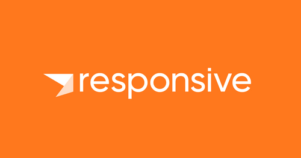
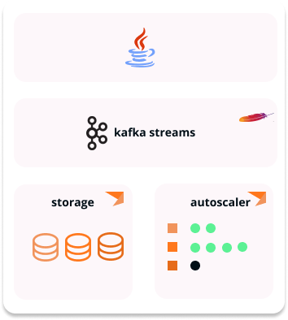
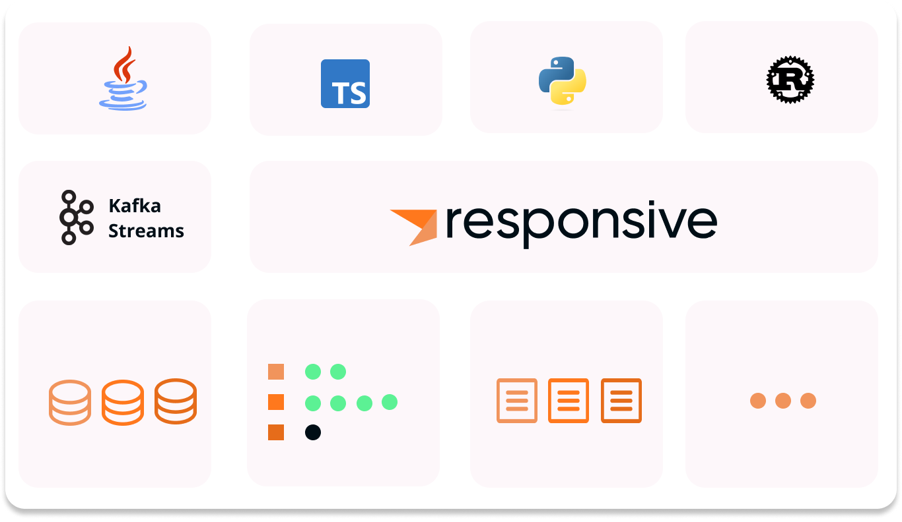

# Introducing Responsive

*Apurva Mehta · September 20, 2023 · 5 min read*

Introducing our new company, Responsive



---

I’m excited to announce that [myself](https://www.linkedin.com/in/apurvarmehta/), my
co-founders [Almog Gavra](https://www.linkedin.com/in/agavra/) and [Rohan Desai](https://www.linkedin.com/in/rohanpd/),
and founding engineer [Sophie Blee-Goldman](https://www.linkedin.com/in/ableegoldman/) have formed a startup called
Responsive. Our mission is to enable developers to build and operate reactive real-time applications at scale.

There’s a lot to unpack, so let’s start at the very beginning: what do we mean by reactive applications and why are we
so excited about them? We will then talk about how our young company intends to fulfill our mission.

## Reactive applications and why we love them

A reactive application is one that employs a programming model centered around functions and their triggers. These are
basic building blocks that can be composed infinitely to build sophisticated low-latency programs.

> A reactive application is one that employs a programming model centered around functions and their triggers

The reactive model is dominant in frontend programming. Events like ‘clicks’ trigger chains of functions that result in
updates to the user interface. Latency must be low and a single event can trigger many actions like database updates,
backend service calls, etc. This behavior is perfectly modeled by functions and triggers.

Reactive backend programs have been less common until recently. First, Apache Kafka’s rise as the de facto event
streaming platform means that events are now available to backend developers. Second, developers can write reactive
applications that respond to events thanks to libraries
like [Kafka Streams](https://kafka.apache.org/documentation/streams/), which provide high-level event processing APIs.

While running the stream processing organization for the last several years at Confluent, I had a front row seat from
which to experience Kafka Streams’ growing popularity. I saw companies
like [Salesforce](https://engineering.salesforce.com/real-time-einstein-insights-using-kafka-streams-ca94008c2c6f/) use
Kafka Streams to score and rank emails to boost sales
efficiency, [Deutsche Bahn](https://www.infoq.com/news/2020/01/kafka-event-stream-deutsche-bahn/?utm_source=devglan) use
it to make real time announcements of train
arrivals, [Walmart](https://www.slideshare.net/ConfluentInc/kafka-streams-at-scale-deepak-goyal-walmart-labs-kafka-summit-london-2019)
use it to make real time recommendations and detect fraud during checkout
flows, [BlackRock](https://engineering.blackrock.com/delivering-eventual-consistency-with-kafka-streams-c013a217b9b9)
use it to power their liquidity management solutions, and many many more.

My experience convinced me that reactive applications like those listed above are the best way to architect systems that
deliver sophisticated and low latency responses to business events.

What's more, I'm confident that there's tremendous opportunity to deliver APIs specifically designed for Reactive
applications in more languages, and in a form that’s far easier to operate. And so we formed Responsive to do just that.
We intend to make Responsive the best way for developers to write and run reactive real-time applications in
organizations of every size and scale.

> There's tremendous opportunity to deliver APIs specifically designed for Reactive applications in more languages, and
> in a form that’s far easier to operate. **And so we formed Responsive to do just that**.

With the stage set, let’s jump into more detail on what we are building at Responsive.

## Phase 1: Managed, cloud native, modern Kafka Streams

Given the popularity of Kafka Streams for reactive backends, our first goal is to improve the lives of Kafka Streams
developers building and operating those reactive applications. So, we spent time understanding what they love about
Kafka Streams, and what their biggest pains are. Here is what we found.

Developers love Kafka Streams for its powerful APIs, rich feature set, and—arguably most importantly—because it ships as
a library.

> Developers love Kafka Streams for its powerful APIs, rich feature set, and—arguably most importantly—because it ships
> as a library.

Since Kafka Streams is a library, you don’t need to sacrifice any of your build, test, deployment, observability, or
other tooling. You don’t need to depend on a platform team running a shared compute cluster. And your Kafka Streams apps
run in the same environment as your other apps, enabling transparent interoperability. This flexibility is one of the
most beloved features of Kafka Streams.

By the same token, by being only a library, you, the app developer, are responsible for solving all the problems of
running a distributed stateful application. You have to worry about state management, application sizing, debugging
complex distributed protocols, and more. If you have had to fix infinite rebalance loops or have been caught out by an
interminable state restore, you know what we are talking about. In fact, this class of issues have consistently been
cited as the biggest hindrance to further adoption of Kafka Streams in almost all the organizations we spoke to.

Is there a way for the Kafka Streams developer to have their cake and eat it too?

As of today, the answer is: yes! Thanks to Responsive for Kafka Streams, you get kubernetes-native, instantly
autoscaling Kafka Streams apps that run in your environment without changes to your application code. We offer fully
managed storage and control plane services that allow you to forget about operations and focus exclusively on building
your application using the tools you love. Say goodbye to infinite rebalances and interminable state restores. Say hello
to cloud native, instantly elastic, Kafka Streams!



Responsive brings storage and control plane services to the Kafka Streams apps running in your environment to bring
instant, intelligent, autoscaling. Cloud-native Kafka Streams, here we come!

Responsive plugs into Open Source Kafka Streams using public APIs, so you can switch your app to Responsive
in [minutes](https://docs.responsive.dev/sdk/quickstart). All it takes is:

```diff
-   KafkaStreams streams = new KafkaStreams(
+   KafkaStreams streams = new ResponsiveKafkaStreams(
      builder.build(),
      props
    );
```

Our first customers are already moving their mission critical production Kafka Streams apps to Responsive, and we are
looking forward to onboarding many more over the coming months. We are very excited to see where the Kafka Streams
community goes with the power of Responsive behind it!

## Phase 2: Reactive Backends for Everyone

Kafka Streams is an enduring technology that we love and will continue to invest in. That said, there is space for a new
clean-slate event processing runtime for multiple reasons:

1. There is demand for a Kafka Streams-like API in many languages, but this is hard to do from a JVM-based technology
like Kafka Streams.
2. There is room to simplify the APIs and optimize them for reactive applications; many of the large adopters of Kafka
Streams we spoke to have built abstraction layers on top of it to simplify application development.
3. We want to push the envelope on runtime characteristics and semantics. For instance, making high latency external
calls in response to an event is not cleanly modeled in Kafka Streams, but is fairly popular in reactive
applications.

To offer these features and more, we intend to introduce an alternate runtime that integrates with the same Responsive
Platform, finally bringing rich reactive APIs to non Java ecosystems.



In the future, our Responsive runtime will sit alongside Kafka Streams and run on the Responsive Platform to deliver
rich reactive APIs and services for all backend application developers.

We are looking to engage with design partners interested in writing reactive backend programs in non-Java languages. If
you want to partner with us on our new runtime, consider [joining our waitlist.](https://www.responsive.dev/sign-up-for-responsive-beta)

We’re just getting started
--------------------------

We are thrilled to be on our way to realizing our mission of enabling every developer to build and operate reactive
real-time applications at scale.

Over the coming weeks, we will dive into details about the problems we are solving with the Responsive platform over a
three-part blog series.

In the mean time, consider [joining our waitlist](https://www.responsive.dev/sign-up-for-responsive-beta) or drop me a line
at [apurva@responsive.dev](mailto:apurva@responsive.dev) if you want to try Responsive and improve the availability,
reliability, and manageability of your Kafka Streams applications. As mentioned earlier, it only takes minutes to move!
