# Kafka Streams and Rebalancing Through the Ages

*Sophie Blee-Goldman · November 30, 2023 · 30 min read*

A history lesson on how the rebalance protocol in Apache Kafka has evolved over the years, and why. Distributed systems enthusiasts will love this. 


---

In our previous blog post “[Defense Against the Dart Art of
Rebalancing](https://www.responsive.dev/blog/guide-to-kafka-streams-rebalancing)”,
we started with a deep dive on the fundamentals of the consumer group
rebalancing protocol before dishing out some practical defense lessons against
the all-too-common rebalancing issues. Now it’s time to put away your wands and
dust off your textbooks for a history lesson on some of the key developments to
rebalancing throughout the ages.

> We highly recommend reading the [previous blog post](https://www.responsive.dev/blog/guide-to-kafka-streams-rebalancing) in
> the rebalancing series if you need a primer (or refresher) course on the
> subject of rebalancing before you read this. If you’re just looking to fill
> in your background knowledge then you can skim over the “Incident 911”
> sections to save time, as they are focused on specific advice for debugging
> problematic rebalances

# Rebalancing through the Ages

If you’ve ever worked at all with the Apache Kafka consumer client or written
an application with Kafka Streams, you’re probably familiar with the concept of
consumer groups and have heard of the famous (if not infamous) rebalancing
protocol. It’s been around for so long that it’s difficult to imagine Kafka
without it. You might even be wondering if there was ever even a time before
rebalancing to begin with. Did it look anything like it does today? How has it
evolved over time, and why? And where might it go from here?

This blog post has all the answers to these questions and more, so whether
you’re a history nerd or a Kafka nerd (or any other kind of nerd), read on for
a slightly different look at a common topic (no pun intended). And relax: this
history lesson doesn’t come with a final exam.

## Before the Big Bang

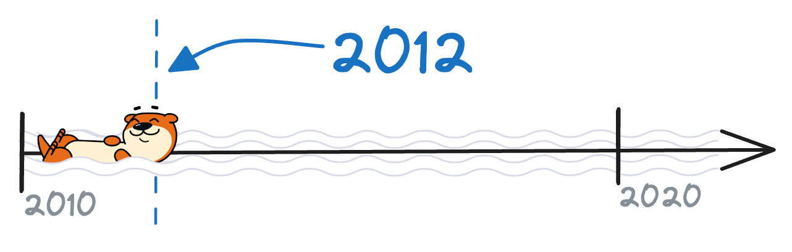

Let’s jump right in! We can answer the first question right away: rebalancing
has been around since the advent of the consumer group. A quick search for
[JIRA tickets with the term
“rebalance”](https://issues.apache.org/jira/browse/KAFKA-479?jql=project%20%3D%20KAFKA%20AND%20text%20~%20rebalance%20AND%20created%20%3E%3D%202010-11-01%20AND%20created%20%3C%3D%202012-11-01%20ORDER%20BY%20created%20DESC)
shows issues dating all the way back to the very first official version, 0.7.0.
In fact, the very first hit is from 2012, so the fossil record proves this
protocol is currently over a decade old.

Rebalancing is such an integral part of Kafka consumer groups that it’s easy to take for granted how revolutionary it was back then: here you have a protocol that gives applications fault tolerance, load distribution, elasticity — all the essentials of a distributed system. At the same time, it took care of the hard parts that used to be considered the client’s problem, such as fencing zombies, detecting liveness, and dynamically balancing read work — or should I say, “re”-balancing.

All this tremendously improved the value prop of Kafka, and played a role in
its immediate success in the early days. Users no longer had to struggle with
low-level networking details or worry about synchronization across servers and
threads. Everything was reduced to a handful of generally straightforward
consumer client methods. For the most part, all you had to do was poll the
consumer for new records, and the consumer group protocol would take care of
the rest!

Right out of the gate, the rebalancing protocol lead consumer groups far. But
as a critical component of a relatively new system that was rapidly evolving,
it didn’t take long for a major redesign to be proposed. The first few years of
rebalancing proved one thing: the protocol needed to be centralized. In the
first iteration of rebalancing, there was no group coordinator, and it was
really up to the group to synchronize itself and work out a partition
assignment that everyone could agree on. It would actually run a distributed
assignment algorithm and hope that everyone reached the same decision. This
lead to the obvious-in-hindsight split-brain problems that tend to haunt any
distributed algorithms without external coordination, and rebalances would
often fail. At the same time, some users wanted to have control over the way
partitions were assigned to consumer instances, instead of relying on automatic
rebalancing. If you’re interested in reading up on all the issues with the
original protocol in all their gory glory, archeologists have carefully
preserved [these ancient texts](https://cwiki.apache.org/confluence/display/KAFKA/Consumer+Client+Re-Design)
for people like you.

Clearly, something had to be done about consumer group rebalances. The solution
turned out to be an extensive overhaul of the consumer group protocol and is
ultimately what lead Kafka into the modern era, to the form that most people
would recognize it as today.

## The Modern Era

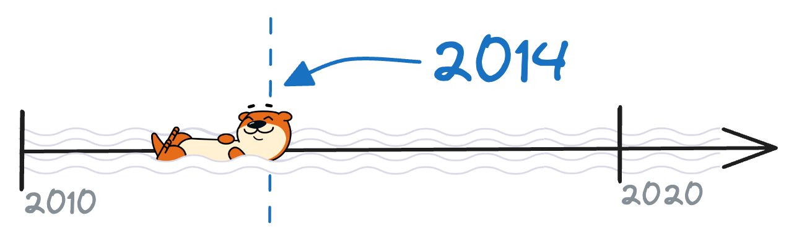

It all started with the client rewrite: in truly ancient times, the consumer
and producer client that most people are familiar with did not exist. But by
0.7.0 we had Java-based producer and consumer clients (though admittedly, they
still had a long way to go), and we were ready to tackle the rebalancing
problems head-on. It’s these clients that really ushered in the modern-day
Apache Kafka, and in particular, the modern rebalancing protocol.

The most fundamental change was the introduction of the group coordinator,
which those who read our previous blog post will remember well. The brokers had
all the synchronization tools already available, so rather than have individual
consumers try and hash things out with each other, a single broker would be
randomly selected to act as the coordinator for each consumer group. From this
one single change, we got many of the features and protocols that still define
Kafka today: the two-phase rebalancing procedure with distinct JoinGroup and
SyncGroup phases, customizable partition assignment, and manual offset
management.

By 0.9.0, not only did we have the
[GroupCoordinator](https://github.com/apache/kafka/blob/0.9.0/core/src/main/scala/kafka/coordinator/GroupCoordinator.scala),
but also the
[ConsumerPartitionAssignor](https://github.com/apache/kafka/blob/0.9.0/clients/src/main/java/org/apache/kafka/clients/consumer/internals/PartitionAssignor.java)
(originally just named “PartitionAssignor”) and the
[ConsumerRebalanceListener](https://github.com/apache/kafka/blob/0.9.0/core/src/main/scala/kafka/javaapi/consumer/ConsumerRebalanceListener.java),
making it easy for anyone to hook into the rebalancing protocol and customize
it to their needs just by implementing an interface, callback, or assignment
algorithm. The partition assignor was of particular note, and the desire to
have this be customizable by application developers meant keeping the
assignment on the client side. Rather than solve the distributed assignment
problem by pushing the assignor into the brokers, another new concept was
introduced: the “group leader”. Like the group coordinator, this was nothing
more than an arbitrarily-selected node that could make decisions on behalf of
the group, although whereas the group coordinator was a broker, the group
leader was just one of the members of the consumer group. By using the group
coordinator to elect a group leader for each individual rebalance, we could
vastly simplify the assignment logic into something that was not just
customizable, but very neatly so. Developers could just focus on the partition
distribution algorithm and rely on the group leader selection to ensure that
the assignment was performed only once per rebalance. It was a graceful
solution that in many ways reflects on the beauty of Kafka itself: providing
rich apis and protocols to write powerful apps by solving the hard parts
centrally.

This generation of the rebalancing protocol took us all the way from 2014 to
2023. That’s a pretty good run — almost a full decade! And it will continue to
live on for a bit longer in at least some form, but recently, it’s begun to
start thinking about its retirement. As much as the rebalancing protocol has
done for Kafka and its users, there is always room for improvement. And the
world has changed since 2014, a lot: it’s no surprise that what may have worked
well in the days of on-prem servers is not perfectly suited for a world that’s
migrated to cloud environments. And so, we’re just now seeing the modern
rebalancing protocol begin to step aside and make way for the next generation.


## The Future is Now

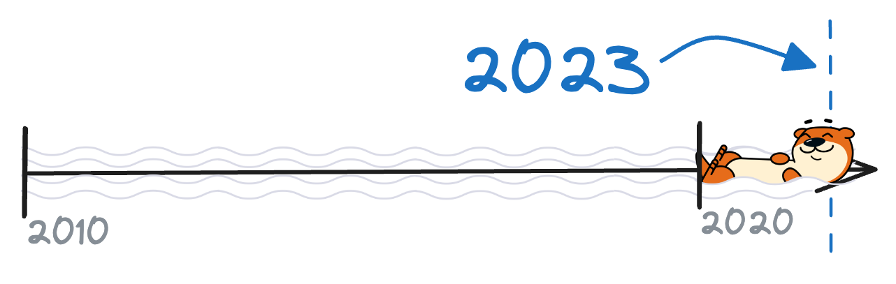

If you’ve been paying attention to the Kafka dev community or attended a recent
Kafka Summit, odds are you’ve heard about [KIP-848: The Next Generation of the
Consumer Rebalance
Protocol](https://cwiki.apache.org/confluence/display/KAFKA/KIP-848%3A+The+Next+Generation+of+the+Consumer+Rebalance+Protocol).
As the name suggests, this KIP is all about taking the next step in the
evolution of rebalancing to bring the protocol into the future. It’s a huge
project that I’ll leave to the authors to describe in detail, but it’s worth
taking a peek at what’s to come to round out our history of the consumer group.
Of course, we can’t really talk about the “next generation” without defining
the current generation. Let’s actually step all the way back to the beginning
and sketch out the discrete generations of rebalancing.

At first, we had the herd-mentality generation characterized by distributed
assignment algorithms. Ironically, despite this being the least centralized
form of the protocol with the most client-side coordination, it was actually
the least customizable state of the consumer client, with little flexibility
over the logic that lived in the client.

In contrast, the modern generation of rebalancing began the move towards
centralization by pushing most of the group coordination server-side, into the
new group coordinator. Yet at the same time, new consumer APIs made it possible
to customize the partition assignment logic, which was kept on the client side
for this exact reason.

Which brings us to the next generation, and the future of rebalancing. Although
the group leader went a long way towards simplifying the previous rebalancing
protocol, there was still a degree of split brain present in the consumer group
management. The server-side group coordinator was responsible for ensuring
liveness, fencing zombies, and triggering rebalances after changes in group
membership. But the partition assignment and some other rebalancing triggers
were still up to the client. As anyone who has ever tried to debug a cycle of
rebalancing will tell you, it can be a nightmare to try and unravel the full
story of the consumer group, and next to impossible if you only have the server
logs and not those of the client application. In addition, the client-side
logic was getting incredibly complicated: clients could act independently but
still had to come together for each rebalance to get an assignment from the
group leader, and rebalances had to be split up into more and more phases, from
the JoinGroup and SyncGroup to the double rebalances of the incremental
cooperative protocol (more on this later).

In the end, the best way to reduce the complexity of the rebalancing protocol
was to finally move the partition assignment all the way out of the client and
into the brokers. This is more than just lifting the ConsumerPartitionAssignor
interface into the core Kafka code, of course: with the next-gen rebalancing
protocol, the group coordinator is finally fully aware of the assignment and in
control of the group, which frees up its members to act truly independently and
actually resolve their partition assignment without dragging the entire group
into a rebalance. It’s a big leap, but it should feel like the natural
successor to the modern generation of rebalancing, and it’s been a long time
coming!

If you’re excited to hear more about what’s coming or wondering how it’s being
implemented, check out **[Apache Kafka's Next-Gen Rebalance Protocol: Towards
More Stable and Scalable Consumer
Groups](https://www.confluent.io/events/current/2023/apache-kafkas-next-gen-rebalance-protocol-towards-more-stable-and-scalable/)**,
a talk from Current 2023 by one of the main authors of the new protocol. And
those of you with consumer client applications can look forward to seeing it in
action very soon!

# A Brief History of Kafka Streams

Some of you might be thinking, “But wait: what about Kafka Streams?” So far
we’ve really only focused on the plain consumer client. And of course, Kafka
Streams is really just a consumer group at its heart. But it’s an extra fancy
one, one that stretched the rebalancing protocol to its limits since day one
and has driven many of the rebalancing changes over the years. So let’s rewind
the clock back to 2015: the year that Kafka Streams was officially introduced.
Streams made its first appearance back in version 0.10.0, and with it came a
whole set of drastically different runtime characteristics, semantic
constraints, and performance needs. This kicked off a series of increasingly
complex improvements to the way in which rebalances are handled — and used — by
Kafka Streams.

We’re going to step through each of the major improvements and examine what
they were trying to fix, how the protocol was changed, what benefit we got from
it — and what we may have sacrificed for it.

### Improvement 0: the StreamsPartitionAssignor

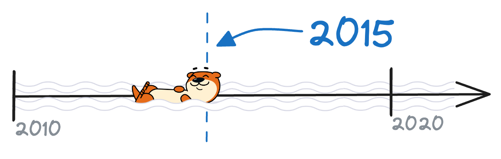

*Problem: Streams is ~~special~~ stateful*

Kafka Streams (can be) massively stateful: this makes pretty much all aspects
of rebalancing more difficult, as discussed in the earlier blog post **[Don't
Panic: The Definitive Guide to Kafka Streams
State](https://www.responsive.dev/blog/guide-to-kafka-streams-state)**. The
rebalancing procedures all take longer, since even basic things like partition
revocation/initialization have higher latency when state gets involved: for
example, we now need to flush the local state store and write a checkpoint file
for each task that’s closed due to the corresponding partition being revoked.
On the other end, a newly-assigned partition might take a long time to start up
if it has to restore from the changelog topic to rebuild state. Obviously, all
of these effects built up and scale with the total number of partitions that
are handed off between consumers each rebalance. This hints at the real killer
of introducing statefulness to the rebalancing protocol: partition-to-consumer
affinity.

Remember, before Kafka Streams came along, the partition assignor could treat
all consumers equally. Its job was to come up with the most balanced possible
assignment, which it did over and over again for every rebalance, without ever
considering the assignment it had come up with during the last one. But
suddenly the mere act of moving a partition from one consumer to another can
mean having to copy the full contents of a changelog topic into the consumer’s
local state directory. It immediately became obvious that the carefree attitude
of Kafka’s existing assignors wasn’t going to work out for Kafka Streams.
Clearly, in the same way that Streams needed to manually control how offsets
are committed, it would need to manually control how partitions are assigned.

And so, Streams jumped on the advent of the original client-side assignment
protocol and introduced the **StreamsPartitionAssignor** — although back in the
day, when it was first added in [PR
#353](https://github.com/apache/kafka/pull/353), it was called the
“KafkaStreamingPartitionAssignor” (you can see why we shortened it!)

### Improvement 1: sticky task assignment

*Problem: don’t want task migration to disrupt processing*

But wait…just adding our own partition assignor was only the first step. What
about that partition-to-consumer affinity? What can we actually do with our
custom assignor to address this, and avoid — or at least minimize — the amount
of downtime after a rebalance due to the restoration of changelog state?

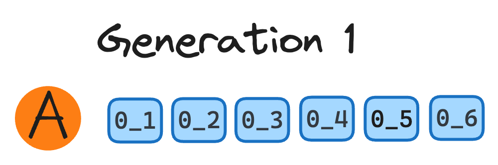

Let’s start with a concrete example. Imagine an application with a single
subtopology, which performs some stateful operation on an input topic with 6
partitions for 6 stateful tasks overall. If we start out with just a single
consumer A and then spin up a second consumer B, 3 of the tasks will be
“migrated”, ie reassigned from consumer A to consumer B. And since consumer B
is completely new, it doesn’t have any state stores yet and will have to build
up state from the changelog for each of its assigned tasks before it can start
processing. But that’s ok for now — that kind of downtime is just unavoidable
for a newly-started consumer (or is it?).

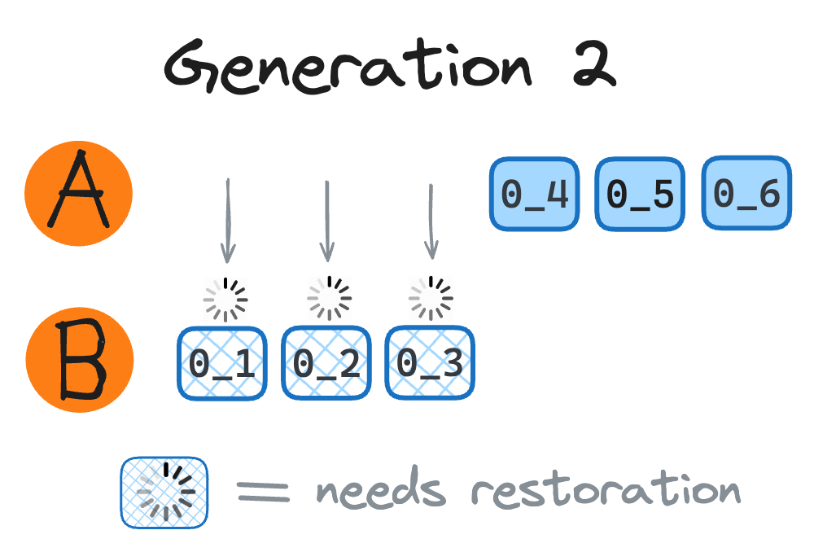

So now we have three tasks assigned to each consumer. Let’s say consumer B has
tasks `0_1`, `0_2`, and `0_3`, and A has `0_4`, `0_5`, and `0_6`

Now imagine you want to keep scaling out to meet a spike in load, so you spin
up consumer C. With the default RangeAssignor strategy, the only focus is on
making sure each consumer gets an equal share of the partitions, so you could
end up with an assignment like this:

```java
// previous assignment:
consumer A: 0_4, 0_5, 0_6
consumer B: 0_1, 0_2, 0_3

// current assignment:
consumer A: 0_5, 0_6
consumer B: 0_3, 0_4
consumer C: 0_1, 0_2
```

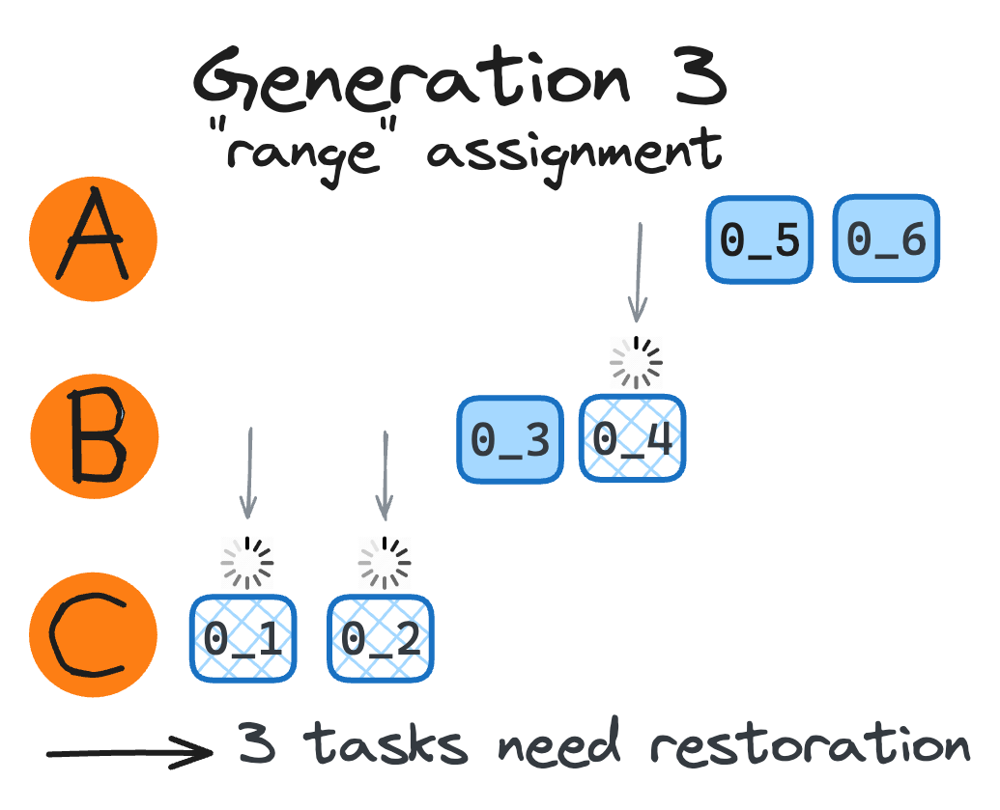

Notice task `0_4` used to be on consumer A and now is suddenly owned by
consumer B! Sometimes partition migration is just unavoidable, but that’s not
the case here — the assignor could still meet the balance constraints without
causing consumer B any restoration downtime by switching tasks `0_4` and `0_1`
in the new assignment.

This might not seem that bad, but anyone who has run a truly large stateful
Kafka Streams application will know that even one unnecessary restoration can
mean hours of downtime when rebuilding from the very beginning of the
changelog. So it’s critical for the assignor to pay attention to who already
owns which tasks, and who would need to wait for that task to build up state.
In other words, the assignor should try and make the assignment “sticky” — to
minimize the number of partitions that are moved from one consumer to another
during a rebalance.

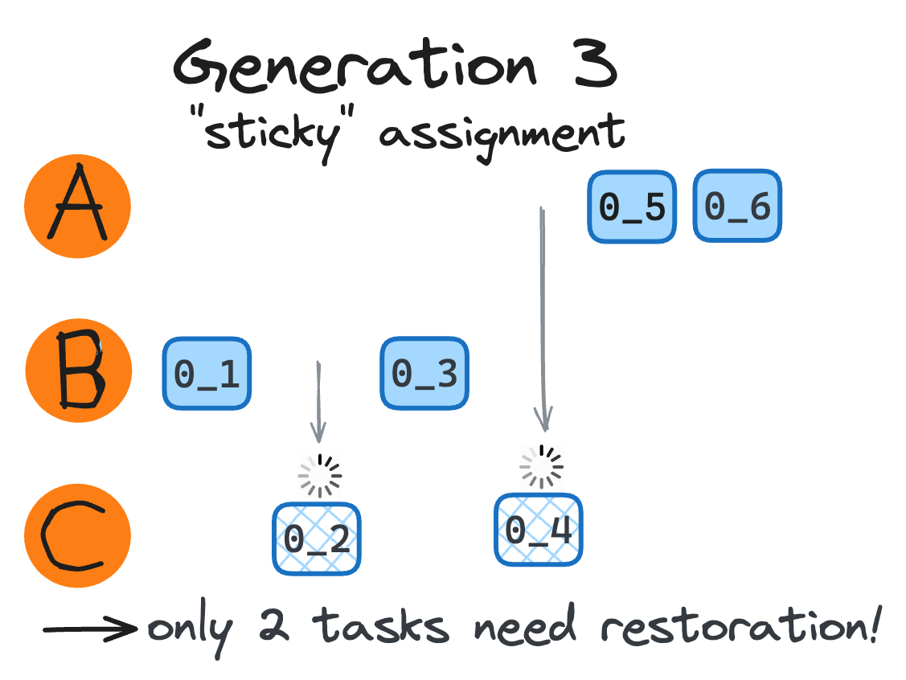

And thus sticky task assignment came to Kafka Streams. While the update may
sound small, it involved a lot more than just an algorithm change. In fact, the
[original PR](https://github.com/apache/kafka/pull/497) is almost 1,500 lines
of code! This comes down to another major change in the
StreamsPartitionAssignor: the addition of custom Subscription userdata.

To perform a sticky assignment, the assignor needed to know: sticky with
respect to *what*? Since the assignment is a purely client-side protocol ([or
at least it was back
then](https://cwiki.apache.org/confluence/display/KAFKA/KIP-848%3A+The+Next+Generation+of+the+Consumer+Rebalance+Protocol)),
it’s not like the mapping of partitions to consumers is persisted anywhere,
much less supplied to the assignor by a broker like the group coordinator. It
was up to Streams to make sure this information made it into the input of the
assignment algorithm. And so, we began to have each StreamThread provide some
additional metadata to the Subscription its consumer would send to the
assignor. This “userdata” would grow over time and go on to form the backbone
of essential Kafka Streams features, but in its very first iteration, it
included just three fields: a “client UUID” to identify StreamThreads running
in the same process, the set of previously-assigned tasks, and any other tasks
for which there was some state found on disk. This was before the addition of
standby tasks, so normally, during steady-state the last two fields would be
the same and generally only the “previously assigned tasks” set needed to be
considered. However, the previous task assignment was (a) only kept in memory,
and (b) only reflected the most recent assignment. So the “tasks found on disk”
metadata was essential for maintaining stickiness in more turbulent times, such
as following a single node bounce or after recurring rebalances due to rolling
upgrades.

Folks with keen eyes might notice that the original StreamsPartitionAssignor
was added on [Oct 26, 2015](https://github.com/apache/kafka/pull/353) and the
sticky assignment fix went in on [Nov 11,
2015](https://github.com/apache/kafka/pull/497) — just two weeks later! This
just goes to show how critical stickiness is to the success of the
StreamsPartitionAssignor, and really, to Kafka Streams itself!

Interestingly, not too long after Kafka Streams implemented a sticky task
assignment,
[KIP-54](https://cwiki.apache.org/confluence/display/KAFKA/KIP-54+-+Sticky+Partition+Assignment+Strategy)
came along proposing a new kind of assignor for the plain consumer client: a
sticky one. Within about a year and a half, there was a StickyAssignor of the
consumer client’s very own.

### Improvement 2: standby tasks

*Problem: don’t want failures/outages to disrupt processing:*

The next major milestone in the development of Kafka Streams came in quick
succession. In fact, [PR #526](https://github.com/apache/kafka/pull/526) was
merged only a few days after the sticky task assignment was (and by the same
person — those were busy times!) By Nov 16, 2015, we saw the introduction of
standby replicas, more commonly known as **standby tasks.**

These days, standbys are so commonly known and talked about that for many, it’s
difficult to imagine Kafka Streams without them. And for good reason: Kafka
Streams without standby tasks is like driving a car without an airbag: highly
recommended against (although only one of those is actually illegal — for now!)
But seriously, standby tasks *are* critical to any stateful Kafka Streams
application. For this reason, almost anyone will tell you to enable them for
your production environment (which perhaps begs the question of why they are
still disabled by default).

Unlike many kinds of distributed systems where state replicas are the source of
fault tolerance, standby replicas in Kafka Streams are actually more like local
caches. The changelog is the one bringing fault tolerance to the picnic,
providing a source-of-truth copy of everything in a state store that can be
consumed to restore that state store in the event of a hard crash with loss of
the persistent volume. But standby replicas bring the high availability — just
because you *can* restore the local state directory from the changelog doesn’t
mean you *want* to! Whether you have a disk failure or simply want to scale
down your cluster and need somewhere to reassign those active tasks, standby
replicas are there to save the day: that is, to save your wallet from changelog
consumption costs and save your SLA from processing downtime.

Of course, standby replicas are only as helpful as their ability to be
converted into active tasks. The more standby replicas you configure for your
app, the better the odds of a displaced active task finding its new home on a
standby host. In the end, you have to balance the cost of a
restore-from-scratch scenario with the cost of adding more standbys. The
standby cost is generally a simple question of resource consumption, and sure,
no one wants to pay more to host a copy of state that might never even get
used!

But the restore-from-scratch might cost you more than a few bucks if it leads to a breach in your core business or an SLA violation, so think carefully about how much you’re willing to risk.

### Improvement 3: poll duration

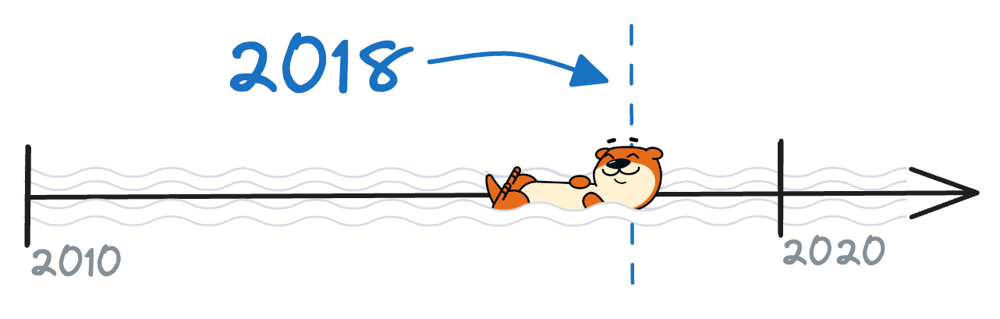

*Problem: Don’t want metadata updates to disrupt processing:*

With sticky task assignment and standby replicas in place, we basically have
the major backbone of Streams rebalancing in place, and it’s time to fast
forward a few years to get into some of the more recent history. But before we
jump into the major features that really brought consumer group rebalancing
into the cloud era, let’s make a quick stop in 2018 to touch on a lesser-known
fix that rarely gets a mention alongside the famous rebalancing improvements
but is no less important. One that was in fact a stepping stone towards truly
seamless rebalances: [KIP-266: Fix consumer indefinite blocking
behavior](https://cwiki.apache.org/confluence/display/KAFKA/KIP-266%3A+Fix+consumer+indefinite+blocking+behavior).

You may be wondering what could possibly be interesting about what sounds like
a basic fix for an issue with hanging APIs. And it’s true, this improvement of
humble origins is hardly a sexy feature like sticky task assignment or
cooperative rebalancing (spoiler alert!) — but it laid the groundwork for
modern rebalancing nonetheless. Yet it also undeniably led to some cracks in
the facade, and we’ve had to reckon with it repeatedly even years later. So
what exactly is this change in behavior?

Before KIP-266, the consumer could block indefinitely inside #poll while
updating its metadata to stay in the group. The fix was simple in theory:
enforce the timeout that could previously be exceeded, for example during a
long rebalance. The whole point of KIP-266 was to make sure *all* the consumer
APIs respected their various timeouts, so why should #poll be any different?

Only, #poll *is* different: unlike other methods of the consumer, poll had an
additional responsibility besides just the request itself: rebalancing. As
those who read [the previous blog
post](https://www.responsive.dev/blog/guide-to-kafka-streams-rebalancing) are
aware, all of the steps involving in rebalancing have to take place inside the
poll call. Those readers will also be aware of the multiple phases of a
rebalance, the JoinGroup and SyncGroup, each involving a request and response
pair with the group coordinator. Before KIP-266, you had a guarantee that the
consumer would block inside poll until the rebalance was completed, so from the
outside it was easy to view rebalances as a single event. But the consumer
might have been spending much of that time just sitting around waiting for the
group coordinator’s response. Enforcing the timeout allowed consumers to exit
this poll call during that interval, finally unveiling the true nature of
rebalances as a sum of discrete steps rather than one continuous event. It may
not have been as revolutionary as quantum mechanics, but the resulting change
in worldview feels the same.

This now meant that a consumer might start and end a rebalance from within
separate invocations of #poll — theoretically up to three different poll calls
may be involved in a single rebalance. In other words, a StreamThread may issue
a JoinGroup request, leave the poll call and do something else, and then return
to process the JoinGroup response and send the SyncGroup request, exit the poll
once more, and then finally return to process the SyncGroup response and
officially rejoin the group at that generation. This allowed things like
punctuation or shutting down the app to occur, although it could not (yet)
process records in between phases of the rebalance.

This seemingly innocuous change set the stage for lightweight and transparent
rebalances, as we will see in the next section. But it came at a cost: when we
can no longer ensure that all consumers are waiting inside #poll for the
duration of a rebalance, it becomes harder to coordinate a large group across
multiple rebalances. This has led to many subtle bugs and instabilities, which
we’re still uncovering to this day (see
[KAFKA-14419](https://issues.apache.org/jira/browse/KAFKA-14419) for a recent
example).

### Improvement 4: static membership

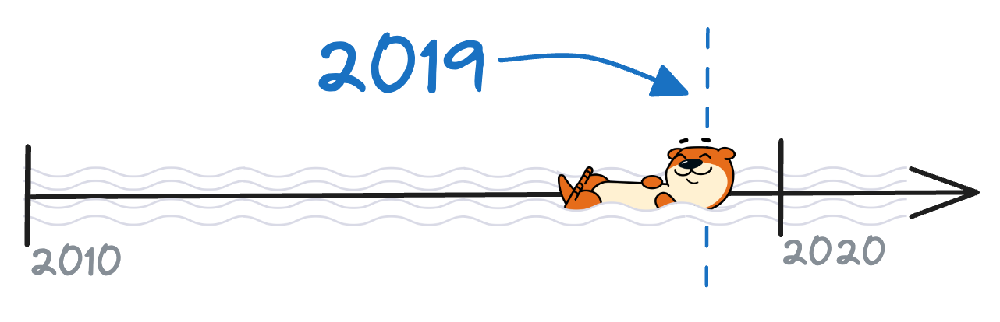

*Problem: Don’t want unnecessary rebalances to disrupt processing*

With all that under our belt, it’s time to start talking about the major
players in the rebalancing world. The first paradigm shift in rebalancing arose
from having to deal with stateful Kafka Streams, and we saw the
StreamsPartitionAssignor, sticky task assignment, and standby replicas all
rolled out in quick succession back in 2015. This worked pretty well for a
while, but slowly (at first; then not so slowly), the world began to make its
move into the cloud. Unsurprisingly, such a large disruption to the normal mode
of operation meant that things did not always work as well as they used to. A
wave of complaints about endless rebalancing, long downtimes, and frequent
disruptions set the stage for the next paradigm shift in rebalancing. And with
it came a series of major features based on long KIPs with even longer KIP
discussions, beginning around 2019. Each of these has been discussed at length
in their own dedicated blog posts, which we encourage you to read if you’re
looking for a deep dive on the feature itself.

By the start of 2019, thanks to standby tasks and sticky assignment,
applications were generally able to recover after rebalances without suffering
any lasting effects. But the rebalances themselves were still highly
disruptive, as each consumer had to stop processing completely, suspend all
active and standby tasks for the duration of the rebalance, and then
re-initialize the new and existing tasks every time. These “stop-the-world”
rebalances were always frustrating, but at least they only happened for good
reason: or so we thought. What was mainly a nuisance to on-prem deployments
quickly became a killer to applications moving into the cloud. It became
apparent that the current model of rebalancing would need to be adapted for a
world in which nodes are regularly bounced and elastic scaling is everything.

Static membership was our attempt at solving at least the first problem. Users
noticed their consumer groups constantly rebalancing due to the relatively much
more unstable cloud environments. Remember, each consumer needs to ping the
group coordinator with a heartbeat within the configured
`session.interval.ms` to avoid getting kicked out
of the group and triggering a rebalance (and the default session interval was
only 10s back then). Even worse, consumers that were shut down gracefully tried
to send a LeaveGroup request to effectively kick itself out of the group,
leading to absolute chaos during rolling redeployments. Most frustratingly, any
restart of the consumer — no matter how quick — led to the loss of its
in-memory “member id”, meaning the group coordinator would no longer recognize
it as the same consumer from before the restart. With all these sources of
unnecessary rebalancing, it’s no wonder everyone was fed up with rebalances,
and so we started with static membership: a method of preventing rebalances
that don’t actually need to happen by assigning “static” identifiers to each
consumer instance in the group, aka the `group.instance.id`

You can read more about how static membership works in the blog post (authored
by the same person who wrote the feature itself): “[Apache Kafka Rebalance
Protocol for the Cloud: Static
Membership](https://confluentcsmain.gatsbyjs.io/blog/kafka-rebalance-protocol-static-membership)”.
The title of this blog post alone tells you just how critical the need was for
a rebalancing protocol that could truly meet the demands of the modern cloud
environment. But static membership was only the beginning (and in fact, thanks
to the many improvements that it opened the door for, these days we only
recommend enabling static membership for the most unstable environments).

### Improvement 5: cooperative rebalancing

*Problem: Don’t want the rebalance itself to disrupt processing*

Shortly after static membership came **incremental cooperative rebalancing,**
which has an old but great blog post written by someone I can personally vouch
for. Check out **[From Eager to
Smarter](https://www.confluent.io/blog/cooperative-rebalancing-in-kafka-streams-consumer-ksqldb/)**
for a detailed examination of the cooperative rebalancing mechanics. You can
also find some great background information and insight in the KIP document
itself. Make sure you’re looking at **[KIP-429: Kafka Consumer Incremental
Rebalance
Protocol](https://cwiki.apache.org/confluence/display/KAFKA/KIP-429%3A+Kafka+Consumer+Incremental+Rebalance+Protocol)**
because there are actually two different incremental cooperative rebalancing
KIPs: KIP-415 for Kafka Connect, and KIP-429 for the plain consumer client and
Kafka Streams. To make things extra confusing, the Connect version of this
feature actually incorporates many elements of the consumer client’s static
membership feature, all wrapped into a single KIP.

So, everyone is doing it, but where did this “cooperative rebalancing” idea
come from? We can actually answer that with just the existing history knowledge
that we’ve built up so far: it turns out that once we have a sticky assignment
strategy, the current model of “stop-the-world” rebalancing became silly at
best, and a major disruption at worst. Why have each consumer revoke all of its
partitions before every rebalance if it was going to get most of the same ones
assigned back to it at the end? And why stop processing completely during that
time? As it turns out, we don’t need to do either of those things — but it took
a lot of intricately designed protocol changes to make it happen, as well as a
sacrifice that pushed in the exact opposite direction of static membership: an
extra rebalance was needed any time partitions had to be revoked from a
consumer.

The cooperative rebalancing protocol introduced a tradeoff that fundamentally
changed the future trajectory of rebalancing in Kafka Streams. Making them
lightweight and transparent in exchange for an extra rebalance marked the end
of an era: an era in which rebalancing was seen as a dead weight to be avoided
at all costs. And in its wake came a golden age of rebalancing: one in which it
could be used as a tool to improve Kafka Streams. Where we might even want to
intentionally trigger a rebalance from Streams.

### Improvement 6: warmup tasks

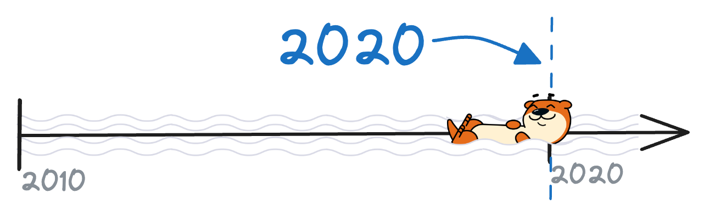

*Problem: Don’t want scaling out to disrupt processing*

Once rebalancing was no longer cursed by the “stop-the-world” eager protocol,
it didn’t take long for Kafka Streams to start leveraging them for even further
rebalancing improvements. After cooperative rebalancing came to Streams in the
fall of 2019, the next major feature entered the picture in the spring of 2020:
warmup tasks.

Warmup tasks were just another kind of standby task — in fact indistinguishable
from “normal” standby replicas to Kafka Streams itself — that solved a major
weakness that had become apparent in the original feature of standby tasks:
that they are only useful as long as you can guarantee that an active task is
assigned to the node that already had the standby version of that task. In
other words, if the assignor is forced to assign an active task to a node that
doesn’t have any copy of its state already built up from the changelog, then
having a standby copy of that state on some other node doesn’t really help!

But when might this actually happen? After all, the assignor is supposed to be
sticky — shouldn’t it make sure that tasks are assigned to nodes that had that
task before? Generally yes, sticky assignment would get you pretty far, but
there were always edge cases where full state restoration was simply
unavoidable — and massively costly! One of the most obvious examples, and
perhaps the most egregious, was scaling out. Any new node would have a fresh
state directory and no previously-assigned tasks, but the assignor was still
bound to uphold a balanced assignment, which meant some tasks would need to be
assigned to the new node. And this made sense: after all, why spin up a new
node if not to assign it some partitions to work on?

There’s actually nothing wrong with this behavior for plain consumer client or
stateless Kafka Streams apps. But when those tasks have to restore hundreds of
GB of state before they can begin processing: in fact, before *any* tasks on
the new node can begin processing? Well, that starts to get ugly. For one
thing, all those tasks assigned to the new node are essentially down and
blocked from processing, leading to potentially huge end-to-end latency
increases for the corresponding partitions.

And no one wants to wait for an hour for their new node to start doing anything
useful! Especially since you probably only scaled up to begin with because of
some trigger like unusually high traffic to deal with. It was clear that for
Streams to succeed in the modern cloud-centric world, it would need to be more
elastically scalable, and for that it would need to solve the scale-out
problem. And so, to start tackling this specific case (while still benefiting
all kinds of consumer group scenarios, **[KIP-441: Smooth Scaling Out for Kafka
Streams](https://cwiki.apache.org/confluence/display/KAFKA/KIP-441%3A+Smooth+Scaling+Out+for+Kafka+Streams)**
entered the picture.

So this solves the availability problem, and now we can actually add nodes without long downtimes, which is great! But…we can’t actually use them. Wait, what?

We still have to wait for the warmup tasks to do their thing. So if you scaled
out because you were struggling to keep up with the input load before, you
won’t actually see any benefit from the new nodes until the warmup tasks finish
restoring from the changelog. Furthermore, by default Streams will limit the
total number of warmup tasks at any given time, to keep resource consumption
from exploding. So not only do you need to wait for all the warmup tasks to,
well, “warm up” their state: you have to wait for them to do so sequentially!
Or mostly sequentially, as the default max.warmup.replicas is actually 2. You
can configure a higher maximum number of warmup replicas, but this is only
going to make things worse for your already-struggling app as it puts
additional load on the already-stressed StreamThreads in the worst case, and
increases network and broker load in the best case.

Even so, eventually those warmup tasks will transition to active, and your app
will reach the steady-state — if the input traffic stays steady at the new
rate, that is! But if the input traffic has died down and the backlog has been
processed by the time the warmups are ready, you just wasted all that effort to
be right back where you started (technically worse, as you’ll probably want to
scale down then which means going through the entire warmup cycle again!)

Alternatively, if the traffic just keeps going up and up, you’ll need to keep
adding more nodes and going through this each cycle. If you have a lot of
state, the fluctuations in traffic might happen faster than the time it takes
for your app to stabilize on the new assignment, and you’ll probably just have
to massively overprovision it and hope for the best.

### Improvement 7: rack-aware standby task assignment

*Problem: Don’t want rack failures to disrupt processing*

The final and most recent major rebalancing improvement is a pure assignment
optimization — it doesn’t need to touch on any other parts of the system or
trigger follow-up rebalances to help the operators of Kafka Streams
applications sleep easier at night. Before this, rack failures and data center
outages could wipe out all copies of a particular task, leaving the assignor
with no active, standby, or warmup copy of the state to continue processing
with. The Streams library only guaranteed that active and standby tasks would
not live on the same physical node: but what if you had multiple physical nodes
living on the same rack?

To prevent systematic failures from taking down entire tasks and forcing a
restore-from-scratch scenario, rack-awareness was introduced to the
StreamsPartitionAssignor. Specifically, standby task rack-awareness (note there
is now another assignor feature called “rack awareness” that applies to both
standby and active tasks, and is distinct from this: this other feature is
targeted at reducing cross-AZ costs rather than improving rebalancing
operations).

As the name suggests, rack-aware standby task assignment simply plugs into the
algorithm for distributing standby tasks, which is always done after the
assignment of active tasks. The assignor basically extends its current
constraint for standby tasks so that they’re restricted from being placed on
certain nodes: not just those with the active version of that task assigned,
but now any node on the same rack as the node with this active task. The
feature uses configurable, customizable tags to enforce the constraint, leaving
a lot of flexibility to make the standby task assignment work for any kind of
setup. Check out [**KIP-708: Rack aware StandbyTask assignment for Kafka
Streams**](https://cwiki.apache.org/confluence/display/KAFKA/KIP-708%3A+Rack+aware+StandbyTask+assignment+for+Kafka+Streams)
for the full details on how this is accomplished, and how you can enable it if
this sounds relevant to you!

### Improvement 8: ???

*Problem: Don’t want restoration to disrupt processing*

We can keep chipping away at the issues facing very stateful apps, but each
added complexity comes at a cost, and that cost is often stability and ease of
operation. At the same time, the assignment logic is only growing more and more
complex as yet more competing factors enter the mix. In the end, there’s only
so far you can get with bandaids: if you want Streams to be truly elastic,
highly-available, and stable in a real cloud environment, we need to break out
of the restoration cycle altogether.

## Round-up of current issues:

Obviously, rebalancing is a complex part of a complex distributed system, and
it’ll probably be iterated on and optimized from now until the end of time.
We’ve made some huge strides over almost a decade now, so the natural question
is: what’s next?

There’s certainly no shortage of remaining issues. Some of them can probably be
neglected for a long time, some of them just give the developers a hard time
with little impact on the end user, and some are just annoying without being
painful. However, we’ve reached a point where some of the final remaining
issues look like they might mean the difference between a Kafka Streams that
wallows away in dark server rooms, and one that truly excels in the modern
cloud environment (which is in…bright server rooms?)

Let’s do a quick roundup of the critical issues that still impact Kafka Streams:

1. Stateful apps cannot be truly elastic: they can barely even be reactive,
   much less predictive
2. Rebalances and assignment can be difficult to monitor and debug since they
   change over time. How do you know when it’s supposed to be rebalancing, and
   how do you know when it should stop?
3. No centralized authority over the rebalances:
 1. The assignor has to rely on consumers to self-report their own membership
    and metadata. If we can’t distinguish between a consumer missing a single
    rebalance and a true scale-down event, it’s impossible to determine whether
    to temporarily reassign just those tasks or redistribute the entire
    assignment.
 2. We also rely on individual consumers to blindly trigger follow-up
    rebalances, which may be unnecessary (eg in case of probing rebalances) or
    accidentally preempt slower members of the group and lead to frustrating
    rebalancing storms (eg
    [KAFKA-14419](https://issues.apache.org/jira/browse/KAFKA-14419)).

It’s worth noting that the next-gen rebalancing protocol of
[KIP-848](https://cwiki.apache.org/confluence/display/KAFKA/KIP-848%3A+The+Next+Generation+of+the+Consumer+Rebalance+Protocol)
that we touched on at the start will actually go a long way towards solving
points 2 and 3 above, and we’re all excited to see it in action! Unfortunately
the initial design is exclusively targeted at the plain consumer client, and
Streams users can no more enable the next-gen rebalancing protocol than they
can plug in the RangeAssignor or any other ConsumerPartitionAssignor besides
the StreamsPartitionAssignor. As you’ve now seen, Streams does a lot with its
assignor, so it’ll take some time for us to peel apart the complexity and
implement the next generation of rebalancing in Streams. But as you’ve also now
seen, we’re nothing if not dedicated to the cause of improving rebalancing for
Kafka Streams!

Of course, that still leaves point 1 from above: elasticity. This is, and
always has been, the white whale of stateful applications like Kafka Streams.
And to really solve it, we’re going to need more than just an endless series of
incremental improvements to the rebalancing protocol; we need to tackle state.

## A Briefly Reimagined History of Streams

What if instead of hacking the task assignment to make the infra work, we could
make the infra work for the task assignment? Task assignment is fundamentally a
scheduling/resource question. We want to figure out the optimal way to place
tasks on nodes, and then do that!

And not just when it first starts up, either — in a modern application running
in a cloud environment, we have great visibility and the ability to react to
changes in the environment. We don’t just want the best task assignment for
your specific application: we want to enforce the best possible assignment for
that specific combination of resources at that particular moment in time.

In other words, elasticity. We want the app to respond to changes in the
processing rate, not the other way around — so we can’t be waiting for tasks to
warm up on certain nodes. We need the state to just be there already; to be
highly available. We need remote state stores.

This is one of the driving insights behind our work at Responsive. That's why our first product,
the [Responsive SDK](https://www.responsive.dev/sdk), allows you to drop RocksDB from your application nodes,
making them stateless by swapping out RocksDB with remote state stores. Watch my talk from
[Kafka Summit London 2024](https://www.confluent.io/events/kafka-summit-london-2024/its-a-trap-solving-restoration-with-custom-kafka-streams-state-stores/)
to learn about all the innovations that enable exactly-once and fast remote stores.
You may also read my blog post on
[async processing](../async-processing-for-kafka-streams/index.md) to dive deeper into
how we deliver remote state storage without sacrificing throughput.

Stateless tasks obviate the need for standby and warmup
replicas, thus making rebalances much simpler and more robust. Stateless tasks
also simply the problem of task assignment since tasks no longer have to
be sticky to specific nodes but rather can be placed on any node which has
sufficient capacity. All of this improves the efficiency, reliability, and
scalability of stateful Kafka Streams applications.

If this sounds intriguing, our [quickstart](https://docs.responsive.dev/sdk/quickstart)
shows you how to get a Kafka Streams app running with a remote MongoDB database in 5
minutes, thus paving the way to a more reliable, scalable, and efficient Kafka Streams applications.
If you have any questions or comments, hop on to [our Discord channel](https://discord.com/channels/1154564700764393583/1154564701569695776) and say hello!
