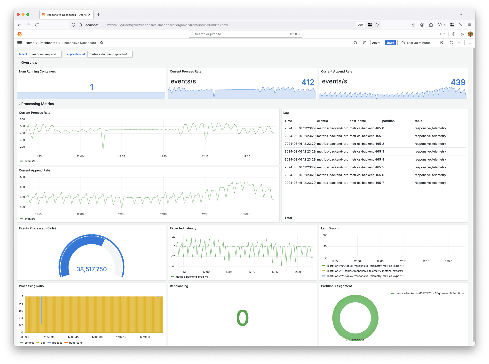
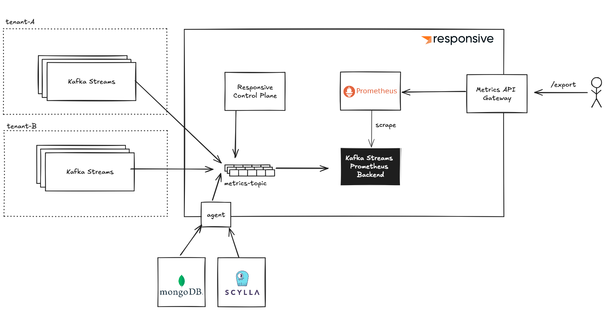

# A Metrics API for Kafka Streams

*Almog Gavra · August 29, 2024 · 5 min read*

Introducing the Responsive Metrics API, which allows exporting metrics into your observability engine of choice.


---

## Monitor Kafka Streams with Your Observability Stack

Think back to your last Kafka Streams incident — collecting all the information you needed to root cause it may have felt like putting together a jigsaw puzzle where each piece is hidden in a different drawer: sure, it’s possible, but wouldn’t it have been nice if everything was laid out right in front of you? You may even have a lingering postmortem follow-up action to get those extra metrics ingested or increase that log retention.

The rest of this post covers why Kafka Streams observability can be so challenging and announces Responsive's new Metrics API for Kafka Streams.

> If you are already using Responsive and just want to get started, skip to ["How to Integrate"](#how-to-integrate).

## Why is Kafka Streams Observability Hard?


**First,** Kafka Streams is a complex distributed system, and over time we’ve added hundreds of metrics to debug all sorts of nuanced problems. Your state store is using too much memory? There’s a metric for that. How much time is being spent on `punctuate` calls? There’s a metric for that. You want to know minimum, maximum or average cache hit ratio? You guessed it, there’s a metric for that too!

But with all these hundreds of metrics swimming around, it can be overwhelming to find the most important ones — and that’s just the first step.

On the flip side of the equation, not all metrics are available out of the box with Kafka Streams. A critical one, for example, is the rate at which events are being ingested by your application. This provides important context to augment the current process rate (you want to see the process rate match the ingest rate).

**Second,** once you’ve identified the set of metrics you want, you need to know how to correctly interpret them. Even some that seem obvious can be nuanced: you may think that lagging behind hundreds of events is bad! Certainly you always want to be caught up, but if you’re processing tens of thousands of events per second sustaining low triple-digit lag is generally acceptable.

We’ve [written at length](https://www.responsive.dev/blog/monitoring-kafka-streams) in the past on which metrics to monitor for Kafka Streams, so hopefully that helps you get past the first two stages, but there’s still one more to tackle:

**Lastly**, once you’ve done the design work of figuring out what you want to monitor you still need to put shovels in the ground and build out the metrics collection pipeline. While state-of-the-art technology has gotten much better, it can still be a challenge to collect the JMX metrics and ingest them into your observability engine of choice.

## Responsive’s Solution

Today we are solving all of your monitoring woes by introducing the Responsive’s Metrics API: a simple, prometheus-compatible endpoint for ingesting all the most important Kafka Streams metrics into your monitoring system of choice and preconfigured dashboard to match.



## How it Works: Powered by Kafka Streams

Responsive exports all sorts of metrics: metrics we collect from Kafka Streams applications running in our customers’ VPCs, derived and primary metrics we compute in our control plane and storage metrics from MongoDB or ScyllaDB. In order to get these all in one place, correctly tagged by tenant and ingested into a prometheus instance, we pipe all the metrics from different sources into Kafka and materialize them in a streams-backed HTTP server for prometheus to scrape:



The Kafka Streams app at the heart of this architecture is really simple, it just cleans some data and holds the metrics in a time-ordered buffer and exposes an endpoint for prometheus to scrape. Whenever prometheus scrapes that data, it clears its buffer of all the metrics that were scraped. (In case you were wondering, we are monitoring this app using Responsive's Metrics backend!)

This allows us to control the backpressure of metrics — if prometheus can’t keep up with scraping it faster than we can fill the buffer, then we can have degradation scenarios planned out. In some situations, it may be better to downsample metrics so that our metrics are always up to date even with lower granularity, in other situations it may be important to keep every last metric and accept an ingestion lag in our metrics pipeline. The Kafka Streams Backend handles all that logic for us.

The other custom component of this architecture is the Metrics API Gateway, which serves as a federation layer between the user exporting metrics and our Prometheus server, which is multi-tenant. This component federates requests after ensuring that the customer has a valid API key for the tenant/environment and tags the request to prometheus to include only metrics tagged with the specified tenant and environment.

## How To Integrate

The metrics API for your organization is available at `<org id>-<env id>.metrics.us-west-2.aws.responsive.cloud`. This means that if you are using prometheus you can configure a prometheus scrape job to scrape these metrics:

```yaml
job_name: responsive-streams-metrics
scrape_interval: 10s
scheme: https
metrics_path: /export
basic_auth:
  username: <api key> # this is an API key created in your Responsive Cloud environment
  password: <secret>  # this is the secret for the key created above
static_configs:
  - targets:
    - <org id>-<env id>.metrics.us-west-2.aws.responsive.cloud
```

The most popular observability vendors all provide was to integrate with a Prometheus API. Datadog, for example, allows you to monitor prometheus endpoints using their agent with the [openmetrics configuration](https://docs.datadoghq.com/integrations/openmetrics/).

[Read our documentation](https://docs.responsive.dev/reference/monitoring) for a complete integration guide.

## What’s Next?

We’ve got a few things planned for metrics and observability. For one, we’re adding support for selected log collection so that you’ll not only have the metrics to know whether something is going wrong but also all the information you need to debug what’s going on. We’re also planning out native integrations with some observability vendors (like Datadog) so that you can import you data with the click of a button. Lastly, we’re always looking out for which metrics we should add to our core suite, balancing making the metrics comprehensive while ensuring the ratio of pixels to information remains extraordinarily high!

From day zero, our customers have been asking for a metrics API and we’re happy to announce that as of today this long-awaited feature is available to anyone using Responsive. If anyone has requests for what would make their lives as Kafka Streams developers easier, feel free to reach out to directly on [LinkedIn](https://www.linkedin.com/company/responsivedev), [Email](mailto:info@responsive.dev) or [Discord](https://discord.gg/jEk8JvjJrg)!
