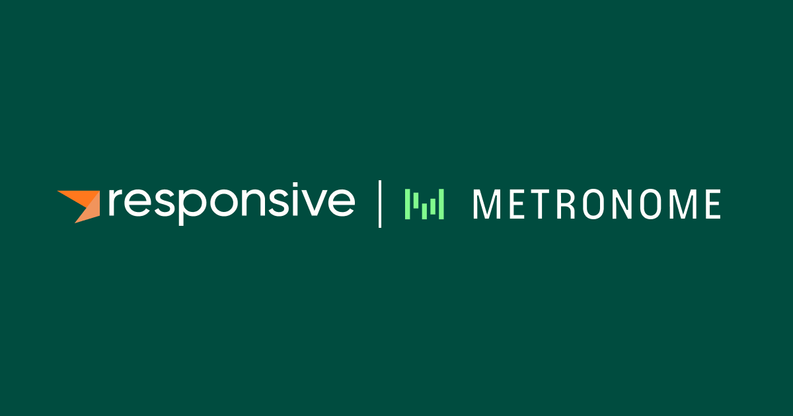

# How Metronome delivers advanced usage-based billing with Kafka Streams and Responsive

*Apurva Mehta · August 14, 2024 · 2 min read*

Learn how Metronome scaled their Kafka Streams ingestion pipeline with Responsive to deliver advanced real time billing features to companies like OpenAI, Nvidia, and more.

---

[Metronome](https://www.metronome.com)’s platform makes billing fast, flexible, and frictionless, enabling customers
 like OpenAI, NVIDIA, and Databricks to launch products rapidly, adopt any pricing model with ease, and streamline their revenue
operations.

The reliability and correctness of Kafka Streams is of paramount importance to Metronome. For instance, if their Kafka Streams
 based ingestion pipeline is down or faulty, spend limits and other core features don't trigger correctly. 

Learn how [Reponsive helps scale Metronome's usage of Kafka Streams](https://www.responsive.dev/customers/metronome)
while maintaining 99.99%+ availability for mission-critical, stateful, transactional workloads as their customer 
base and usage has skyrocketed.
