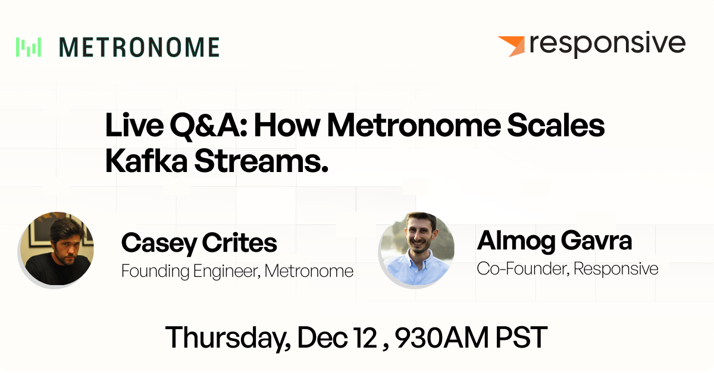

# Live Q&A: Scaling Event Driven Architectures with Metronome

*Apurva Mehta · November 13, 2024 · 2 min read*

Tune in for an in-depth conversation with Casey Crites, Founding Engineer at Metronome about how Metronome built and scaled their Kafka Streams based ingestion pipeline to deliver advanced real time billing features to companies like OpenAI, Nvidia, and more.

---

[Metronome](https://www.metronome.com)’s platform makes billing fast, flexible, and frictionless, enabling customers
 like OpenAI, NVIDIA, and Databricks to launch products rapidly, adopt any pricing model with ease, and streamline their revenue
operations.

The reliability and correctness of Kafka Streams is of paramount importance to Metronome. For instance, if their Kafka Streams
 based ingestion pipeline is down or faulty, spend limits and other core features don't trigger correctly. 

We are pleased to share a wide ranging conversation between [Almog](https://www.linkedin.com/in/agavra/) and Metronome's
founding engineer [Casey Crites](https://www.linkedin.com/in/caseycrites/) in which they cover Metronome' event driven
journey from day 0 to the present, and the lessons learned along the way.

> Watch the webinar [on-demand](https://www.responsive.dev/resources/metronome-kafka-streams-interview) and [join Casey and Almog](https://www.responsive.dev/resources/metronome-q-and-a) for a live Q&A on Thursday, 12 December 2024 at 930am PST.

Some of the topics discussed include:

* Why did Metronome choose Kafka and Kafka Streams to drive their mission-critical ingestion pipeline?
* What were the design tradeoffs they had to make as they built out their architecture and why?
* How did they implement techniques like blue/green deployments?
* and more
