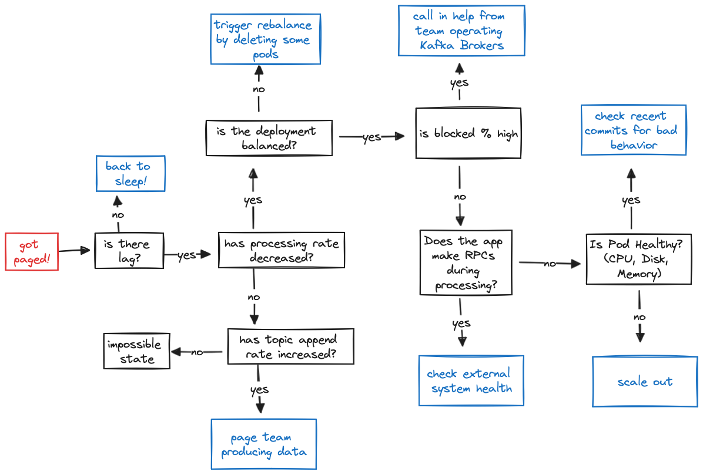

# You Will Survive Monitoring Kafka Streams

*Almog Gavra · January 24, 2024 · 5 min read*

Kafka Streams comes bundled with hundreds of metrics - this post will cover the “highest ROI” metrics to include on your dashboard.

---

*The first time I tried to monitor my Kafka Streams deployment, I was afraid — I was petrified. I kept thinking I could never settle on a dashboard to define. But then I spent so many nights looking at metrics in Datadog, and I grew strong. And I learned how to get along.*

*So here you go — just in case — here’s some inspiration for your timeseries database. I’ve got ten graphs for you to track, I’ll make sure you won’t look back, once you have these monitors your incidents won’t be so absurd.*

Behind the catchy tunes is a reality: Kafka Streams comes bundled with hundreds of metrics and it can be tough to wade through them to figure out what you need to monitor. This post will cover the “highest ROI” metrics that I include on my overview dashboard — they’re all the graphs you need to quickly go through the flowchart below and get back to sleep if you get paged.

## Lag

*You think you’d lag? You think you’d fall back behind?* The first thing is to set up alerts on lag, the most important metric from a product perspective (if your app is lagging, you may not be hitting your SLAs to process events in a timely fashion)!

Given the importance of lag, I like to visualize lag in two different forms: **(Graph 1) Total Lag (Timeseries)** and **(Graph 2) Lag by Topic Partition**.

The **Timeseries Lag** graph provides an understanding of whether or not lag is improving or degrading for each partition, while the **Lag Table** gives you a snapshot of the worst partitions which you can use to correlate whether there’s a problem with a specific pod or if the lag is evenly distributed. They show the same data, but it’s sometimes nice to have a “now” view sorted by the worst offenders to see if there’s any imbalanced partitions.

The metrics you need to graph these are both computed with the `kafka.consumer:type=consumer-fetch-manager-metrics,name=records-lag` MBean.

## Processing

Once you’ve got a sense of the overall health of your application… g*o on now, go, root cause your lag.* There’s effectively two categories that could be causing lag:

1. The rate at which you are processing has decreased, which will be reflected in **(Graph 3) Current Process Rate**
2. The rate at which the topic is being appended to has increased, which will be reflected in **(Graph 4) Input Append Rate**

As long as your **Current Process Rate** and your **Input Append Rate** stay constant you know you’ll stay alive. If your input append rate has increased, it’s time to figure out what’s going on upstream - potentially scaling out your application if the increase in traffic is accounted for and you need to just increase your processing capabilities. Note that these two graphs will not always match in steady state — the input append rate includes metadata messages such as transaction markers which are not counted in the process rate — you should only look at the trends for each individually.

The current processing rate metric is available by checking the `kafka.streams:type=stream-thread-metrics,name=process-rate` MBean. If you have access to the broker metrics, you can compute the input append rate by taking the rate of change of the `kafka.log:type=Log,name=LogEndOffset` MBean.

## Process Ratio

If you’ve narrowed down your problem to a decrease in process rate, you can further narrow down your problem by checking where your application is spending its time; **(Graph 5) Phase Ratio** and **(Graph 6) Processing vs. Blocked Ratio** are the graphs to look at to debug slow progress. If you aren’t making consistent progress you may want to consult **(Graph 8) Time Since Last Rebalance** described in the next section.

If you suddenly see the time during commit or poll start to increase, and similarly the blocked time on the latter graph, it’s time to check your broker metrics. If you are spending all your time in process, it’s time to take a deeper look at your Kafka Streams app. You may either:

1. Need more physical resources to keep up with the increased computational load.
2. Need to check external systems you call out to during processing (time blocked on external calls during processing will show up as processing time instead of blocked time since the latter only accounts for time blocked waiting on the Kafka broker).

These metrics are computed using the MBeans for `kafka.streams:type=stream-thread-metrics,name=(commit-ratio|process-ratio|poll-ratio|punctuate-ratio)` and `kafka.consumer:type=consumer-metrics,name=io-wait-time-ns-total` respectively.

## Balanced Deployments

*It took all the strength you had not to fall apart, you kept trying to mend the pieces of your broker’s heart. And you spent oh-so-many nights debugging your streams app you used to cry. But now you have know where to pry*: whether or not your application is balanced. You can check **(Graph 7) Partition Distribution** and **(Graph 8) Time Since Last Rebalance** to check how your application is behaving.

In most scenarios, you want to make sure that your partitions are evenly distributed across the nodes in your cluster (the fine print is that this may not be true if you have sub-topologies with different numbers of partitions, but it’s generally a decent proxy). The builtin assignment logic makes it difficult to address this an imbalance in partitions if it does happen since it attempts to “stick” partitions to nodes in order to prevent unnecessary restoration; if you see imbalanced partition assignment remain for a long period of time consider scaling out your application.

For the time since last rebalance, you should see it growing up and to the right. If you are running into many rebalances, check out our blog post on [surviving rebalance storms](https://www.responsive.dev/blog/guide-to-kafka-streams-rebalancing).

These metrics are computed using the MBeans for `kafka.consumer:type=consumer-coordinator-metrics,name=assigned-partitions` and ``kafka.consumer:type=consumer-coordinator-metrics,name=last-rebalance-seconds-ago`.

## Bonus

There are two more graphs that aren’t absolutely necessary but are nice to have and help build a good dashboard: **(Graph 9) Kafka Streams State** and **(Graph 10) Expected Latency**.

The Kafka Streams state helps you make sure that none of your clients are in an `ERROR` state or stuck in `PENDING_SHUTDOWN`. The expected latency (the amount of time until an event that is appended now is processed) gives you a way to understand the impact of your lag in units that are meaningful to you: time it takes for records to be processed.

These two graphs are currently computed and made available through the [Metrics API](https://docs.responsive.dev/control-plane/monitoring) in the [Responsive Control Plane](https://www.responsive.dev/control-plane).

## Overview

*You survived!* When you put it all together, you get a dashboard that looks something like this one (with mock data).

At Responsive, our [SDK](https://www.responsive.dev/sdk) automatically collects all of these metrics and our Metrics API for Kafka Streams
enables [one-click integration](https://docs.responsive.dev/control-plane/monitoring) if you want these metrics in
observability systems like Grafana or Datadog.
