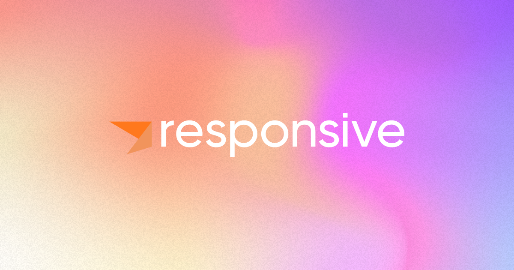

# Founder's Letter: Responsive and the Future of Stream Processing

*Apurva Mehta · December 3, 2024 · 2 min read*

A recap of all that we've built in our first 18 months as a company, and what that means for the future of stream processing.

---

Isn’t it funny how day by day nothing changes, but when you look back, everything is different?

Dear data streaming community,

A lot has happened in the world of stream processing in the year and a half since we started Responsive. We shipped
three [truly](https://www.responsive.dev/sdk) [innovative](https://www.responsive.dev/control-plane)
[products](https://www.responsive.dev/rs3-storage), landed our first customers, and landed our first expansions too -
no small feat for a team of four in under 18 months! But, even so, I think this understates the progress we’ve made.
Let me explain why.

When we started Responsive back in April 2023, the stream processing world seemed destined to become a world of
‘better data processing’ as opposed to a world of fundamentally new types of applications, a distinction I wrote about
in this [thread](https://bsky.app/profile/apurvamehta.com/post/3layudnadic2p). Back then, streaming SQL was all the
rage, with every major player in the space and half a dozen startups building streaming SQL offerings. SQL is a great
language for expressing ETL and analytics logic, but it has never been a language developers pick for expressing
application logic.

By contrast, Responsive was founded on the belief that the true value of stream processing is in the new applications
you can build with event streams. For example, applications like
[real-time spend limits](https://docs.metronome.com/enhance-customer-experience/customer-controls/) are only possible
at scale as event driven applications. And while Kafka Streams’ embedded form factor made it the
[leading choice](https://www.responsive.dev/blog/kafka-streams-production-use-cases) for developers building
mission-critical event driven apps, there was [too](https://www.responsive.dev/blog/guide-to-kafka-streams-rebalancing)
[much](https://www.responsive.dev/blog/guide-to-kafka-streams-state) [friction](https://www.responsive.dev/blog/a-size-for-every-stream) in operating Kafka Streams, which we strongly believed was holding the ecosystem back.

So we got to work on fixing the root causes of the reliability, scalability, and operability issues with Kafka Streams.
Through that process, we’ve delivered four first-of-their-kind stream processing innovations in just 18 months:

1. We successfully disaggregated state from Kafka Streams application nodes with the
[Responsive SDK](https://www.responsive.dev/sdk). Embedded state is a
[major compromise](https://www.responsive.dev/blog/stop-embedding-rocksdb-in-kafka-streams) that has hurt the
scalability, operability, and reliability of stream processors like Kafka Streams and Apache Flink for a decade.
With Responsive, this compromise is a thing of the past.
2. We successfully implemented [policy based autoscaling](https://docs.responsive.dev/control-plane) for Kafka Streams
with the [Responsive Control Plane](https://www.responsive.dev/control-plane). This makes Responsive the only
production system where you can define scaling rules based on business SLAs like how much of a delay you are willing
to tolerate before an event is processed.
3. We took the idea of disaggregated state to its logical conclusion in a world of object storage. Our
[Responsive Streaming Storage Service (aka RS3)](https://www.responsive.dev/rs3-storage) is the first
objectstore-native storage system which is designed to be used as the state store of high scale stream processors.
Being objectstore-native redefines the scalability, elasticity, reliability, and economics of streaming state stores.
Think Warpstream, but for your stream processor’s state. RS3 is built on
[SlateDB](https://www.responsive.dev/blog/why-slatedb-for-kafka-streams), which is an LSM tree storage engine built
from first principles for object storage.
4. We’ve introduced a wholly new [pricing model](https://www.responsive.dev/pricing) that bills on the most obvious
metric for a stream processor: events processed, and in particular
[origin events](https://docs.responsive.dev/sdk/origin-events) processed. Origin events can be thought of as the events
happening out in the world (eg. orders placed at a retailer), and usually correlate well with business value. Thus
origin events are a highly transparent, predictable, and value aligned pricing metric for stream processors. By
contrast, the ‘compute units’ that you are usually confronted with in other stream processing systems are opaque and
unpredictable.

These innovations collectively cement open source [Kafka Streams](https://kafka.apache.org/documentation/streams/) as
the best choice for building event driven applications, since they allow for upgrading Kafka Streams apps in place to
unlock levels of reliability, automation, and scale which would be out of reach elsewhere. For example,
[Metronome](https://www.metronome.com/) started with the open source Kafka Streams library and
[added Responsive](https://www.responsive.dev/customers/metronome) incrementally as their business continued to
scale and as their demands for better reliability, automation, and support grew.

By providing the cleanest possible journey to the most sophisticated stream processing capabilities, Kafka
Streams with Responsive no longer forces a tradeoff between the ideal developer experience and production scalability.
This in turn will allow more developers to create more sophisticated event driven applications, which is a future
we are excited to be a part of!

If you want to explore what Responsive has to offer, the [SDK](https://www.responsive.dev/sdk) is the best place
to get started. If you have questions or comments, I’d love to hear from you. Find me on
[X](https://x.com/apurva1618), [BlueSky](https://bsky.app/profile/apurvamehta.com), or via
[email](mailto:apurva@responsive.dev).

Let’s build together, 
Apurva 
CEO, Responsive
