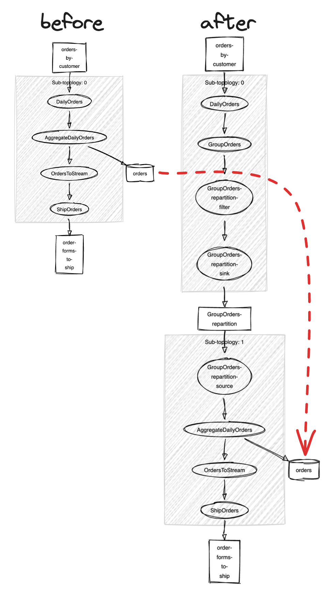

# Kafka Streams 101: Topology Upgrades

*Sophie Blee-Goldman · February 13, 2025 · 20 min read*

A Kafka Streams 101 lesson to learn how to identify unsafe changes to a topology and the techniques to mitigate them


---

**Last Updated:** Apache Kafka version 4.0 and Responsive SDK version 0.39.0

> **Learning Objective:** By the end of this Kafka Streams 101 lesson you will understand the different types of application upgrades and how to evaluate their risks, learn how to identify unsafe changes to a topology and the techniques to mitigate them, and develop a plan to keep your apps safe with best practices you can put in place for new applications to make your future self’s life easier

# Quick Summary

- Best practices: how to prepare an application for future upgrades
- Types of upgrades: when are they safe and what to do if they aren’t
- Upgrading painlessly: tips for minimizing risks and upgrading smoothly

# Concept Overview

## Best practices for new applications

The single most important thing you can do for a Kafka Streams application you’d like to change or upgrade is to prepare for this in advance. Taking just a few precautions when first setting up a new application can save you a ton of time, money, and frustration in the future. You should come away from this with an understanding of the best practices for future-proofing so you’ll know what to do when it’s time to write your next Kafka Streams application.

### Name your operators

Probably the best way to safeguard your application topology is to name your operators — that means every single one. We’ll go into more detail on the “why” and what goes wrong if you evolve a topology without this in the next section, so for now we’ll focus on the “how”.

Naming an operator is easy — every DSL operator should have an overload that includes a parameter where you can specify the name. Most operators make this straightforward by using the aptly-named class `Named`, while others include the name as part of an operator-specific config class. For example, you can set the name for a `groupBy`/`groupByKey` using `Grouped#as`, and name a stream-stream join via  `StreamJoined#withName`.

We highly recommend making a pass over the application to ensure everything is named before it’s deployed. Right now there’s no programatic way of verifying this (see  [KIP-1111: Enforcing Explicit Naming for Kafka Streams Internal Topics](https://cwiki.apache.org/confluence/display/KAFKA/KIP-1111%3A+Enforcing+Explicit+Naming+for+Kafka+Streams+Internal+Topics)) so it’s up to you to check the application manually.

The best way to do this is by using the topology description mentioned above. Print the topology and look for any processors with auto-generated names. These are typically very easy to spot as they will start with `KSTREAM` or `KTABLE` and end with an index containing many leading zeroes, for example `KSTREAM-REDUCE-0000000002`

### Version serdes/schemas

Most apps will end up using a composite data type somewhere in their topology, which means you’ll have to go beyond the basic out-of-the-box serdes to handle your custom key/value types. Some bite the bullet and write their own serdes while others will rely on something like JSON, Avro, or Protobuf. Whichever you use, there will be a schema defined for each class that tells Kafka Streams how to serialize data into bytes when writing to an output topic or deserialize input topic data bytes. Serdes are also used to encode the records written into a state store.

At some point, many users end up needing to modify the data, for example to include additional metadata when producing events upstream. This results in the input topics containing a mix of the old and new format, which means your application’s serdes need to be able to understand both versions. And an important part of that is being able to detect which is which.

To future-proof your pipeline and allow for schemas to evolve over time, it’s essential to include a protocol version as part of the serialized data. Some formats, such as Avro, have built-in versioning and clearly-defined rules for backward compatibility. Others, like JSON and protobuf, require you to take matters into your hands, as is the case when writing custom serdes. Make sure to include a version field when defining the schema in case you want to evolve it down the line.

### Utilize control topics

As you’ll see throughout this blog post, it can be be useful to insert a “control topic” in front of your Kafka Streams application or pipeline. This pass-through topic acts as a buffer between the input topics and your app and is simple to set up: just create a topic with the same number of partitions as your input topic(s), then copy data directly from the input topic to the control topic and have the application read from the control topic instead. You can even use a lightweight Kafka Streams app to do the copying!

This may sound silly, but it can be a powerful tool that enables all kinds of upgrades and operations you might need down the road:

1. pausing/flushing repartition topics: you can use a control topic as a kind of on/off switch for an application that enables it to finish processing everything it has started working on so far while pausing incoming events. Simply shut down the application that copies from the input topics to turn off the flow of events into the control topic. This causes the Kafka Streams application to stop working on new input events but allows it to finish processing intermediate results. After a while it will have flushed all the data from its repartition topics and become idle, at which point you can shut the application down — or cut over to a different one.
2. increasing partitions: as discussed later in this guide, scaling up the number of partitions to increase parallelism is a major pain for stateful Kafka Streams applications. Doing this safely generally means reprocessing data from the start with a new application that has more partitions. A blue/green deployment strategy that utilizes control topics can greatly simplify things by letting you increase the partitions for the new control topic without having to touch the original input topics, as well as helping to drain events from the original app.

### Utilize Kafka Streams Test Infra

Even with this guide, you might not always catch an incompatible upgrade right away: whether you thought the change wouldn’t cause problems or just updated something by accident. Testing is an essential part of safe upgrades and topology evolution, and is most effective when you set it up from the start.

While we’ll cover testing in more detail in a later lesson, there are a few upgrade-specific tips we can mention now. First, we highly recommend utilizing the [TopologyTestDriver](https://kafka.apache.org/39/javadoc/org/apache/kafka/streams/TopologyTestDriver.html) to verify not only your original application logic but it’s consistency over time. Running a unit test once during development is good, but integrating it into your CI/CD to prevent incompatible changes from being merged or deployed is even better!

You can also fence accidental and/or incompatible by writing a topology-verification test. Just print out the original topology description and save it in the test, then each time your CI/CD runs it can print the latest topology description and compare it against the expected one. This way any changes to the topology will be detected, and when updating the expected topology you’ll be forced to evaluate whether the update seems safe or not.

> 💡 A simple `assertThat(topology.describe(), equalTo(expectedTopology)` goes a long way!

# Ultimate upgrade guide

Of course, the word “upgrade” can mean many things in the context of a Kafka Streams application, and every possible meaning comes with its own set of rules, restrictions, and workarounds. If you’ve already deployed a Kafka Streams app then it’s important to carefully assess any kind of modification to the app or its environment so you can come up with a plan. Different kinds of upgrade come with different risks, ranging from lost time and/or costs all the way to silently corrupted data and incorrect processing results.

So any time you find yourself wanting or needing to update an app that’s already processed input data, use this guide to come up with a plan and ensure things go smoothly.

## Upgrading the Kafka Streams library version

Probably the most common kind of upgrade is just updating the version of the Kafka Streams library itself. This includes both upgrading and downgrading your app (though we really hope you only ever have to bump the version!). It should more or less always be possible and safe by default, but there are a few nuances that are worth discussing here.

First and foremost, make sure to always read the [Kafka Streams upgrade guide](https://kafka.apache.org/documentation/streams/upgrade-guide) *before* changing any code! Here’s a brief sketch of how to read this:

1. Start with the very first section for the exact upgrading process. This highlights specific steps you may need to follow depending on which version you’re upgrading to and from. For example, doing an upgrade across certain versions will require setting the  `upgrade.from` config in the first rolling bounce where you change the version, and then performing a second rolling bounce to unset the `upgrade.from` config.
2. Skim the next section on “[Notable compatibility changes in past releases](https://kafka.apache.org/documentation/streams/upgrade-guide#streams_notable_changes)” for anything that applies to you. This part calls out any important updates that may affect your application setup or require a special upgrade path.
3. Go through the “Streams API changes in x.y.z” sections for a list of new features, deprecated/removed APIs, and other highlights you’ll want to know about. Note that these are organized by the version they first appear in, so if you’re upgrading between non-adjacent versions you should go through everything under the intermediate versions you’re skipping over. If you only look at the API changes for the final version you’re likely to miss some important changes and/or warnings.
4. For the most part Kafka Streams can be run against any broker version, though starting in 4.0 newer Kafka clients will no longer be compatible with older brokers (and vice versa). Certain features may also have broker version dependencies, such as `exactly_once_v2` which requires brokers be 2.5 or above. When in doubt, check out the client-broker compatibility matrix [here](https://kafka.apache.org/documentation/streams/upgrade-guide#streams_api_broker_compat).

## Application updates

This category of upgrades covers any changes to the application code itself (rather than something external like its topics). Note that a given change can potentially result in more than one of the below scenarios, so be sure to go through all that match.

> ⚙ Check out the appendix for an introduction to the “topology description” if you’re unfamiliar with this term or don’t know how to generate one for your app

The first step for any application update is to compare the topology description of the old and new code to help visualize the effect on your application runtime. The main things to look out for are changes to the keys, subtopology structure, and state store or source/sink topic names (ie changelog and repartition topics). We’ll cover each of these cases separately, but a given upgrade may result in more than one of these topology effects so you’ll need to go over each of the following that apply.

### Adding or removing DSL operators

If you just want to add or remove a DSL operator that doesn’t [change the key](#changing-keys) or [subtopology structure](#addingremovingmerging-subtopologies), you’re in luck! It’s always safe to evolve the logic within your subtopologies, which gives you a lot of freedom to upgrade without consequences. Just update the code and redeploy the app — provided you’ve named your operators, that is.

But wait — what if you deployed an app already and didn’t name the operators? All hope is not necessarily lost, though you’ll have to proceed carefully and some changes might be off-limits. As usual, the important thing to evaluate is whether any of the internal topics are affected by a change. Luckily you can tell pretty easily from the topology description: look for any changes to the changelog and repartition topic names by verifying the store names and the source topic names for each subtopology. Pay attention to the numerical suffix in particular — the reason naming is so important is because the mechanism for generating unique names relies on an index that is incremented for each processor or store in the topology, so adding/removing/moving anything in the DSL can result in a different name being generated for a given processor or state store. And since these names are used to generate the names of internal topics, changes to the topology can result in losing changelog data and/or intermediate results from repartition topics.

Let’s illustrate this with a simple example app. Here is the original application before a change:

```java
builder.stream("clicks")
    .groupByKey()
    .count()
    .toStream()
    .to("total-clicks");

Topologies:
   Sub-topology: 0
    Source: KSTREAM-SOURCE-0000000000 (topics: [clicks])
      --> KSTREAM-AGGREGATE-0000000002
    Processor: KSTREAM-AGGREGATE-0000000002 (stores: [KSTREAM-AGGREGATE-STATE-STORE-0000000001])
      --> KTABLE-TOSTREAM-0000000003
      <-- KSTREAM-SOURCE-0000000000
    Processor: KTABLE-TOSTREAM-0000000003 (stores: [])
      --> KSTREAM-SINK-0000000004
      <-- KSTREAM-AGGREGATE-0000000002
    Sink: KSTREAM-SINK-0000000004 (topic: total-clicks)
      <-- KTABLE-TOSTREAM-0000000003
```

Note in particular the name of the store: `KSTREAM-AGGREGATE-STATE-STORE-0000000001` What happens to this name when we insert a `filter` before the stateful count?

```java
builder.stream("clicks")
    .filter((k, v) -> isValid(v))
    .groupByKey()
    .count()
    .toStream()
    .to("total-clicks");

Topologies:
   Sub-topology: 0
    Source: KSTREAM-SOURCE-0000000000 (topics: [clicks])
      --> KSTREAM-FILTER-0000000001
    Processor: KSTREAM-FILTER-0000000001 (stores: [])
      --> KSTREAM-AGGREGATE-0000000003
      <-- KSTREAM-SOURCE-0000000000
    Processor: KSTREAM-AGGREGATE-0000000003 (stores: [KSTREAM-AGGREGATE-STATE-STORE-0000000002])
      --> KTABLE-TOSTREAM-0000000004
      <-- KSTREAM-FILTER-0000000001
    Processor: KTABLE-TOSTREAM-0000000004 (stores: [])
      --> KSTREAM-SINK-0000000005
      <-- KSTREAM-AGGREGATE-0000000003
    Sink: KSTREAM-SINK-0000000005 (topic: total-clicks)
      <-- KTABLE-TOSTREAM-0000000004
```

The name of the store has changed to `KSTREAM-AGGREGATE-STATE-STORE-0000000002`! Since the changelog topic name is derived from the store name, the application will now be looking for previous state in the topic `KSTREAM-AGGREGATE-STATE-STORE-0000000002-changelog` , while the actual data from before adding this `filter` is in the topic `KSTREAM-AGGREGATE-STATE-STORE-0000000001-changelog`.

This is why it’s so crucial to name your operators when you write a new app — you can’t add names later to make an upgrade safe since changing the name of processors is exactly what makes an upgrade unsafe!

> ⚙ You can add names to some operators even for an existing app, but only those that don’t affect persistent resources such as store/changelog names and repartition topics. This means you could add names after the fact to help distinguish custom processors while debugging, for example, but not to enable upgrades.

### Updating stateful operation configs

Certain DSL operators have config options that you may wish to update at some point. As a rule of thumb, anything that only affects a physical property is safe to modify, such as the retention period of a windowed store or the [BufferConfig](https://kafka.apache.org/39/javadoc/org/apache/kafka/streams/kstream/Suppressed.BufferConfig.html) for suppression. You can also tune the grace period up or down, which can be useful for adapting to irregular data. But what about something like the window size or equivalent time-based parameter?

### Window size: stream-stream joins

If you have a windowed join and want to try out a different window size by changing the `timeDifference`  parameter of the JoinWindows config class, you’re in luck. Windowed joins are computed by persisting the events themselves in the window stores and the `timeDifference` only determines what gets joined when processing a new event — so nothing from the old topology sticks around after an upgrade. The app will just resume from where it left off and any results from that point on will reflect the new `timeDifference` value.

### Window size: time, session, and sliding window aggregations

Windowed aggregations, on the other hand, are a bit more complicated. Changing the window size is technically unsafe since the intermediate results will be a mix of the two window sizes, although eventually it will align to the new window size and produce correct results. This happens once the stream-time (based on event timestamps) has advanced beyond the retention period of the store, or window size + grace period. Unlike the windowed join which stores events, windowed aggregations actually store partial *results* — results computed based on the window size. This is true for all window types, whether it’s `windowSize` for TimeWindows, `inactivityGap` for SessionWindows, or `timeDifference` for SlidingWindows.

For example let’s say you’re changing the window size of a time windowed aggregation from 100 to 10ms. Before the upgrade, 2 records are processed with timestamps of 1 and 20. These both fall into the window at [0, 100] and will be aggregated together, with the result inserted into the window store under the composite key made from the window start time (0ms) and record key. You then upgrade to the new window size and resume processing, where the next input event for this key has a timestamp 5. According to the new configuration this record falls into the window at [0, 10], so Streams will aggregate the new value with the previous result for this window. Since it looks things up by window start time, the aggregation we stored earlier under 0ms is returned, and the final result for this window is the combination of all three events. But the event from timestamp 20 doesn’t actually fall into the window [0, 10] — it’s left over from the grouping of the old window size. If you want to change the window size, just make sure to account for these inconsistencies, as the results will reflect a combination of both window sizes until all the data from before the upgrade is expired from the store.

### Changing store names

Store names should *never* be changed since the changelog topic name is derived from it. Messing with the changelog name is effectively the same as deleting it — Kafka Streams won’t know about the old changelog and will happily create a new one under the new name, losing all of the previously built up state as a result. If you’re really desperate, you can get around this by manually creating the new changelog topic and then copying over everything that was in the old one. Just make sure to maintain the same partitioning — some stores use a custom key schema and won’t map to the correct partition using the key-based partitioning scheme.

### Removing repartition topics

Sometimes you deploy an application and only later notice that there is an unnecessary repartition step — the most common reason for this is using the key-changing version of an operator before a stateful operation, such as `groupBy` instead of `groupByKey` or `map` rather than `mapValues`. If the extra repartition topic is causing problems or you want to reduce costs, it’s technically possible to upgrade the app and remove it, but only if you can flush the data out of the repartition topic before getting rid of it. Otherwise you’ll end up missing all the records in that topic since they won’t be reprocessed from the input topic. See [Flushing repartition topics](#flushing-repartition-topics) in the appendix for some ways you can do this.

As is the case for most topology upgrades, resetting the application as described in the appendix under the [Application reset tool](#application-reset-tool).

### Adding/removing/merging subtopologies

Changing your application code in any way can affect the overall subtopology structure by adding and removing entire subtopologies or shuffling their positions in the overall topology. In the previous section we covered what happens when an upgrade removes a repartition, but what if it adds one or just moves independent subtopologies are? While it’s safe to proceed in terms of correctness when no repartitions are removed, be aware that changing the subtopology structure can result in the application “losing” its local state stores and having to restore the changelog from scratch.

This boils down to how persistent store instances are saved on disk. Each partition for a subtopology results in a separate “task” and each store in the subtopology is saved in a task directory named after the task id. Since the task id is `<subtopology>-<partition>`, any upgrade that results in a state store being moved from one subtopology to another also affects the physical directory Kafka Streams uses for that state. And since the app doesn’t see the stores in the new task directory when it starts up, it assumes the local state is missing and will rebuild it from the changelog from scratch.

Luckily, you should be able to predict when an upgrade will result in a full state restore. Compare the topology descriptions from before and after the change and pay attention to the mapping of state stores to subtopology — do any of the stores move from one subtopology to another? If so, those stores will have to go through restoration. Fun fact: since this has to do with the task directory structure, it only affects local persistent state like RocksDB. With Responsive’s remote storage there are no task directories, so you can evolve your topology without fear of restoration!

> 🚨 In some versions of Kafka Streams, you might run also into an exception like `Tried to lookup lag for unknown task`  after upgrades that result in fewer subtopologies. See the “Related Error Messages” section below for details and solutions.

Let’s use an example to highlight this. Below is the source code and topology description for an application that aggregates orders into daily shipments:

```java
// Before
builder.stream("orders-by-customer", Consumed.as("DailyOrders"))
    .groupByKey(Grouped.as("GroupOrders"))
    .windowedBy(TimeWindows.ofSizeAndGrace(Duration.ofDays(1), Duration.ofHours(2)))
    .reduce(this::combineOrders, Named.as("AggregateDailyOrders"), Materialized.as("orders"))
    .toStream(Named.as("OrdersToStream"))
    .to("order-forms-to-ship", Produced.as("ShipOrders"));

Topologies:
   Sub-topology: 0
    Source: DailyOrders (topics: [orders-by-customer])
      --> AggregateDailyOrders
    Processor: AggregateDailyOrders (stores: [orders])
      --> OrdersToStream
      <-- DailyOrders
    Processor: OrdersToStream (stores: [])
      --> ShipOrders
      <-- AggregateDailyOrders
    Sink: ShipOrders (topic: order-forms-to-ship)
      <-- OrdersToStream
```

Now imagine we decide to change the `groupByKey` to a `groupBy` so that our app can filter out certain characters (say, because a new downstream system can’t handle them). See how this affects the subtopology structure:

```java
// After
builder.stream("orders-by-customer", Consumed.as("DailyOrders"))
    .groupBy((k, v)-> removeRestrictedChars(k), Grouped.as("GroupOrders")) // changed line
    .windowedBy(TimeWindows.ofSizeAndGrace(Duration.ofDays(1), Duration.ofHours(2)))
    .reduce(this::combineOrders, Named.as("AggregateDailyOrders"), Materialized.as("orders"))
    .toStream(Named.as("OrdersToStream"))
    .to("order-forms-to-ship", Produced.as("ShipOrders"));

Topologies:
   Sub-topology: 0
    Source: DailyOrders (topics: [orders-by-customer])
      --> GroupOrders
    Processor: GroupOrders (stores: [])
      --> GroupOrders-repartition-filter
      <-- DailyOrders
    Processor: GroupOrders-repartition-filter (stores: [])
      --> GroupOrders-repartition-sink
      <-- GroupOrders
    Sink: GroupOrders-repartition-sink (topic: GroupOrders-repartition)
      <-- GroupOrders-repartition-filter

  Sub-topology: 1
    Source: GroupOrders-repartition-source (topics: [GroupOrders-repartition])
      --> AggregateDailyOrders
    Processor: AggregateDailyOrders (stores: [orders])
      --> OrdersToStream
      <-- GroupOrders-repartition-source
    Processor: OrdersToStream (stores: [])
      --> ShipOrders
      <-- AggregateDailyOrders
    Sink: ShipOrders (topic: order-forms-to-ship)
      <-- OrdersToStream
```

Notice how the “orders” store has moved from subtopology 0 to subtopology 1 — this means we’ll see a restoration after upgrading.

  > 🖌️ Topology descriptions can be pretty difficult to read, especially as they get long and unwieldy — remember you can plug it into the [visualizer](https://zz85.github.io/kafka-streams-viz/) to generate a diagram that’s much easier on the eyes, as shown below



### Changing keys

In the example above, we added a key-changing operation before a stateful operator. While this can make sense in some cases, such as the restricted-character filtering in that example where most keys are expected to remain unchanged, in general it’s not safe to mess with keys in a stateful application.

Technically, you *can* do it — Streams won’t fail outright or even notice if you upgraded its topology to modify the keys — but you almost certainly shouldn’t. If the state stores read and write results based on the record’s key, it won’t be able to find the previous data under the new key. Even if it could, changing the key often results in repartitioning, and a given key might be mapped to a different partition. You’ve effectively lost all the previously built up state! It’s as if you went and deleted the store and its changelog if you can’t find what was stored under the old keys.

If you need to change the keys for any reason, it’s best to do so at the end of a stateful application. As long as the state stores are using the same keys, you’ll get correct results regardless of what happens to the keys in the downstream topology. For the same reason, you can safely update record keys for stateless apps. Some use cases may even be able to bear the loss of history when changing keys for stateful operations if the previous results are no longer valid, the requirements are lax, or the incorrect results can be detected/fixed. For example a ttl-based deduplicator or a windowed aggregation effectively resets state for each key on a regular interval and will limit the blast radius to just the events within the ttl/window size.

> ⚠️ Of course, any time you’re changing the keys of output records you need to also consider the bigger picture. Who is consuming from these output topics, and will they be affected? The application changing keys could be stateless but feed directly into another Kafka Streams application that isn’t. It’s important to examine the entire application pipeline and evaluate the impact of changing keys on downstream applications of any kind that consume these results.

If you find that you really truly need to update the keys of an existing application without any inconsistent or incorrect results, you’ll have to reset the whole thing and reprocess your input topics from scratch. You can do this by running the [Application reset tool](#application-reset-tool) and wiping the stores as described in [Local state cleanup](#local-state-cleanup).

### Updating processing logic

For any other kind of change that doesn’t fall under one of the above categories, such as tweaking a `map` operation to remove fields from the value or adding a punctuator to your custom processor, it’s most likely safe to do. You can freely update the logic inside your processors as long as they don’t impact the keys, partitioning, or internal topic names. When in doubt, print the topology and apply the basic principles you’ve learned here to evaluate a possible change, or experiment a bit in a test environment to see what happens!

### Changing configs

For the most part, application configs won’t affect the topology and can be updated as you like. There are a few exceptions however:

1. `application.id` : changing this is effectively the same as resetting your app and will force it to reprocess everything from the beginning of the input topic. Don’t do it unless that’s what you want to happen!
2. `group.instance.id`: this config determines the identity of a particular instance when using static membership. You can set and unset this config to enable/disable static membership, but it’s not advised to modify the value once set, as this will reset the group membership of that node (meaning it will have to rejoin/rebalance as if static membership were not enabled)
3. `topology.optimization`: this is currently the only config that actually affects the topology itself (as you probably guessed from the name). It controls which (if any) of the optimizations to apply when compiling a DSL operator topology into the physical processor graph. We always recommend setting this to `ALL` when you first deploy an application, because you generally shouldn’t mess with it once the app is already running. Remember that you need to pass this config into the [StreamsBuilder#build(Properties)](https://kafka.apache.org/39/javadoc/org/apache/kafka/streams/StreamsBuilder.html#build(java.util.Properties)) method for it to take effect!
Each optimization has different rules for upgrading should you want to turn them on or off individually:
  1. `reuse.ktable.source.topics`: uses a source KTable’s input topic as its changelog. This can be safely enabled, but you won’t be able to disable it once used since the changelog will be missing records
  2. `merge.repartition.topics`: moves repartition topics to reduce the number of them created. Not safe to enable/disable unless you can flush the repartition topics — see the appendix for instructions on this
  3. `single.store.self.join`: reduces the number of stores used to implement a stream-stream self-join. Can be enabled for an existing app only if all the operators are named. Should not be disabled once used (and why would you want to!)

## Increasing topic partitions

The maximum possible parallelism of a Kafka Streams app is determined by the number of partitions of its input topics (unless you’re using [async processing](https://www.responsive.dev/blog/async-processing-for-kafka-streams)!) So when an application has scaled out as much as possible to handle an increasing workload but can no longer keep up with the input traffic, it’s natural to want more input topic partitions so you can scale up even further. But while it’s possible to increase the partition count of an existing topic, the question is not whether you can but whether you should.

As usual, the answer is maybe — sometimes. Stateless applications or those who can afford to lose history are unaffected, just like upgrades that modify the record keys. Stateful operations with strict semantics are, as usual, where things get complicated. First let’s understand why:

Unfortunately (but not surprisingly), increasing the partitions just adds new partitions for incoming events — it doesn’t actually shuffle the existing events to the new partitions according to the new partitioning algorithm. The default partitioner uses a hashing strategy to spread keys across the available partitions, where the result depends on the total number of partitions. In other words, increasing the partitions of input topics will mess with how keys are mapped to partitions. Events with key `A` that went to partition 0 originally may now be sent to partition 1, causing all the same problems as with key-changing operations — the previous state for `A` is in the store shard that corresponds to changelog partition 0, but new events with key `A` will be processed using the shard that corresponds to changelog partition 1. Increasing the number of partitions means losing all your previous state.

An interesting corollary of this is that if you can remove the physical isolation of shards for different kafka partitions then this no longer presents any problem for Kafka Streams — for example, Responsive’s remote state stores keep all the data in a single storage backend that can be accessed from any task, for any partition. This means you can actually scale up the input topics and increase parallelism for an application without losing any state or missing results!

If you want to proceed anyway, whether you have a stateless application or just don’t care about losing the existing state, you’ll have to increase the partitions for every topic to get the full benefits of increased parallelism. As usual, it’s best to prepare by printing out the topology description so you can make a list of every internal topic managed by Streams. You can also use the admin client to list topics and jot down every one that starts with the corresponding `application.id`. You can then work your way through the topology and increase partitions for each of the changelog and repartition topics as well as any user input topics. Output topics don’t need to be increased as they won’t affect parallelism for that app, though you likely want to do so to handle downstream traffic.

You should actually be able to do this completely live, without even restarting the application in question. It will automatically detect the new partitions through the consumer group protocol within the `metadata.max.age` and trigger a rebalance to create and assign tasks for them. It’s possible to get unlucky and hit an exception if Streams happens to rebalance in the middle of this process and detects a partition count mismatch, but you can safely ignore this and restart the instance. To minimize this risk, go through the topologies in order and increase partitions for every changelog and source topic in a subtopology before moving on to the next one.

If you have a stateful app and can’t afford to lose data due to repartitioning, your best bet is a blue/green deployment  strategy: create a new set of input topics with the higher partition count and copy everything from the original input topics, then set up a parallel application that reads from these new topics and cut over once it’s caught up enough. See the [Utilize control topics](#utilize-control-topics) section above for more details.

# Operational tips for smooth upgrades

So you’ve come up with an upgrade plan and checked it twice — now what? We’ll end with some general advice for making the upgrade process go smoothly. Most of this applies whether you’re actually upgrading something or just redeploying/restarting an app.

## Deployment methods & tradeoffs

Once you’ve applied your changes, it’s time to start the upgrade! There are several ways to roll out your changes to a running application. Each one comes with various tradeoffs and specialties, so the final step of the plan is to figure out which deployment strategy fits the type of upgrade you want to do. Check out the table at the end for a summary of how they compare to each other.

**Rolling bounce**

Probably the most common way to redeploy an application is by performing a rolling bounce. This involves stopping and restarting each instance one at a time, so the rest of the group can continue to process events throughout the upgrade.

Tips: try to restart the node within the `session.timeout.ms` to avoid an extra rebalance, as the temporary reassignment of tasks can result in restoration overhead and wasted resources. For the same reason, wait for each node to come back online and finish rebalancing before moving on to shut down the next one. Giving it a few minutes to stabilize also helps catch issues early so you can pause or roll back a problematic upgrade.

**Stop everything & restart**

Generally the most careful way to redeploy an application is to stop each of the old Kafka Streams instances and then start them up all at once with the new code. This gives you the most control and time to react or things back at the first sign of trouble.

Tips: try to stop/start all the nodes at the same time. This should minimize unnecessary rebalancing and task reassignments

**Blue-green/cutover**

Finally, in some specific scenarios you may want to do more than just replace the byte code and restart instances. For example if you need to add a key-changing operation and can’t allow the app to generate incorrect results, but also can’t afford to stop processing new events while the application reprocesses everything from the input topics, you can start up the new application in parallel instead of resetting the existing application. This works best when your input topics have everything that is relevant to the current state, such as windowed aggregations where the window size is less than the input topic’s `retention.ms`.

Both applications will read from the same input topics, but each maintains a separate set of repartition and changelog topics. To distinguish the new results from the old ones, you can forward to different output topics. Once the new application has caught up enough, stop the old application and wait for it to flush any repartition events (see the appendix for more detailed instructions). Then complete the upgrade by having whatever consumes the results downstream cut over from the old output topic to the new one. Using control topics mentioned under “Best Practices” will help do a controlled cutover — once everything is hooked up to the new application you can you can spin down the old one.

Tips: check out [this webinar](https://www.responsive.dev/resources/metronome-kafka-streams-interview) for an in-depth look at a real world example

|  | Pros | Cons | When to Use |
| --- | --- | --- | --- |
| **Rolling Bounce** | • No application-wide downtime • Minimizes impact of issues/errors in new version • Little to no build-up of latency or lag | • Takes longer to complete • Individual tasks can still see downtime and build up latency/lag in stateful applications with insufficient standbys • Potential for unnecessary rebalancing & task movement if the timing is off or you get unlucky with rebalances | • Simple restarts • Version upgrades • Minor application changes like config updates or compatible topology upgrades |
| **Stop and Restart** | • Fastest to perform and stabilize after • No mixed versions (e.g., upgrading across incompatible changes) • Can use application reset tool or clear state in between | • Full application downtime may be unacceptable • Records delayed during the upgrade will have large end-to-end latency • Builds up backlog that will need to be burned through on restart • Apps running at or near max capacity may struggle to catch up on the resulting lag | • Certain types of otherwise-incompatible upgrades (especially ones that require the application reset tool) • Low-throughput applications with no (or very generous) latency/downtime requirements |
| **Blue/Green** | • Can enable incompatible upgrades without downtime by reprocessing in parallel • No downtime whatsoever • No disruption due to rebalancing/task shuffling • Should stabilize immediately after the cutover | • Major resource consumption, potentially long preparation time • Data that has expired from the input topics will be lost | • Certain other types of otherwise-incompatible upgrades • Extremely latency-sensitive applications |

# Related Error Messages

```
Tried to lookup lag for unknown task 5_0
```

**Meaning:** one of the Kafka Streams instances reported metadata for a task directory that it found on disk, but no such task exists in the current topology. In the above example it complains about task `5_0`, implying the application had previously run with a topology that included a “subtopology-5”, but the new topology has fewer than 5 subtopologies.

**Possible Fixes:**

- Clear out the local state for each node as described in the [Local state cleanup](#local-state-cleanup) section of the appendix. To avoid having to restore any other state stores in the application, instead of wiping the entire state directory you can try removing only the task directories for the problematic subtopology. This means anything that begins with the same number as the task in the exception message (eg `5_1`, `5_2`, etc should be deleted as well).

# Related Metrics

| MBean | Metric | Description |
| --- | --- | --- |
| `kafka.streams:type=stream-metrics,client-id=[appId]` | `version` | The version of the Kafka Streams client. |
| `kafka.streams:type=stream-metrics,client-id=[appId]` | `topology-description` | The description of the topology executed in the Kafka Streams client. |

# Appendix: useful tools

This guide mentions several tools and strategies for dealing with effects of upgrading. These are explained in more detail below:

## Topology description

Your best friend along the way to upgrading an app is the simple-but-powerful *topology description*, a string representation of the final processing architecture your application gets compiled into by Kafka Streams. It includes all the essential details for evaluating upgrades, such as the processor and subtopology for each state store, source and sink topic names, and the overall graph structure including the organization into numbered subtopologies. Just call the `#describe` method of the [Topology](https://kafka.apache.org/39/javadoc/org/apache/kafka/streams/Topology.html#describe()) class (output of `StreamsBuilder#build` for you DSL users) and print the result to inspect your application in detail. You’ll find examples of this throughout the upgrade guide.

If reading the formatted string output of this API is too hard, too annoying, or just too plain ugly for you to look at, there’s also an open-source topology visualizer available [here](https://zz85.github.io/kafka-streams-viz/). Just paste in the topology description and it will spit out an image representation showing the processors, ownership of state stores, and topics connections to, from, and between subtopologies.

## Application reset tool

In the worst case some upgrades may require you to completely replay an application from the beginning of its input topics, for example to rebuild or correct corrupted state. If this happens, you can use the *application reset tool,* a cli that ships with Kafka which lets you rewind any app back to its original state. The end result is the same as if you were to change the [`application.id`](http://application.id) to create a new app — the main benefit is that resetting lets you keep the same app id which can be nice when you have external systems like monitoring set up based on this id.

> 🚨 Note that the main job of the reset tool is to clean up the topics, for example by resetting offsets and deleting internal topics. A full reset usually also requires cleaning up any local state stores as well, as covered in the section below

Refer to the [Kafka Streams documentation](https://kafka.apache.org/39/documentation/streams/developer-guide/app-reset-tool.html) for the full instructions and explanation of this tool. Be careful when using this to replay a long-running application, for example to evolve your topology in an incompatible way, as it can only reprocess what’s available in the input topics. Anything older than the topic’s `retention.ms` is likely to have been deleted so you should be careful when resetting an app that depends on older data (the default `retention.ms` is “just” 7 days)

## Local state cleanup

Some upgrades might require you to clean up the state stores by deleting the task directories created and managed by Kafka Streams. In some cases this may be used alongside the reset tool as part of a full application reset, while in others only the state cleanup is necessary to handle effects on the directory structure by rebuilding local state from the changelog topic.

There are two ways to clean up this state. If you have access to the persistent volumes with the app’s state, you can delete the state manually by checking the `state.dir` config to locate the state directory. You can simply clear out the entire state directory if you wish, or go into the application subdirectory and remove individual task directories if you have identified a subset of them to delete and want to avoid restoring the others from the changelog from scratch. The directory structure of an app with 1 subtopology, 3 partitions, and a store named “orders” will look like this:

```txt
my-state-dir // state directory, named from state.dir config
|
daily-order-aggregator // application directory, named from application.id config
|        |        |
0_0     0_1      0_2   // subtopology 0 task directories, one for each partition
|        |        |
orders  orders   orders  // store directories, containing rocksdb instances
```

Alternatively, you can just have Streams do the work for you by running the [`KafkaStreams#cleanup`](https://kafka.apache.org/39/javadoc/org/apache/kafka/streams/KafkaStreams.html#cleanUp()) method on each instance. This API will be discussed in more detail in the upcoming Kafka Streams 101: Application Lifecycle lesson.

## Flushing repartition topics

As mentioned in the “Best Practices” section at the start of this guide, the best way to flush repartition topics and drain the intermediate results of an application is by using a control topic to pause and resume the flow of traffic to the input topics. If you don’t have a control topic like this already set up, you can try to replicate the effect in one of two ways:

1. if you have control over the input topics and are able to pause whatever is producing events without losing them, this is the most straightforward option
2. otherwise, you may have to “trick” Kafka Streams in some way. You want to make sure it’s not processing any new input events but is still able to process the rest of the topology. You also don’t want to mess up the topology, for example by removing the input topics subtopology altogether, since as we’ve seen above this can affect other parts of the app. To stay safe, just swap out the input topics the app is reading from and replace them with an empty topic. Note that Streams will shut down if the input topics don’t exist, so it’s important to actually create these empty topics for the duration of the flush. Alternatively, you can have the app subscribe to a regex instead of a specific topic since it will just wait if no matching topic exists — but make sure your pattern really doesn’t match any topic in that cluster!

You may also be wondering how to monitor when the repartition topics have been emptied. There are a few different signals you should look at together. First, you’ll want to wait until the input topic lag drops to 0 since this implies no more records will be produced to the repartition topics. After that you can turn to focus on the lag for each repartition topic — once all of those goes to 0, the application has been drained. Note that sometimes EOS applications will see the lag get stuck at a small nonzero value, which can happen due to “invisible” events like the transaction markers. It’s a good idea to look at other indicators when this happens, as everything else should go to zero as well: the StreamThread’s `process-rate` is one good metric for this, but you can also observe the production rate to the repartition and output topics as well.

# Need help?

We know upgrading Kafka Streams can be confusing and stressful, so if you have questions about anything mentioned in this lesson or are wondering about an upgrade that isn’t covered here, just hop over to the Responsive discord and ask away!
