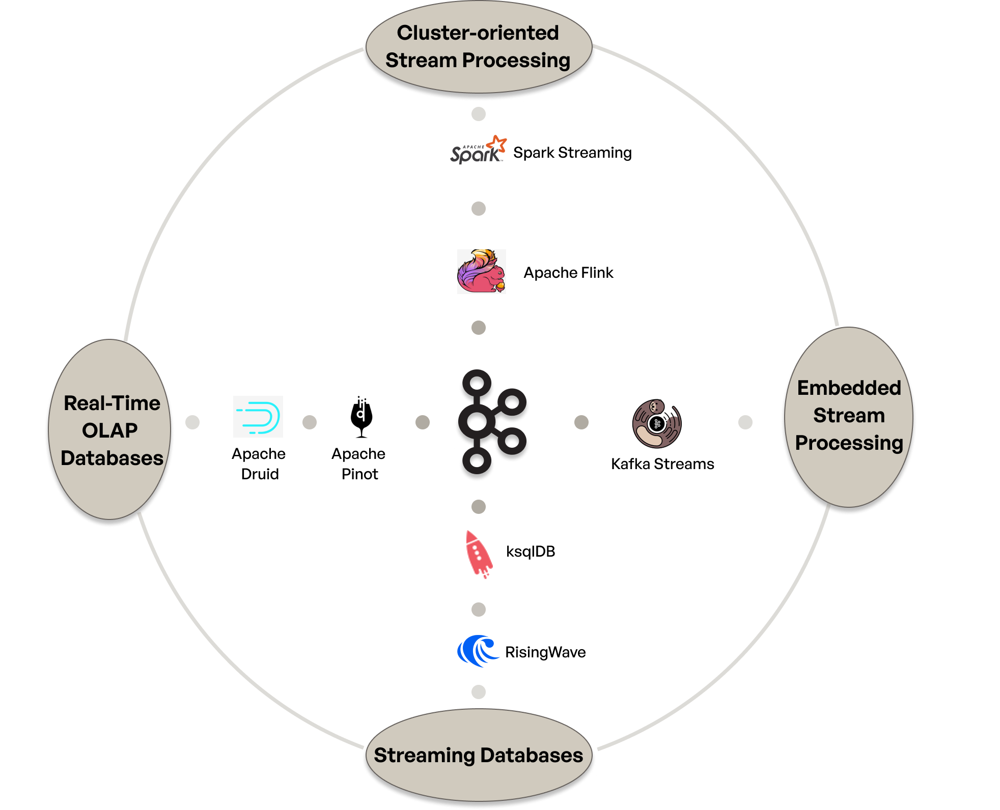
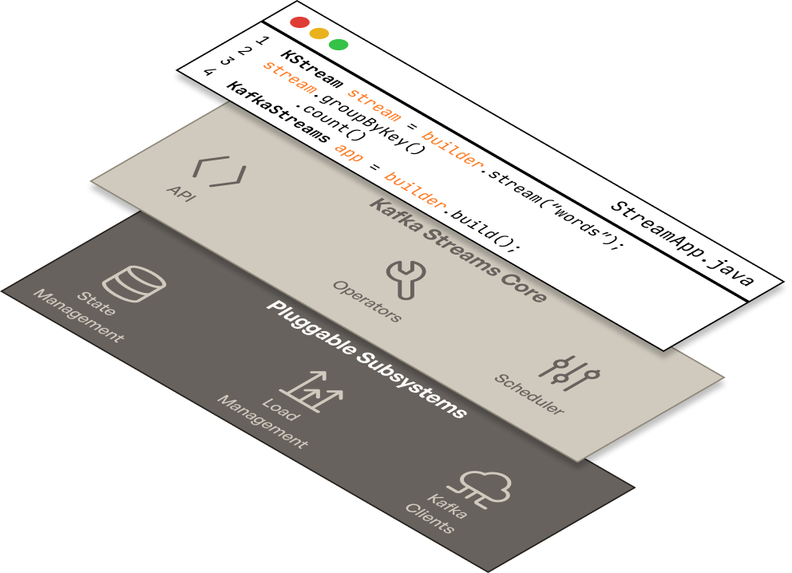

# The Why, When, and How of Kafka Applications

*Apurva Mehta · February 4, 2025 · 8 min read*

Understand why and when to build applications on Kafka, your technology choices for building Kafka applications, when it makes sense to adopt Kafka Streams for your applications, and how to succeed with Kafka Streams.

---

> **Learning Objective:** By the end of this Kafka Streams 101 lesson you will understand what makes Apache Kafka a great base layer for applications, the technology landscape for building Kafka applications, and when to use Kafka Streams for your applications.

# Quick Summary

- Understand why Kafka is an amazing base layer for building applications and when you should build your applications on Kafka.
- Explore the strengths and weaknesses of the technologies catering to the Kafka application layer.
- Understand what makes Kafka Streams ideal for app developers building mission-critical apps, and how to use this 101 series to build the best possible Kafka Streams apps.

# Why Apache Kafka makes a perfect foundation for modern applications

Between 2013 and 2017, [Apache Kafka](https://kafka.apache.org) rapidly added features which made it a highly capable foundation for scalable stateful applications:

- [Kafka 0.8](https://cwiki.apache.org/confluence/display/KAFKA/Changes+in+Kafka+0.8) (2013) added intra-cluster replication, making the log durable and highly available.
- [Kafka 0.9](https://www.confluent.io/blog/apache-kafka-0-9-is-released/) (2015) added the consumer group protocol for high availability clients as well as Kafka Connect for easily integrating Kafka with other systems.
- [Kafka 0.10](https://kafka.apache.org/0101/documentation.html#upgrade_10_notable) (2016) added Kafka Streams, an embedded stateful stream processor.
- [Kafka 0.11](https://www.confluent.io/blog/transactions-apache-kafka/) (2017) added a transactional protocol which allows Kafka client applications to perform atomic writes and Kafka Streams applications to perform atomic read-modify-write operations. This dramatically expanded the universe of applications which could be built on Kafka.

These innovations sparked a boom in Kafka adoption, with companies like [Netflix](https://netflixtechblog.com/evolution-of-the-netflix-data-pipeline-da246ca36905), [Uber](https://arxiv.org/pdf/2104.00087), and [many others](https://github.com/responsivedev/awesome-kafka-streams/) building truly differentiated experiences around Kafka. Its a boom that continues to this day. 

All that Apache Kafka adoption spurred massive investment into the space. Initially, most of the investment was focused on Kafka itself. Confluent, the major cloud providers, and a variety of startups built cloud-native Kafka offerings along with security, governance, observability, and other capabilities which collectively accelerated Kafka’s adoption in modern enterprises and startups alike. 

Unsurprisingly, the investment extended into the compute layer above Apache Kafka as well. As a result, developers today are spoilt for choice with the availability of numerous stream processing systems, streaming databases, real time OLAP systems, and more. 

This abundance of choice can be extremely confusing for developers. So we start this series by helping you answer the following questions: 

- Should you build applications with Kafka?
- What are the technologies which help build applications with Kafka?
- Which Kafka application technologies are right for you?

# When to build applications on Kafka

First things first, when does it make sense for you to build applications on top of Kafka? The usual answer to this question is something like ‘You should use Kafka if you have use cases like real-time analytics, streaming ETL, event driven microservices, etc’. The question of whether you need real-time analytics, or streaming ETL, or event driven microservices in usually an exercise that’s left to the reader. We aren’t going to do that here.

In our experience, it is worth the investment to build on Kafka if your business needs either of the following:

## 1. If you need sophisticated and fast reactions to a growing volume of events

Many problems can only be solved at scale by leveraging event streams via event-driven, asynchronous, applications. For example:

- for online-advertising, when you need to control ad-placement in real-time based on dynamic budgets and ad prices eg. [Pinterest](https://medium.com/pinterest-engineering/using-kafka-streams-api-for-predictive-budgeting-9f58d206c996), [Uber](https://www.uber.com/blog/real-time-exactly-once-ad-event-processing/).
- in the security domain, when you need to detect anomalous patterns quickly to mitigate security threats, eg. [Sumologic](https://www.sumologic.com/blog/profiling-vip-accounts-part-2/).
- in finance, when you need to do real-time fraud detection at scale, eg. [Paypal](https://medium.com/paypal-tech/scaling-kafka-to-support-paypals-data-growth-a0b4da420fab).
- in fintech, when you need features like real-time spend limits and alerting. eg. [Metronome](https://www.responsive.dev/resources/metronome-kafka-streams-interview).
- across multiple domains, when you need to make dynamic predictions. eg. [Uber](https://www.uber.com/blog/building-scalable-streaming-pipelines/) uses Kafka to figure out surge prices, Walmart uses Kafka to enable real time [product recommendations](https://www.slideshare.net/slideshow/kafka-streams-at-scale-deepak-goyal-walmart-labs-kafka-summit-london-2019/147002868).
- etc.

The common thread across all these use cases is that these companies need to perform computationally sophisticated actions at scale with low latency. For instance, whether you need to restrict access to an API because the client is suspected of fraud or because the client has exhausted their budget, you need to make stateful calculations that keep track of previous calls. And in both cases, the quicker you make the decision to turn off access, the better. 

## 2. If you want to to speed up your organization by decoupling engineering teams

Apart from event volume, the other dimension of scale that merits building around Kafka is when you have have multiple teams of engineers who need to build applications over shared data. In these situations, having a shared log like Kafka as a medium of communication between these teams is very beneficial for several reasons: Kafka provides a natural backpressure mechanism that results in better reliability, interfaces between teams are effectively managed through message schemas, each application can materialize its own isolated state off the log, etc.

Martin Kleppmann’s talk on [Turning the database inside out](https://martin.kleppmann.com/2015/11/05/database-inside-out-at-oredev.html) explains the idea perfectly. In terms of examples, here are a few from companies who have successfully decoupled and accelerated their application development thanks to Kafka:

- [Michelin](https://blogit.michelin.io/choregraphy-or-orchestration-thats-the-question/) has built many 100’s of Kafka Streams applications which collectively drive their logistics platform.
- [Expedia](https://www.slideshare.net/slideshow/how-expedia-improved-developer-productivity-and-reduced-mttr-by-over-90/238712501#5) built an event driven architecture comprising dozens of decoupled services to drive their online conversations platform which interfaces directly with customers to help them plan and book travel.
- While there aren’t any public materials about it, several financial institutions build trade settlement systems on Kafka, which enable different settlement stages to be handled by decoupled applications communicating via the log.

# How to pick the technology base for your Kafka Applications

Once you’ve decided that you need to build applications on Kafka, the next question is how to begin. There is a dizzying array of technologies to choose from, all promising to be the perfect solution to your Kafka application problems. Needless to say, reality is a more nuanced. 

This section will try to shed light on the different types of technologies you can use for your Kafka applications, and the tradeoffs represented by each of them.

## The 10,000 ft view

At a very high level, there are five broad categories of technologies you can use to build your Kafka applications upon. Four of these technology categories are presented below, with the fifth being plain old Kafka clients.

*Note: the technologies mentioned above are not intended to be an exhaustive list of technologies which might fit into each category.*

## The 100ft view

As you may expect, there is no one size fits all when it comes to technologies in the Kafka application space. In fact, there are many companies which employ multiple of these technologies to solve different problems. The table below is intended to educate you on the tradeoffs of each technology and thus help you choose the right tool for the job at hand.

| Technology | Pros | Cons | Best-fit use cases |
| --- | --- | --- | --- |
| Kafka Clients. | • Java Clients are bundled with Apache Kafka. • Wide language support with librdkafka. • Embedded in your app for maximum flexibility. | • Steep learning curve: Low-level APIs leave most of the work to the application developers for things like transactions or HA. • Doesn’t model streaming concepts like time, late arriving data, etc. • No native support for stateful processing. | • Ideal for simpler applications, especially those that don’t require stateful streaming operations. |
| Embedded Stream Processing Frameworks, specifically Kafka Streams. | • Kafka Streams is bundled with, and naturally extends, Apache Kafka. • Library form factor embeds in your application for maximum flexibility and clean operations. • Production-grade stateful stream processing apis like joins and aggregations. • Time is modeled in the API. • Optimized for high throughput Kafka applications. | • JVM only. • Kafka-only: your data needs to be flowing in Kafka to be correctly processed by Kafka Streams. • Embedded form factor means each team needs to develop expertise in deploying/operating the apps. | • Perfect for application developers building mission critical applications and pipelines since it’s easy to get started, has a full featured api, has a clean operational model, and natively integrates into your application ecosystem. |
| Cluster-oriented Stream Processing Frameworks, specifically Apache Flink. | • Dedicated frameworks with native solutions for state, load distribution etc. • Typically supports multiple languages like Python, Java, SQL. • Support the full suite of stateful stream processing APIs. • Typically also include connectors to interface with systems outside of Kafka. | • Cluster/job oriented execution model results in relatively less flexibility for the app developer. eg. special measures need to be taken to integrate with your CI/CD, observability stack, etc. • Operational ownership typically split between application teams and a platform team running a cluster. • Since they solve many problems already solved by Kafka, these systems are typically a large investment on top of Kafka. | • If you have a platform team capable of administering and scaling these clusters, these systems work well for data engineers and data scientists building streaming ETL and streaming analytics pipelines. |
| Streaming Databases (eg. ksqlDB, RisingWave, Materialized). | • Familiar SQL interface to model concepts like streaming joins and aggregations. • Incremental computation models mean very efficient maintenance of materialized views. • Many solutions are wire-compatible with postgres, thus bridging the gap between OLTP and streaming systems. | • SQL only can be a non-starter for many application use cases, since imperative application logic is really hard to model in relational-SQL. • Many of these systems have different streaming SQL dialects which can present challenges to people used to traditional SQL. | • These systems can be effective when you need to scale up OLTP systems for analytics queries or even as high traffic read replicas of your OLTP databases. Streaming databases can be perfect for simpler ETL jobs that are well expressed in SQL. |
| Real-time OLAP (eg. Apache Pinot, Clickhouse, Apache Druid). | • Can ingest, index, and execute sophisticated ad-hoc queries against high throughput event data with low latency. • Typically simplified-SQL interfaces. | • Typically don’t support transactional semantics, making it harder to model applications. • More simplified SQL makes it harder to write apps against. | • These are more competitive with data warehousing than traditional application oriented stream processing. These systems can be a good choice for implementing [ELT](https://en.wikipedia.org/wiki/Extract,_load,_transform) patterns. |

# Why pick Kafka Streams: a deeper dive

It’s no secret that we at Responsive are super excited about embedded stream processing in general and about Kafka Streams as a technology in particular. And this being the first article in a Kafka Streams 101 series, we would be remiss to not expand a little bit on the strengths and limitations of Kafka Streams.

We think Kafka Streams is the perfect technology for application developers due to it’s combination of unparalleled flexibility and power:

- It provides best-in-class stateful stream processing capabilities *while* being a practical option for powering both the shiny new application running on your laptop *and* the application running on 1000’s of nodes processing 100k+ events/s on TB’s of state.
- Since it’s embedded by design, it natively plugs into your deployment systems, observability stack, and every other piece of tooling you may have at your company.

It’s important to note that this unparalleled flexibility is no accident. In fact, the fundamental design principle behind Kafka Streams is *composability,* which results in two critical outcomes:

1. Kafka Streams was built to *extend* Kafka. This means it inherits production-grade load distribution and liveness protocols, transactional protocols, and can leverage a scalable, ordered, durable log. This powerful foundation is the reason Kafka Streams packs such a massive punch in a compact embedded form factor!
2. Kafka Streams was built to be *extensible.* It’s state management system, task assignment modules, and even the Kafka client implementations are accessed via well defined public interfaces, which means they can be upgraded in-place without needing your application to change.

## Kafka Streams’ composable architecture is its superpower

Thus Kafka Streams at its core can be thought of as a lightweight streaming runtime which schedules and executes user code via rich stateful stream processing APIs. Everything else is delegated to pluggable subsystems or Kafka protocols:

*Kafka Streams has a compact core which provides its API, streaming operators, and does local thread scheduling. Everything else is provided by Kafka through pluggable components. This means Kafka Streams can be modified and upgraded in-place without requiring changes to your application code or architecture.*

> Kafka Streams’ composability enables it to remain embedded in your application while being extended and upgraded without needing you to rewrite or rearchitect your applications.
> So if you are an application developer using a JVM language and are committed to building applications on Kafka, it’s hard to argue against choosing Kafka Streams as the foundation for your Kafka Applications thanks to its power, flexibility, and extensibility.

## A Kafka Streams Example

The example below gives you a taste of how compact, powerful, and natural Kafka Streams’ API. It also exemplifies the ease with with you can integrate Kafka Streams into your app. It’s really just a library which brings stateful stream processing to your application!

[View code sample on GitHub Gist](https://gist.github.com/apurvam/50e7d774be1a26b887b1d9d4ef46d730)

# What’s next: your guide to summiting the world of Kafka Streams

If you’ve reached this far you are probably very interested in Kafka Streams. That’s great! Here’s how to use all the resources Responsive has built to help you achieve reliable, scalable, correct Kafka Streams applications.

## Basecamp

If you are starting out, or simply want to brush up your knowledge of how to architect and build great Kafka Streams applications, the [**Kafka Streams 101 Series**](https://www.responsive.dev/resources/kafka-streams-101) is perfect for you.

The Kafka Streams 101 series is comprised of focused tutorials on specific subjects. You can skim through all of them to understand the breadth of Kafka Streams, or you can pick and choose to get deeper into specific subjects.

We are constantly adding new articles to this series, so make sure to subscribe to our newsletter to keep up to date on the latest!

## Midpoint

As you get to production, you need to set up observability, size and tune your applications, understand rebalances, understand transactions, manage state, etc. 

Our [**Resources**](https://www.responsive.dev/resources) page contains our most in-depth content to help you with your production applications. It includes in-depth blog posts, operational cheatsheets, and webinars covering production architectures and more.

## The summit

While you can get pretty far with Kafka Streams out of the box—especially if you arm yourself with the information from our blog posts—it’s important to understand Kafka Streams’ structural limitations.  

The most important structural limitation of Kafka Streams is that, since it has *only* Kafka as a dependency, it pushes hard problems like load balancing and state management to the application, which can present operability and reliability problems. Here are some resources that can help you identify and address this structural limitation:

- This [talk](https://current.confluent.io/2024-sessions/unbundle-your-cake-and-eat-it-too-redefining-the-limits-of-kafka-streams) covers the symptoms you will face when you hit the limits of this bundled approach and also lays out the techniques you can emulate to unbundle and extend Kafka Streams to achieve outcomes like instant autoscaling on an application with 10’s of TB’s of state doing 50k events/s with 99.99% availability.
- This [blog post](https://www.responsive.dev/blog/stop-embedding-rocksdb-in-kafka-streams) presents detailed symptoms of the problems of embedding RocksDB in your Kafka Streams nodes.
- The [Responsive SDK](https://www.responsive.dev/sdk) takes advantage of Kafka Streams’ modular design to unbundle state and thus address one structural limitation. If the talk and blog post linked above describe the problems you are facing with Kafka Streams, the SDK may be worth checking out.

# Have questions?

If you have more questions, we are here to help. Responsive collectively has [decades of experience](https://www.responsive.dev/about) in the world of stream processing and Kafka applications. You can find us on our [discord](https://discord.gg/jEk8JvjJrg) or drop a note to us [here](https://www.responsive.dev/contact-us).
